---
aliases:
  - "Airfryer"
  - "Supplements"
title: "Ernährungsleitfaden: Reflux-Schutz, AuDHD-Fokus & Darmgesundheit"
tags:
  - gesundheit
  - ernährung
  - reflux
  - lpr
  - audhd
  - proktologie
  - makros
  - postprandiale-somnolenz
date: 2026-08-19
type: topic-synthesis
---

# Ernährungsleitfaden: Reflux-Schutz, AuDHD-Fokus & Darmgesundheit

> [!NOTE] STA-Verortung
> - **Source (S):** Dr. Mike Israetel, Dr. Melissa Davis, Dr. Jen Case (*The Renaissance Diet 2.0* – RP Diet Priority Pyramid, Nutritional Periodization, Settling Point Reset, Nutrient Timing), LPR-Gastroenterologie (Pepsin-Inaktivierung), Proktologisches Nachsorge-Protokoll nach Analprolaps-Operation (BWK Ulm), Neuro-Ernährung für ADHS/Asperger, Glykämischer Index & Postprandiale Somnolenz, Bristol-Stuhlformen-Skala.
> - **Topic (T):** [[G | Gesundheit]], [[Supplements]], [[Trainingsplan]], [[Morgenroutine]], [[Schlafapnoe Diagnostik und Facharzt]].
> - **Argument / Synthese (A):** Die evidenzbasierte Hierarchie der Renaissance Diet 2.0 (Kalorien 50 % $\to$ Makros 30 % $\to$ Timing 10 % $\to$ Qualität 5 % $\to$ Supplements 5 %, getragen von Adhärenz), gezielte Vermeidung biochemischer Schließmuskel-Entspanner (LPR-Schutz), die **Elimination postprandialer Insulincrashes am Morgen (Beseitigung von Food Coma / Schreibtisch-Einschlafen)** und ein ballaststoffinduzierter Bristol-Typ-4-Stuhlgang schützen operiertes Gewebe und maximieren den kognitiven Tagesfokus.

---

## 1. Schwachstellen-Diagnostik & Ernährungstherapie

| SCHWACHSTELLE | BIOLOGISCHE URSACHE | GEGENMASSNAHME & SYSTEMREGEL |
| :--- | :--- | :--- |
| 1. Stiller Reflux (LPR) | Nächtlich aufsteigende Magensäure und Pepsin reizen Atemwege -> Chronische Sputum-Bildung | - Nach dem Essen: Mind. 3 Std. aufrecht bleiben - Vor dem Schlafen: 3 Std. Fastenfenster - Bett-Kopfende um 10–15 cm erhöhen - Konsequent auf der LINKEN Seite schlafen |
| 2. Postprandiale Somnolenz | Hohe glykämische Last am Morgen | - 4 Scheiben Weiß-/Mischbrot durch langsame |
| & Schreibtisch-Einschla | (4 Scheiben Brot) -> Insulinpeak | komplexe Carbs (Haferflocken, Vollkorn-Dinkel) |
| (Food Coma + OSAS) | treibt Tryptophan & Melatonin hoch | oder reines Rührei + Avocado/Nüsse ersetzen |
| 3. AuDHD Fokus-Verlust | Reaktive Hypoglykämie nach schnellen Kohlenhydraten; Dopamindefizit | - Kohlenhydrate IMMER mit Protein koppeln - Hoher Ballaststoffanteil für stetige Glukose - L-Tyrosin + Kofaktoren (Eisen, Zink, B6) |
| 4. Gewebeschwäche nach | Postoperative Vulnerabilität nach | - 25 bis 35 g Ballaststoffe täglich |
| Analprolaps-OP (BWK Ulm) | Analprolaps-OP (11/2024); Rezidivgefahr durch hartes Pressen | - Mindestens 2,5 Liter stilles Wasser (Pflicht!) - Strikte Zielvorgabe: Bristol-Stuhl-Typ 4 |

---

## 2. Die Frühstücks-Architektur: Anti-Einschlaf-Kalibrierung

> [!WARNING] Das 4-Brot-Paradoxon am Schreibtisch
> Wenn du morgens **4 Eier und 4 Scheiben herkömmliches Brot** isst, erzeugt das Brot einen rapiden Blutzucker- und Insulinanstieg. 
> - **Biochemischer Effekt:** Insulin räumt konkurrierende verzweigtkettige Aminosäuren (BCAAs) aus dem Blutkreislauf in die Muskulatur.
> - **Die Tryptophan-Schwemme:** Freies Tryptophan aus den Eiern strömt ungehindert über die Blut-Hirn-Schranke und wird im Gehirn zu **Serotonin und Melatonin** (Schlafhormon) verstoffwechselt.
> - **Kombination mit Schlafapnoe:** Trifft diese Melatoninausschüttung auf den chronischen OSAS-Schlafdruck, fallen am Schreibtisch unweigerlich die Augen zu.

### Das optimierte Morgen-Protokoll

> [!NOTE] OPTION A: Low-Carb High-Protein Fokus (Kein Food-Coma)
> • 4 Eier (Rührei / Spiegelei) in Olivenöl / Butter
> • 1/2 Avocado ODER eine Handvoll Kürbiskerne / Walnüsse
> • Frischer Spinat / Tomatenfreies Gemüse
> • 500 ml Wasser mit 1 Prise Salz
> -> Hält Insulin flach, liefert reines L-Tyrosin für Dopamin & maximalen Vormittags-Fokus!
---

## 3. Die Truppenküchen-Architektur (Frühstück & Mittagessen in der Kaserne)

> [!NOTE] DAS HYBRIDE KASERNEN-MODELL: TRUPPENKÜCHE (MO–FR) + STUBEN-KÜCHE (ABEND & SA/SO)
> Dein Verpflegungsrhythmus ist militärisch und physiologisch perfekt getaktet:
> 1. **Truppenküche (Mo–Fr Frühstück 07:15–08:00 & Mittagessen 11:00–11:45):** Maximale Kostenersparnis und vollwertige Nährstoffabdeckung während des Dienstes.
> 2. **Stuben-Küche & Airfryer (Mo–So Abendessen & Sa/So ganztägig):** Schnelle, refluxsichere Abendmahlzeiten auf Stube (da der Speisesaal abends im Sommer bis 06.09.2026 geschlossen ist) sowie Wochenend-Verpflegung aus dem PENNY-Einkauf.

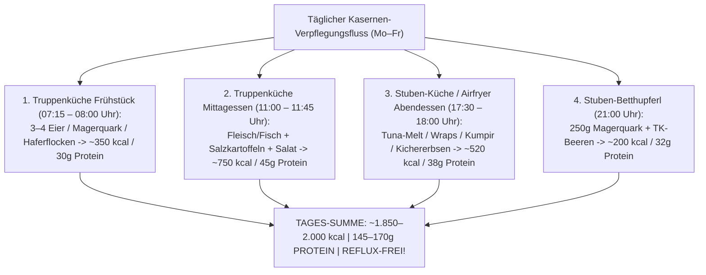

---

### A. Truppenküchen-Frühstück (07:15 – 08:00 Uhr) – Anti-Food-Coma Blueprint:
* **Die richtige Wahl am Kantinen-Buffet:**
  * **3 bis 4 Eier** (gekochte Eier oder Rührei) $+$ **Haferflocken / Magerquark** mit frischem Obst.
  * **Eiserne Regel (Anti-Food-Coma & LPR-Schutz):** **Kein weißes Mischbrot/Toast** (verhindert Insulincrashes und Tryptophan-Einschlafen) und **keinen Kaffee** (schützt den Magen-Schließmuskel vor Reflux).
* **Vorteil:** Hält dich bis zum Mittagessen vollkommen energiegeladen und fokussiert für den Vormittagsdienst.

---

### B. Truppenküchen-Mittagessen (11:00 – 11:45 Uhr Slot: St/Fm Kp):
* **Teller-Zusammenstellung:** Mageres Fleisch/Pute/Fisch ($35\text{--}45\text{g}$ Protein) $+$ Salzkartoffeln (Holt-Sättigungssieger) $+$ buntes Salatbuffet (Karotten, Gurken, Blattsalate; Essig/Öl statt fetter Mayonnaise).
* **Snack-Mitnahme:** 1 Apfel oder Banane für den Nachmittag einpacken.

---

### C. Stuben-Küche & PENNY-Einsatz (Abendessen & Wochenende):
* Da du **Frühstück und Mittagessen Mo–Fr in der Truppenküche** isst, dient dein wöchentlicher **PENNY-Einkauf (~18–24 €)** ausschließlich für:
  1. **6 warme Airfryer-Abendessen (Mo–Sa)**
  2. **Tägliche Magerquark-Betthupferl (21:00 Uhr)**
  3. **Vollständige Selbstverpflegung am Wochenende (Sa & So)**

### A. Streng verbotene Trigger (Schließmuskel-Entspanner & Säurereize)
* **Getränke:** Kaffee (auch entkoffeiniert!), schwarzer Tee, kohlensäurehaltiges Mineralwasser, Cola, Limonaden, Energy Drinks.
* **Kräuter & Gewürze:** Pfefferminze, Minz-Tees, scharfe Chilis, rohe Zwiebeln und Knoblauch (Allium-Gewächse).
* **Genussmittel:** Schokolade, Kakaopulver, Alkohol.
* **Säurereiche Früchte & Gemüse:** Zitrusfrüchte (Zitronen, Orangen, Grapefruit), Tomaten und Tomatensaucen (Nachtschattengewächse), Essig.

---

### B. Dringend benötigte Wirkstoff- & Lebensmittel-Lieferanten

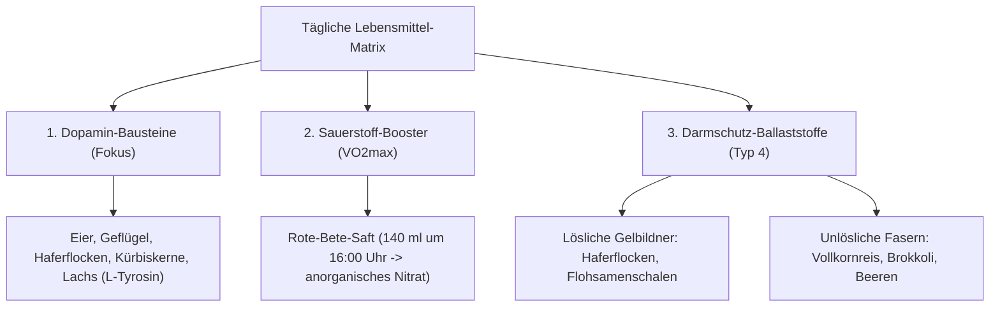

---

## 4. Renaissance Diet 2.0 Hierarchie, Makros & Nutritional Periodization (Dr. Mike Israetel)

> [!NOTE] DIE RENAISSANCE DIET PRIORITÄTEN-PYRAMIDE
> 1. **Kalorienbilanz ($\approx 50\,\%$):** Das Fundament aller Körperkompositions- und Leistungsziele. Gesteuert durch die *Caloric Constraint Hypothesis (CCH)*.
> 2. **Makronährstoff-Verteilung ($\approx 30\,\%$):** Protein zur Sicherung von FSR/FBR ($1,8\text{--}2,2\text{ g/kg}$), Mindestfett für Hormone ($\ge 0,6\text{--}0,8\text{ g/kg}$), Kohlenhydrate skaliert nach Trainingsvolumen.
> 3. **Nutrient Timing ($\approx 10\,\%$):** 4–6 Mahlzeiten gleichmäßig über den Tag; 50–60 % der Carbs im Peri-Workout-Fenster.
> 4. **Lebensmittelzusammensetzung ($\approx 5\,\%$):** Proteinqualität nach PDCAAS, glykämische Steuerung, Mikronährstoffdichte.
> 5. **Supplements & Hydration ($\approx 5\,\%$):** $1,5\text{ ml}$ Wasser pro kcal, 7 evidenzbasierte Supplements.
> - **Fundament:** Das 6-Stufen Adhärenz-Modell (*Inspiration $\to$ Motivation $\to$ Intention $\to$ Discipline $\to$ Habit $\to$ Passion*).

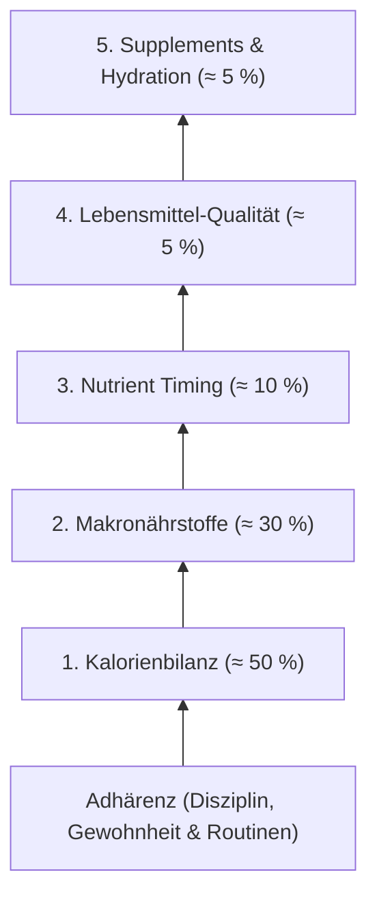

### A. Tägliche Makronährstoff-Aufteilung & CCH-Steuerung:
| Phase | Kalorien | Protein (Eiweiß) | Fett | Kohlenhydrate | Primärer physiologischer Nutzen |
| :--- | :---: | :---: | :---: | :---: | :--- |
| **Mo – Fr (Dienst & Sport)** | **ca. 2.900 kcal** | $2,0\text{--}2,2\text{ g/kg}$ ($160\text{--}170\text{ g}$) | $0,8\text{--}1,0\text{ g/kg}$ ($\sim 65\text{ g}$) | $4,5\text{--}5,0\text{ g/kg}$ ($\sim 350\text{ g}$) | Glykogensättigung, Höchstleistung bei Dienstsport & Laufen |
| **Sa – So (Regeneration)** | **ca. 3.150 kcal** | $1,8\text{--}2,0\text{ g/kg}$ ($150\text{--}160\text{ g}$) | $1,0\text{ g/kg}$ ($\sim 75\text{ g}$) | Erhöhter Anteil ($\sim 400\text{ g}$) | Auffüllen der Glykogenspeicher, ZNS- & Gewebeheilung |

---

### B. RP Nutritional Periodization & Settling-Point-Architektur:

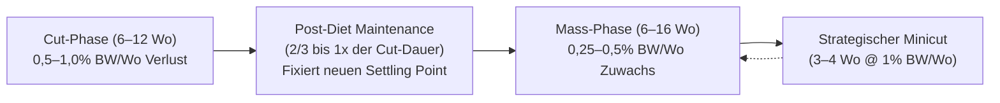

* **1. Cut-Phasen (Fettabbau):**
  * *Verlustrate:* **$0,5\,\%\ \text{bis } 1,0\,\%$ des Körpergewichts pro Woche** ($\sim 0,4\text{--}0,8\text{ kg/Woche}$).
  * *Dauer:* Ideal **6 bis 12 Wochen** (maximal 16 Wochen); maximal **$10\,\%$ des Gesamtkörpergewichts** pro Block, um Muskelabbau und Diät-Ermüdung (*Diet Fatigue*) zu verhindern.
* **2. Die zwingende Post-Diet Maintenance Phase (Diet Recovery Phase):**
  * Nach jeder Cut-Phase muss eine Erhaltungsphase von mindestens **$\frac{2}{3}\text{ bis } 1\times$ der Dauer der Diät** eingelegt werden (z. B. nach 12 Wochen Diät mindestens 8–12 Wochen Erhaltung).
  * *Physiologischer Zweck:* Normalisierung von NEAT, Schilddrüsenhormonen ($T_3$), Leptin und Ghrelin; dauerhafte Verankerung des neuen Körpergewichts als **biologischer Settling Point** zur 100%igen Verhinderung des Jo-Jo-Effekts.
* **3. Mass-Phasen (Muskelaufbau):**
  * *Zuwachsrate:* **$0,25\,\%\ \text{bis } 0,5\,\%$ des Körpergewichts pro Woche** ($\sim 0,2\text{--}0,4\text{ kg/Woche}$).
  * *Dauer:* 6 bis 16 Wochen; maximal $5\text{--}10\,\%$ Gesamtzunahme, um ein optimales *Partitioning-Ratio (P-Ratio)* zu sichern und Fettzell-Hyperplasie zu verhindern.
* **4. Strategische Minicuts:**
  * 3–4-wöchige aggressive Defizite ($1,0\,\%\ \text{BW/Woche}$) zwischen Masseblöcken zur schnellen Wiederherstellung der Insulinsensitivität ohne Verlust an Muskelmasse.

---

### C. RP Peri-Workout Nutrient Timing (Das 6-Stunden-Fenster):

* **Pre-Workout (1–3 Stunden vorab):** $\sim 20\text{--}25\,\%$ der Tages-Carbs (komplex, z. B. Haferflocken, Reis) $+ 30\text{ g}$ mageres Protein; Fette und Ballaststoffe minimieren, um die Magenpassage nicht zu verzögern.
* **Intra-Workout (bei Training $> 60\text{ Minuten}$):** Schnell verfügbare Kohlenhydrate (z. B. Dextrose/Maltodextrin im Wasser) $+ 5\text{--}10\,\%$ des Tagesproteins in Form von Whey/EAAs zur Hemmung des Muskelproteinabbaus (*Fractional Breakdown Rate - FBR*).
* **Post-Workout (0–2 Stunden danach):** $\sim 30\text{--}35\,\%$ der Tages-Carbs (höherer glykämischer Index) $+ 35\text{ g}$ schnell absorbierbares Protein (Whey / Magerquark) bei minimalem Fettgehalt ($< 5\text{ g}$).
* **Bedtime-Meal (Vor dem Schlafen):** Langsam verdauliches Protein (Casein / Magerquark) $+ 15\text{--}25\text{ g}$ gesunde Fette zur Verlängerung der nächtlichen Aminosäure-Verfügbarkeit (*Fractional Synthetic Rate - FSR*).
* **RP Hydrations-Standard:** **$1,5\text{ ml}$ Wasser pro aufgenommene Kilokalorie** ($2.900\text{ kcal} \to \sim 4,35\text{ Liter}$ Gesamtflüssigkeit an Sporttagen inklusive Nahrungswasser).

---

## 5. Evidenzbasierte Makronährstoff-Verhältnis-Studien & Diät-Vergleichs-Forensik

> [!NOTE] DUAL-LAYER DOKTRIN DER MAKRONÄHRSTOFF-PHYSIOLOGIE
> - **Wissenschaftliches Fundament:** Meta-Analysen und klinische Randomised Controlled Trials (RCTs) von Dr. Brian Wansink (Cornell), Dr. Donald K. Layman, Dr. Jose Antonio, Dr. Nirupa D. Luscombe-Marsh, Dr. Carol S. Johnston, Dr. Christopher D. Gardner (A TO Z Study), Dr. Iris Shai (DIRECT-Trial, NEJM), Dr. Margriet S. Westerterp-Plantenga, Dr. James W. Krieger, Dr. Dena M. Bravata sowie die historische Begründung von Hough & Sedgwick (1906).
> - **Kernaussage:** 
>   1. Proteinzufuhr ist der dominierende Regulator von fettfreier Magermasse (*Lean Body Mass*), nahrungsinduzierter Thermogenese (*TEF*) und Sättigungshormon-Kaskaden (*PYY, GLP-1, Ghrelin-Suppression*).
>   2. Hyperkalorischer Proteinüberschuss bis $4,4\text{ g/kg/d}$ führt bei Trainierten zu **keiner Zunahme von Fettgewebe** (Antonio 2014).
>   3. "Low-Fat"-Kennzeichnungen erzeugen psychologische Überkompensation ($+28\,\%$ Kalorienaufnahme nach Wansink 2006) und provozieren reaktive Hypoglykämie durch Fettaustausch gegen hochglykämische Füllstoffe.
>   4. Moderates Low-Carb mit hohem Protein ist ketogenen Extremdiäten kognitiv und entzündungsbiologisch überlegen (Johnston 2006).

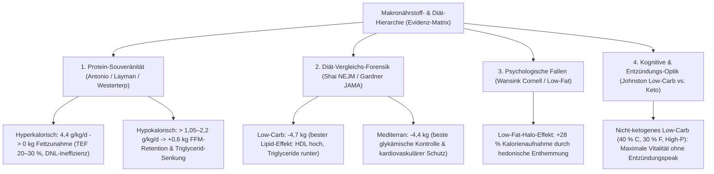

---

### A. Die Low-Fat-Täuschung & Psychologische Überkompensation (Wansink & Chandon 2006)

* **Primärstudie:** Wansink, Brian and Pierre Chandon (2006). *Can "Low-Fat" Nutrition Labels Lead to Obesity?* Journal of Marketing Research, 43(4): 605–617.
* **Wissenschaftlicher Befund:** 
  Probanden konsumierten durchschnittlich **$28\,\%$ mehr Gesamtkalorien**, wenn Snacks mit dem Etikett „Low-Fat“ (fettarm) versehen waren, im Vergleich zu identischen regulären Snacks.
* **Biochemische & Psychologische Wirkmechanismen:**
  1. **Health-Halo-Effekt & Schuldentlastung:** Das Etikett „fettarm“ reduziert die wahrgenommene kognitive Schuld (*Guilt of Consumption*) und führt zu einer massiven Unterschätzung der Portionsgröße und Energiedichte.
  2. **Industrielle Fettaustausch-Falle:** Um die durch Fettentzug verlorene Textur und Schmackhaftigkeit auszugleichen, ersetzt die Lebensmittelindustrie Lipide durch hochglykämische modifizierte Stärken, Maltodextrin und Zucker. Dies provoziert steile Blutzuckerspitzen, gefolgt von reaktiver Hypoglykämie und gesteigertem Hunger.

---

### B. Die Hyperkalorische Protein-Schutz-Doktrin bei Trainierten (Antonio et al. 2014)

* **Primärstudie:** Antonio J, Peacock CA, Ellerbroek A, Fromhoff B, Silver T (2014). *The effects of consuming a high protein diet (4.4 g/kg/d) on body composition in resistance-trained individuals.* Journal of the International Society of Sports Nutrition, 11: 19.
* **Studiendesign & Befund:**
  Krafttrainierte Probanden konsumierten über 8 Wochen eine extrem proteinreiche Hyperkalorien-Diät mit **$4,4\text{ g Protein pro kg Körpergewicht täglich}$** ($5,5\times$ der offizielle RDA-Wert von $0,8\text{ g/kg}$, Kalorienüberschuss von $\approx +800\text{ kcal/Tag}$).
  * **Ergebnis:** Trotz des signifikanten Kalorienüberschusses trat **keine Zunahme an Fettmasse** (*Fat Mass*) auf. Dies steht im Kontrast zu historischen Überfütterungsstudien an Untrainierten mit niedrigerer Proteinzufuhr.
* **Biochemische Mechanismen des Nicht-Ansatzes von Protein als Fettgewebe:**
  1. **Nahrungsinduzierte Thermogenese (TEF):** Protein erfordert $20\text{--}30\,\%$ seines physiologischen Brennwerts allein für enzymatische Spaltung, Peptidtransport und Aminosäuren-Verstoffwechselung (im Vergleich zu nur $5\text{--}10\,\%$ bei Kohlenhydraten und $0\text{--}3\,\%$ bei Fetten).
  2. **Hohe energetische Barriere der De-Novo-Lipogenese (DNL):** Der biochemische Pfad von Aminosäuren über Transaminierung, Acetyl-CoA-Synthese zur Fettsäuresynthese ist thermodynamisch hochgradig ineffizient und wird vom menschlichen Organismus fast ausschließlich zur ATP-Produktion, Gluconeogenese oder Proteinsynthese genutzt.
  3. **Substratoxidations-Verschiebung:** Hohe Aminosäurenspiegel im Plasma forcieren die basale Fett- und Substratoxidation im Muskelgewebe.

---

### C. Muskel-Sparing, Blutzuckerstabilität & Lipidprofil bei High-Protein (Layman et al. 2003)

* **Primärstudie:** Layman DK, Boileau RA, Erickson DJ, Painter JE, Shiue H, Sather C, Christou DD (2003). *A reduced ratio of dietary carbohydrate to protein improves body composition and blood lipid profiles during weight loss in adult women.* Journal of Nutrition, 133(2): 411–417.
* **Klinische Kernergebnisse einer reduzierten CHO:Protein-Ratio:**
  * **Signifikant höherer Gewichts- und Gesamtfettverlust:** Selektive Reduktion von viszeralem und subkutanem Fettgewebe.
  * **Muskelschutz (*Sparing of Muscle Protein*):** Erhalt der metabolisch aktiven Muskelmasse durch Aufrechterhaltung der intrazellulären Leucin-Schwellenwerte zur mTORC1-Aktivierung.
  * **Blutzucker- und Insulinstabilität:** Flache postprandiale Glukosekurven, vollständige Beseitigung von reaktiver Hypoglykämie und postprandialer Somnolenz (Food Coma).
  * **Senkung der Serum-Triglyceride:** Drastische Reduktion zirkulierender Triglyceride durch verringerte hepatische VLDL-Synthese.

---

### D. Meta-Analysen zu Low-Carb- & Proteindosierungen (Bravata 2003, Krieger et al. 2006)

* **Bravata et al. (2003, JAMA):** *Efficacy and safety of low-carbohydrate diets: a systematic review.* JAMA, 289(14): 1837–1850.
  * Frühe Meta-Analyse; wies nach, dass Gewichtsverlust primär über die Energiereduktion und Diätdauer gesteuert wird, während kurzfristige Low-Carb-Phasen signifikante Vorteile bei glykämischer Kontrolle aufweisen.
* **Krieger et al. (2006, AJCN):** *Effects of variation in protein and carbohydrate intake on body mass and composition during energy restriction: a meta-regression.* American Journal of Clinical Nutrition, 83(2): 260–274.
  * **Meta-Regressions-Durchbruch:** Eine Proteinzufuhr von **$> 1,05\text{ g/kg Körpergewicht}$** war statistisch signifikant mit einer **zusätzlichen Erhaltung von $+0,6\text{ kg}$ fettfreier Masse (FFM)** während hypokalorischer Diäten assoziiert.
  * **Schlussfolgerung:** Das Proteinniveau bestimmt den Erhalt fettfreier Gewebe, unabhängig von der relativen Verteilung von Fetten und Kohlenhydraten.

---

### E. Low-Carb mit High-Protein vs. High-Fat (Luscombe-Marsh et al. 2005)

* **Primärstudie:** Luscombe-Marsh ND, Noakes M, Wittert GA, Keogh JB, Foster P, Clifton PM (2005). *Carbohydrate-restricted diets high in either monounsaturated fat or protein are equally effective at promoting fat loss and improving blood lipids.* American Journal of Clinical Nutrition, 81(4): 762–772.
* **Studiendesign:** 
  Vergleich zweier hypokalorischer Diäten ($1.433\text{ kcal}$, $36\,\%$ Kohlenhydrate):
  * **Gruppe A (High Protein):** $34\,\%$ Protein, $29\,\%$ Fett.
  * **Gruppe B (High MUFA / einfach ungesättigte Fette):** $18\,\%$ Protein, $45\,\%$ Fett.
* **Ergebnisse:**
  * Beide Diäten führten zu vergleichbarem Fettverlust, Insulinsensitivitäts-Gewinn und reduzierten kardiovaskulären Risikomarkern.
  * **Der entscheidende Vorteil von High Protein:** Die High-Protein-Gruppe verhinderte den diätbedingten Abfall des **Thermic Effect of Feeding (TEF)** signifikant besser.
  * **Klinische Sicherheit:** Weder Nierenfunktionsparameter (GFR, Kreatinin-Clearance) noch Knochenumsatzmarker zeigten negative Veränderungen.

---

### F. Low-Carb versus Very Low-Carb / Ketogen (Johnston et al. 2006)

* **Primärstudie:** Johnston CS, Tjonn SL, Swan PD, White A, Hutchins H, Sears B (2006). *Ketogenic low-carbohydrate diets have no metabolic advantage over nonketogenic low-carbohydrate diets.* American Journal of Clinical Nutrition, 83(5): 1055–1061.
* **Studiendesign:**
  Vergleich einer ketogenen Diät ($\sim 5\,\%$ Carbs, $60\,\%$ Fett) mit einer nicht-ketogenen Low-Carb-Diät ($40\,\%$ Carbs, $30\,\%$ Fett, hoher Proteinanteil).
* **Kernergebnisse & Warnhinweise:**
  1. Beide Diäten waren bezüglich Gewichtsverlust und Reduktion der Insulinresistenz gleichwertig.
  2. **Metabolische & psychologische Nachteile der Ketose:** 
     * **Erhöhtes Entzündungsprofil:** Die ketogene Gruppe zeigte ein ungünstiges Verhältnis von Arachidonsäure zu Eicosapentaensäure (AA:EPA) in den Plasma-Phospholipiden.
     * **Erhöhte subjektive Erschöpfung & Vitalitätsverlust:** Signifikant verminderte Wahrnehmung von Tatkraft und Energie (*Vigor*).
  3. **Konsequenz für den Bundeswehr- & Leistungsalltag:** Ein moderates, nicht-ketogenes Low-Carb-Konzept ($40\,\%$ Carbs gekoppelt an $160\text{ g}$ Protein) liefert volle Glykogenspeicher für Dienstsport und Ausdauer, ohne kognitiven Leistungsabfall oder systemische Entzündungssteigerung.

---

### G. Die großen Langzeit-Vergleichsstudien: A TO Z Study & NEJM DIRECT-Trial

#### 1. The A TO Z Weight Loss Study (Gardner et al. 2007, JAMA)
* **Primärstudie:** Gardner CD, Kiazand A, Alhassan S, Kim S, Stafford RS, Balise RR, Kraemer HC, King AC (2007). *Comparison of the Atkins, Zone, Ornish, and LEARN diets for change in weight and related risk factors among overweight premenopausal women: the A TO Z Weight Loss Study: a randomized trial.* JAMA, 297(9): 969–977.
* **12-Monats-RCT-Ergebnisse ($N=311$):**
  * **Atkins (Low-Carb, High-Protein):** **$-4,7\text{ kg}$** Gewichtsverlust (signifikant überlegen).
  * **LEARN (Low-Fat, Lifestyle):** $-2,6\text{ kg}$.
  * **Ornish (Very Low-Fat, High-Carb):** $-2,2\text{ kg}$.
  * **Zone (40/30/30):** $-1,6\text{ kg}$.
* **Metabolisches Fazit:** Atkins erzielte nicht nur die höchste Gewichtsreduktion, sondern auch die günstigsten Effekte auf Blutdruck, Triglyceride und HDL-Cholesterin.

#### 2. Der 2-Jahres-RCT: DIRECT-Trial (Shai et al. 2008, NEJM)
* **Primärstudie:** Shai I, Schwarzfuchs D, Henkin Y, Shahar DR, Witkow S, Greenberg I et al. (2008). *Weight loss with a low-carbohydrate, Mediterranean, or low-fat diet.* New England Journal of Medicine, 359(3): 229–241.
* **Studiendesign:** 322 Probanden (BMI 31, Adhärenz $95,4\,\%$ nach 1 Jahr, $84,6\,\%$ nach 2 Jahren).
* **Vergleichs-Ergebnisse:**

| DIÄTFORM | PROTOKOLL-VORGABE | GEWICHTSVERLUST (2 JAHRE) | METABOLISCHES HIGHLIGHT |
| :--- | :--- | :---: | :--- |
| **Low-Carb (Atkins-Stil)** | $20\text{ g}$ Carbs/Tag für 2 Monate, danach $120\text{ g/Tag}$; ad libitum | **$-4,7\text{ kg}$** (Peak: $-5,5\text{ kg}$) | **Bester Lipid-Effekt:** Größter HDL-Anstieg ($+8,4\text{ mg/dL}$), stärkste Triglycerid-Senkung ($-20\,\%$). |
| **Mediterrane Diät** | $< 35\,\%$ Fett (Olivenöl, Nüsse), $1.800\text{ kcal}$ (Männer) / $1.500\text{ kcal}$ (Frauen) | **$-4,4\text{ kg}$** (Peak: $-4,6\text{ kg}$) | **Beste glykämische Kontrolle:** Signifikante Senkung von Nüchternglukose und HOMA-IR bei Diabetikern. |
| **Low-Fat (AHA-Stil)** | $30\,\%$ Fett, $10\,\%$ gesättigte Fettsäuren, kalorienrestringiert | **$-2,9\text{ kg}$** (Peak: $-3,3\text{ kg}$) | Geringste Gewichtsreduktion und schwächste Adhärenz. |

---

### H. Protein, Sättigungskaskaden & Anti-Jo-Jo-Mechanismen (Westerterp-Plantenga 2003)

* **Primärstudie:** Westerterp-Plantenga MS (2003). *The significance of protein in food intake and body weight regulation.* Current Opinion in Clinical Nutrition and Metabolic Care, 6(6): 635–638.
* **Kernelemente der Protein-vermittelten Körpergewichtsregulation:**
  1. **Sättigungshierarchie:** Protein erzeugt die stärkste physiologische Sättigung pro Kalorie im Vergleich zu Kohlenhydraten und Fetten.
     * Stimulation der anorexigenen Sättigungshormone **Peptid YY (PYY)** und **GLP-1** im Ileum/Kolon.
     * Dauerhafte Suppression des orexigenen Hungerhormons **Ghrelin**.
  2. **Tierisches vs. pflanzliches Protein:** Tierische Proteinquellen mit vollständigem Aminosäureprofil induzieren eine höhere nahrungsinduzierte Thermogenese als isolierte pflanzliche Proteine.
  3. **Spontane Kalorienreduktion:** Unter *Ad-libitum*-Bedingungen führt eine Erhöhung des Proteinanteils zu einem automatischen, unbewussten Rückgang der Gesamtkalorienaufnahme.
  4. **Prävention des Jo-Jo-Effekts:** Eine dauerhaft hohe Proteinzufuhr nach erfolgtem Gewichtsverlust minimiert die Wiederzunahme von Fettgewebe durch metabolische Ineffizienz, anhaltend hohen Energieverbrauch (TEF) und den Erhalt der kontraktilen Muskelmasse.

---

### I. Historische Verankerung der Muskel- und Protein-Doktrin (Hough & Sedgwick 1906)

* **Historische Quelle:** Hough, Theodore & Sedgwick, William T. (1906). *The Human Mechanism: Its Physiology and Hygiene and the Sanitation of Its Surroundings*, Ginn & Company, S. 236.
* **Klassisches Grundsatzaxiom:**
  > *"Hence the most reasonable treatment of obesity is to limit the use of non-protein foods and to indulge in hard muscular work."*
* **Bedeutung:** Bereits vor über 120 Jahren erkannten die Pioniere der angewandten Physiologie das unumstößliche Gesetz: Fettreduktion und Körperrekomposition erfordern die selektive Begrenzung nicht-essentieller Nicht-Protein-Kalorien bei gleichzeitigem schwerem muskulären Widerstandstraining.

---

### J. Direkte Kasernen- & Einsatz-Transformation (Ebene 2 Praxis-Blueprint)

| WISSENSCHAFTLICHER BEFUND | FEHLERHAFTE ALLTAGSPRAXIS | KORREKTE KASERNEN- & STUBEN-EXEKUTION |
| :--- | :--- | :--- |
| **Low-Fat-Täuschung (Wansink 2006)** | Kauf von "fettarmen" Fruchtjoghurts oder Fertigsaucen mit Stärke/Zucker. | Echten Magerquark ($12\text{ g}$ Protein, $0,2\text{ g}$ Fett) oder Eier wählen; Süßung über Flav-Drops / Erythrit. |
| **Hyperkalorischer Schutz (Antonio 2014)** | Angst vor Protein im Aufbau; unnötige Begrenzung auf $1,2\text{ g/kg}$. | Tägliches Proteinziel felsenfest bei **$160\text{ g}$** ($2,1\text{ g/kg}$) halten; Überschüsse fließen in TEF und MPS. |
| **CHO:Protein-Sparing (Layman 2003)** | Weißbrot-Frühstück mit hohem Carb-Peak in der Truppenküche. | Morgen-Protokoll: Rührei/Spiegelei + Magerquark; Carbs flach halten gegen Food Coma. |
| **Nicht-ketogene Leistungs-Optik (Johnston 2006)** | Extreme Null-Kohlenhydrat-Ketose, die ZNS-Ermüdung und Entzündung erzeugt. | $150\text{--}250\text{ g}$ komplexe Carbs (Kartoffeln, Haferflocken, Reis) peri-workout um Training & Dienstsport. |
| **Sättigungskaskade (Westerterp 2003)** | Dünne Shakes und flüssige Kalorien, die nach 30 Min. Hunger erzeugen. | Festes Protein kauen (Geflügel, Thunfisch, Hülsenfrüchte) + Magerquark-Betthupferl (21:00 Uhr). |

---

## 6. Die 7 Stufen der Österreichischen Ernährungspyramide (BMG & FGÖ)

Die offizielle österreichische Ernährungspyramide basiert auf einem 7-Stufen-Prinzip mit visualisierten Portionsgrößen (Faust- und Handflächen-Regel). Sie sichert lückenlose Mikronährstoffversorgung, zelluläre Sättigung und hohe Leistungsfähigkeit:

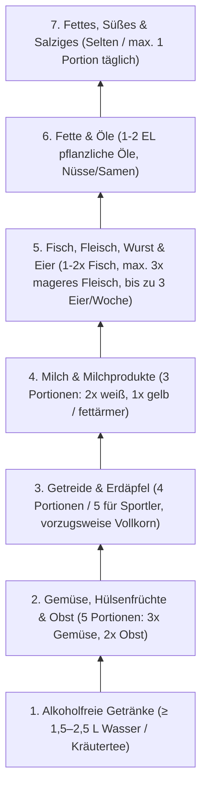

### Die visuelle Faust- & Handflächen-Portions-Doktrin:

| LEBENSMITTELGRUPPE | TÄGLICHE EMPFEHLUNG | HAND-/FAUST-PORTIONSGRÖSSE | SPEZIFISCHE ATHLETEN- / REHA-REGEL |
| :--- | :--- | :--- | :--- |
| **Alkoholfreie Getränke** | $\ge 1,5\text{--}2,5\text{ Liter}$ | $1\text{ Glas} = 200\text{--}250\text{ ml}$ | Stilles Wasser, ungesüßte Kräutertees; zuckerhaltige Softdrinks meiden. |
| **Gemüse & Hülsenfrüchte** | **3 Portionen** | **1 geballte Faust** (roh/gegart) | Schonende Zubereitung (kurze Gar-/Warmhaltezeiten) schont Vitamine. |
| **Obst & Beeren** | **2 Portionen** | **1 geballte Faust** / Handvoll | Vorzugsweise zuckerarme Beeren; liefert sekundäre Pflanzenstoffe. |
| **Getreide & Erdäpfel** | **4–5 Portionen (Sportler: 5)** | **1 Handfläche** (Brot) / **2 Fäuste** (Reis/Nudeln/Kartoffeln gekocht) | Hoher Vollkornanteil sichert Ballaststoffe & langanhaltende Glukose. |
| **Milch & Milchprodukte** | **3 Portionen** | **1 Becher/Glas** ($200\text{ ml}$ Joghurt/Milch) / **2 Handflächen-Scheiben** (Käse) | 2x "weiß" (Topfen/Joghurt) + 1x "gelb" (fettarmer Käse); liefert Calcium. |
| **Fisch, Fleisch & Eier** | Wöchentlich: 1-2x Fisch, max. 3x Fleisch, bis 3 Eier | **1 Handtellergroßes, fingerdickes Stück** ($\sim 100\text{--}150\text{ g}$) | Fettreicher Kaltwasserfisch (Lachs, Forelle, Saibling) liefert EPA/DHA. |
| **Pflanzliche Fette & Nüsse**| **1–2 Esslöffel** | **1 Esslöffel Öl** / **1 kleine Handvoll Nüsse** | Raps-, Oliven-, Walnuss- oder Leinöl; Qualität vor Quantität. |
| **Süßes, Fettes, Salziges** | Max. 1 Portion (selten) | Kleine Handvoll / 1 Portion | Max. $30\,\%$ Fettenergie, max. $50\text{ g}$ freier Zucker, max. $6\text{ g}$ Salz/Tag. |

---

## 7. Biologische Wertigkeit & Smarte Protein-Kombinationen

Um auch bei kostengünstigen und pflanzlichen Proteinquellen eine erstklassige Aminosäuren-Verwertbarkeit (*Protein Digestibility Corrected Amino Acid Score*) zu erzielen, nutzt das FGÖ-Kombinationsprinzip synergistische Ergänzungen:

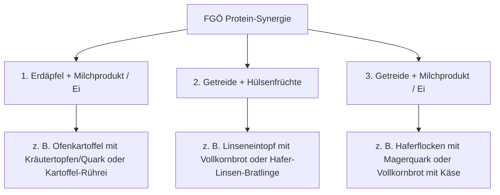

* **Vorteil für den Bundeswehr-Alltag:** Ermöglicht den Aufbau dichter Muskelmasse mit günstigen Supermarkt-Zutaten (unter 2,00 € pro Mahlzeit), ohne auf teure Protein-Shakes angewiesen zu sein.

---

## 8. Fettqualitäts-, Salzspar- & F.i.T.-Käse-Architektur

### A. Die F.i.T.-Umrechnung bei Käse (Fett in der Trockenmasse $\to$ Absoluter Fettgehalt):
Auf Käseverpackungen ist meist nur der *F.i.T.-Wert* angegeben. Der tatsächliche absolute Fettgehalt berechnet sich nach der offiziellen FGÖ-Formel:

$$\text{Absoluter Fettgehalt (g / 100g)} = \text{F.i.T.-Wert} \times \text{Kategorie-Faktor}$$

| KÄSESORTE | KATEGORIE-FAKTOR | BEISPIEL-BERECHNUNG | ABSOLUTER FETTGEHALT |
| :--- | :---: | :--- | :---: |
| **Frischkäse / Topfen / Mozzarella** | $\mathbf{\times 0,3}$ | $40\,\%\ \text{F.i.T.} \times 0,3$ | $\mathbf{12\,\%\ \text{Fett}}$ |
| **Weichkäse (Camembert, Brie)** | $\mathbf{\times 0,4}$ | $45\,\%\ \text{F.i.T.} \times 0,4$ | $\mathbf{18\,\%\ \text{Fett}}$ |
| **Schnittkäse (Gouda, Edamer)** | $\mathbf{\times 0,5}$ | $45\,\%\ \text{F.i.T.} \times 0,5$ | $\mathbf{22,5\,\%\ \text{Fett}}$ |
| **Hartkäse (Emmentaler, Parmesan)** | $\mathbf{\times 0,6}$ | $45\,\%\ \text{F.i.T.} \times 0,6$ | $\mathbf{27\,\%\ \text{Fett}}$ |

### B. Fett- & Salzspar-Strategien:
* **Fettfallen entlarven:** Sichtbares Fett bei Fleisch wegschneiden; ungesehene Fette in Wurstwaren, Fertiggerichten und Frittiertem meiden (Airfryer als fettfreie Heißluft-Alternative nutzen).
* **Salzlimit ($6\text{ g / Tag}$):** Nachsalzen am Tisch vermeiden. Stattdessen Speisen mit frischen/getrockneten Kräutern, Paprikapulver, Kurkuma oder Knoblauchpulver (refluxverträglich dosiert) würzen.

---

## 9. Lebensmitteletiketten-Forensik & Allergen-Management

### A. Nährwert-Check & getarnte Zuckerarten:
Beim Einkauf im Supermarkt (PENNY/Edeka) gilt:
1. **Zutatenliste in absteigender Reihenfolge:** Steht Zucker oder Fett an den ersten 3 Stellen $\to$ Produkt meiden.
2. **Die „Big 7“ Pflichtangaben pro $100\text{ g}$:** Energiegehalt, Fett, gesättigte Fettsäuren, Kohlenhydrate, davon Zucker, Eiweiß, Salz.
3. **Getarnter Zucker:** Hersteller verschleiern Zucker oft hinter alternativen Begriffen: *Saccharose, Dextrose, Glukosesirup, Fruktose, Maltose, Malzextrakt, Maltodextrin, Invertzuckersirup, Dicksäfte (Agavendicksaft, Apfeldicksaft)*.

### B. Unverträglichkeiten- & Allergen-Matrix:

| FORM | PATHOLOGIE / URSACHE | SYMPTOME | VERTRÄGLICHE ALTERNATIVE |
| :--- | :--- | :--- | :--- |
| **Laktoseintoleranz** | Mangel an Enzym Laktase; Spaltung von Milchzucker gestört | Blähungen, Bauchkrämpfe, Diarrhö | Laktosefreie Milch/Topfen, Hartkäse (von Natur aus laktosearm). |
| **Fruktosemalabsorption** | Transporterschwäche im Dünndarm | Blähungen, Schmerzen | Beerenobst, stärkereiche Carbs (Reis, Hafer), zuckerarme Gemüsesorten. |
| **Histaminintoleranz** | Ungleichgewicht Histaminaufnahme / DAO-Abbau | Kopfschmerz, Urtikaria, Magen-Darm | Frische Lebensmittel (keine lang gereiften Käse, kein Sauerkraut, kein Dosenfisch). |
| **Zöliakie / Gluten** | Autoimmunreaktion auf Getreideeiweiß Gluten | Darmschleimhaut-Atrophie | Glutenfreie Getreide (Reis, Mais, Hirse, Buchweizen, Quinoa). |

---

## 10. Das 30-Mikronährstoff-Kompendium & Tracking-Forensik (15 Vitamine & 15 Mineralstoffe nach D-A-CH, EFSA & Open Food Facts)

> [!NOTE] BIOCHEMISCHE DOKTRIN DER MIKRONÄHRSTOFF-HOMÖOSTASE
> - **Fundament:** Deutsche Gesellschaft für Ernährung (D-A-CH), European Food Safety Authority (EFSA), National Institutes of Health (NIH) sowie Open Food Facts API Spezifikation.
> - **Kernaussage:** Makronährstoffe (Protein, Kohlenhydrate, Fette) liefern das zelluläre Substrat und Baumaterial. Mikronährstoffe (15 Vitamine, 15 Mineralstoffe & Spurenelemente) fungieren als **essentielle Enzymkofaktoren, Elektronentransporter und Membranstabilisatoren**, ohne die mitochondriale ATP-Synthese, Muskelkontraktion, Wundheilung nach OP und Neurotransmitter-Synthese zusammenbrechen.
> - **Open Food Facts API Mapping:** Jeder Mikronährstoff ist mit seinem standardisierten Feld im `nutriments`-Payload verknüpft und proportional skalierbar.

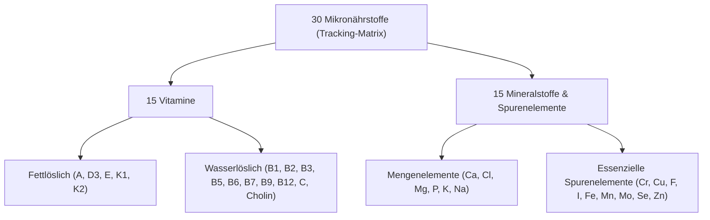

---

### A. Die 15 Vitamine: Biochemie, D-A-CH-Bedarf & Open Food Facts API

| VITAMIN | OFF-API KEY (`nutriments`) | D-A-CH / EFSA RICHTWERT | BIOCHEMISCHE FUNKTION & WIRKMECHANISMUS | TOP-QUELLEN (KASERNE & PENNY) | SYNERGIEN / ANTAGONISMEN |
| :--- | :--- | :---: | :--- | :--- | :--- |
| **Vitamin A** *(Retinol & Beta-Carotin)* | `vitamin-a_100g` | $850\text{ µg RAE}$ | Rhodopsinsynthese (Dämmerungssehen bei Nachtmärschen); Schleimhautintegrität (LPR-Refluxschutz). | Karotten, Süßkartoffeln, Spinat, Eigelb. | Fettabhängige Resorption; Zink-abhängiger Transport via RBP. |
| **Vitamin B1** *(Thiamin)* | `vitamin-b1_100g` / `thiamin_100g` | $1,2\text{ mg}$ (Sport: $1,4\text{ mg}$) | Kofaktor der Pyruvat-Dehydrogenase (Glukose $\to$ Acetyl-CoA); ATP-Synthese im ZNS. | Haferflocken, Sonnenblumenkerne, Vollkornbrot, Erbsen. | Bedarf steigt proportional zur Kohlenhydratzufuhr. |
| **Vitamin B2** *(Riboflavin)* | `vitamin-b2_100g` / `riboflavin_100g` | $1,4\text{ mg}$ | Zentraler Baustein von FAD / $\text{FADH}_2$ (Komplex II Atmungskette, Fettsäure-Beta-Oxidation). | Magerquark, Milch, Eier, Champignons, Brokkoli. | Lichtempfindlich; synergistisch mit B3 und B6. |
| **Vitamin B3** *(Niacin / Nicotinamid)* | `vitamin-pp_100g` / `vitamin-b3_100g` | $16\text{ mg NE}$ | Baustein von $\text{NAD}^+$/NADH und $\text{NADP}^+$/NADPH (Glykolyse, PARP-DNA-Reparatur). | Hähnchenbrust, Thunfisch, Lachs, Erdnussbutter. | Kann aus Tryptophan synthetisiert werden ($60:1$). |
| **Vitamin B5** *(Pantothensäure)* | `pantothenic-acid_100g` / `vitamin-b5_100g` | $5\text{ mg}$ | Zentraler Baustein von Coenzym A (CoA) und Acyl-Carrier-Protein (Zitronensäurezyklus). | Eier, Vollkorn, Hülsenfrüchte, Avocado. | Hitze- und säureempfindlich. |
| **Vitamin B6** *(Pyridoxin / P5P)* | `vitamin-b6_100g` / `pyridoxine_100g` | $1,6\text{ mg}$ ($> 160\text{g P}: 2,0\text{ mg}$) | Kofaktor der DOPA-Decarboxylase (Dopaminsynthese für AuDHD-Fokus) & Glykogen-Phosphorylase. | Hähnchen, Kichererbsen, Bananen, Kartoffeln. | Zwingend gekoppelt an hohe Proteinzufuhr ($0,02\text{ mg/g P}$). |
| **Vitamin B12** *(Cobalamin)* | `vitamin-b12_100g` / `cobalamin_100g` | $4,0\text{ µg}$ | Kofaktor der Methionin-Synthase (Homocysteinabbau), Myelinscheidenbildung & Erythropoese. | Magerquark, Eier, Thunfisch, Rindfleisch. | Resorption erfordert gastrischen Intrinsic Factor. |
| **Biotin** *(Vitamin B7 / Vitamin H)* | `biotin_100g` / `vitamin-b8_100g` | $40\text{ µg}$ | Kofaktor carboxylierender Enzyme (Pyruvat-Carboxylase); Keratinmatrix (4C-Haare & Hautbarriere). | Eigelb, Haferflocken, Nüsse, Linsen. | Avidin in rohem Eiklar blockiert Biotin irreversibel (Eier stets kochen!). |
| **Cholin** | `choline_100g` | $400\text{ mg}$ (EFSA) | Vorstufe von Acetylcholin (ZNS-Fokus & Muskelendplatte) & Phosphatidylcholin (Zellmembranen). | Ganze Eier (Vollei), Sojalecithin, Fisch, Brokkoli. | Synergistisch mit Methionin und Folat im Methylierungszyklus. |
| **Folat** *(Vitamin B9 / Methylfolat)* | `folates_100g` / `vitamin-b9_100g` | $300\text{ µg}$ | C1-Körper-Transfer, Purin-/Pyrimidinsynthese (DNA-Replikation), Dopamin-Synthese-Kofaktor. | Spinat, Grünkohl, Brokkoli, Linsen, Kichererbsen. | Hitzeempfindlich; Vitamin C schützt Folate vor Oxidation. |
| **Vitamin C** *(Ascorbinsäure)* | `vitamin-c_100g` | $110\text{ mg}$ | Kollagensynthese (Prolinhydroxylierung zur Narbenstabilisierung nach OP); $\text{Fe}^{3+} \to \text{Fe}^{2+}$ Reduktion. | Paprika, Brokkoli, Beerenobst, Sauerkraut. | Steigert pflanzliche Eisenresorption um das 3- bis 4-Fache. |
| **Vitamin D** *(Cholecalciferol / D3)* | `vitamin-d_100g` | $20\text{ µg}$ ($800\text{--}4.000\text{ IE}$) | Steroidhormon-Signalweg (VDR), intestinale Calciumresorption, Testosteron-Erhalt, Gewebereparatur. | Fettreicher Fisch (Lachs), Eigelb, D3+K2 Tropfen (11:45 Uhr). | Synergie: Zwingend zusammen mit Fett, K2-MK7 und Magnesium einnehmen. |
| **Vitamin E** *(Alpha-Tocopherol)* | `vitamin-e_100g` | $14\text{ mg}$ | Schutz mehrfach ungesättigter Membranfettsäuren (EPA/DHA) vor Lipidperoxidation. | Olivenöl, Rapsöl, Mandeln, Sonnenblumenkerne. | Regeneriert durch Vitamin C nach Radikalfang. |
| **Vitamin K1** *(Phyllochinon)* | `vitamin-k_100g` / `phylloquinone_100g` | $70\text{ µg}$ | Gamma-Glutamylcarboxylierung hepatischer Gerinnungsfaktoren (Faktoren II, VII, IX, X). | Grünes Blattgemüse, Spinat, Brokkoli, Rosenkohl. | Fettlösliche Resorption; Antagonist zu Cumarin-Derivaten. |
| **Vitamin K2** *(Menachinon / MK-7)* | `menaquinone_100g` / `vitamin-k2_100g` | $100\text{--}200\text{ µg}$ | Aktiviert Osteocalcin (Calciumeinbau in Knochen) & Matrix-Gla-Protein (Verhütung von Gefäßkalk). | Natto, gereifter Hartkäse, D3+K2 Kombi-Supplement. | Lenkt durch D3 resorbiertes Calcium zielgerichtet ins Skelett. |

---

### B. Die 15 Mineralstoffe & Spurenelemente: Mengenelemente, Spurenelemente & Bioverfügbarkeit

| MINERALSTOFF | OFF-API KEY (`nutriments`) | D-A-CH / EFSA RICHTWERT | BIOCHEMISCHE FUNKTION & ELEKTROLYT-PHYSIOLOGIE | TOP-QUELLEN (KASERNE & PENNY) | SYNERGIEN / ANTAGONISMEN |
| :--- | :--- | :---: | :--- | :--- | :--- |
| **Calcium (Ca)** | `calcium_100g` | $1.000\text{ mg}$ | Knochenmineralisation (Hydroxylapatit); elektromechanische Muskelkopplung (Querbrückenzyklus). | Magerquark, Schnittkäse, Milch, Brokkoli. | Hohe Dosen hemmen Eisen- und Zinkresorption. |
| **Chlorid (Cl)** | `chloride_100g` | $2.300\text{ mg}$ | Wichtigstes extrazelluläres Anion; Magensäurebildung (HCl - relevant für LPR-Refluxsteuerung). | Speisesalz (NaCl), Vollkornbrot, Käse, Schinken. | Zusammen mit Natrium reguliert es den osmotischen Druck. |
| **Magnesium (Mg)** | `magnesium_100g` | $350\text{--}400\text{ mg}$ | Kofaktor $> 300$ Enzyme; ATP-Mg-Komplexierung; NMDA-Blocker (ZNS-Wind-Down, REM-/Tiefschlaf). | Haferflocken, Nüsse, Linsen; Mg-Malat (06:30), Mg-Bisglycinat (21:00). | Gegenspieler zu Calcium am Muskelrezeptor; schützt vor Krämpfen. |
| **Phosphor (P)** | `phosphorus_100g` | $700\text{ mg}$ | Bestandteil von ATP, Phosphokreatin, Membran-Phospholipiden und Nukleinsäuren; Säurepuffer. | Magerquark, Eier, Fleisch, Hülsenfrüchte. | $\text{Ca}:\text{P}$-Verhältnis idealerweise $1:1\text{ bis }1,3:1$. |
| **Kalium (K)** | `potassium_100g` | $4.000\text{ mg}$ | Primäres intrazelluläres Kation; Ruhemembranpotenzial ($Na^+/K^+$-ATPase); Blutdrucksenkung. | Kartoffeln, Bananen, Tomatenmark, Spinat, weiße Bohnen. | $\text{Na}:\text{K}$-Pumpe: Hohes Kalium puffert Natrium-Überlastung ab. |
| **Natrium (Na)** | `sodium_100g` | $1.500\text{ mg}$ (Sport: $2.500\text{ mg}$) | Extrazelluläres Leition; Blutvolumen; sekundär aktiver Transport (Glukose-Na-Symport SGLT1). | Speisesalz, Brot, Käse, Schinkenwürfel. | Bei starkem Marsch-Schweißverlust zwingend zuführen ($1\text{g Salz/L}$). |
| **Chrom (Cr)** | `chromium_100g` | $30\text{--}100\text{ µg}$ | Teil des Glukosetoleranzfaktors (Chromodulin); steigert Insulinsensitivität an Muskelzellen. | Vollkornhafer, Brokkoli, Fleisch, Nüsse. | Vitamin C steigert die intestinale Chromresorption. |
| **Kupfer (Cu)** | `copper_100g` | $1,0\text{--}1,5\text{ mg}$ | Kofaktor Cytochrom-c-Oxidase (Komplex IV), Ceruloplasmin (Eisenstoffwechsel), Superoxiddismutase. | Kakaopulver, Sonnenblumenkerne, Vollkorn, Linsen. | $\text{Zn}:\text{Cu}$-Antagonismus (hohes Zink $> 50\text{mg}$ induziert Metallothionein). |
| **Fluorid (F)** | `fluoride_100g` | $3,8\text{ mg}$ | Fluorapatitbildung im Zahnschmelz; Kariesprophylaxe und Knochenfestigkeit. | Fluoridiertes Speisesalz, schwarzer/grüner Tee. | Calciumreiche Nahrung kann Fluoridresorption leicht vermindern. |
| **Jod (I)** | `iodine_100g` | $200\text{ µg}$ | Zentraler Baustein von Thyroxin ($T_4$) und Trijodthyronin ($T_3$); steuert BMR-Grundumsatz. | Jodiertes Speisesalz, Seefisch (Kabeljau/Seelachs), Eier. | Selenmangel hemmt die Dejodierung von $T_4$ zu aktivem $T_3$. |
| **Eisen (Fe)** | `iron_100g` | $10\text{ mg}$ (Ausdauer: $14\text{ mg}$) | Sauerstoffträger in Hämoglobin/Myoglobin; Kofaktor der Tyrosinhydroxylase (Dopamin!). | Haferflocken, Kürbiskerne, Linsen, Rindfleisch. | Resorption: Vitamin C $+300\,\%$; Kaffee/Tee/Calcium $-60\,\%$. |
| **Mangan (Mn)** | `manganese_100g` | $2,0\text{--}5,0\text{ mg}$ | Kofaktor der mitochondrialen MnSOD (antioxidativer Zellschutz); Knorpel- & Proteoglykansynthese. | Haferflocken, Vollkornreis, Nüsse, Hülsenfrüchte. | Hohe Eisen- oder Calciumdosen hemmen Manganresorption. |
| **Molybdän (Mo)** | `molybdenum_100g` | $50\text{--}100\text{ µg}$ | Kofaktor der Sulfitoxidase (Abbau schwefelhaltiger Aminosäuren) und Xanthinoxidase. | Hülsenfrüchte (Linsen, Bohnen), Vollkorngetreide. | Sehr hohe Bioverfügbarkeit aus pflanzlichen Quellen ($> 80\,\%$). |
| **Selen (Se)** | `selenium_100g` | $70\text{ µg}$ | Selenocystein in Glutathionperoxidase (GSH-Px) & Dejodasen ($T_4 \to T_3$ Schilddrüsenaktivierung). | Paranüsse (1 Nuss = Tagesbedarf), Eier, Thunfisch. | Synergistisch mit Vitamin E beim Membranschutz. |
| **Zink (Zn)** | `zinc_100g` | $14\text{ mg}$ (Sport: $16\text{ mg}$) | Kofaktor $> 300$ Enzyme; Wundheilung (Gewebe OP-Narbe), Testosteronsynthese, Dopamin-Kofaktor. | Kürbiskerne, Rindfleisch, Haferflocken, Linsen, Gouda. | Phytinsäure in ungekochtem Getreide bindet Zink (Haferflocken einweichen!). |

---

### C. Klinische Prioritäten & Synergie-Schaltungen für das Nutzer-Profil

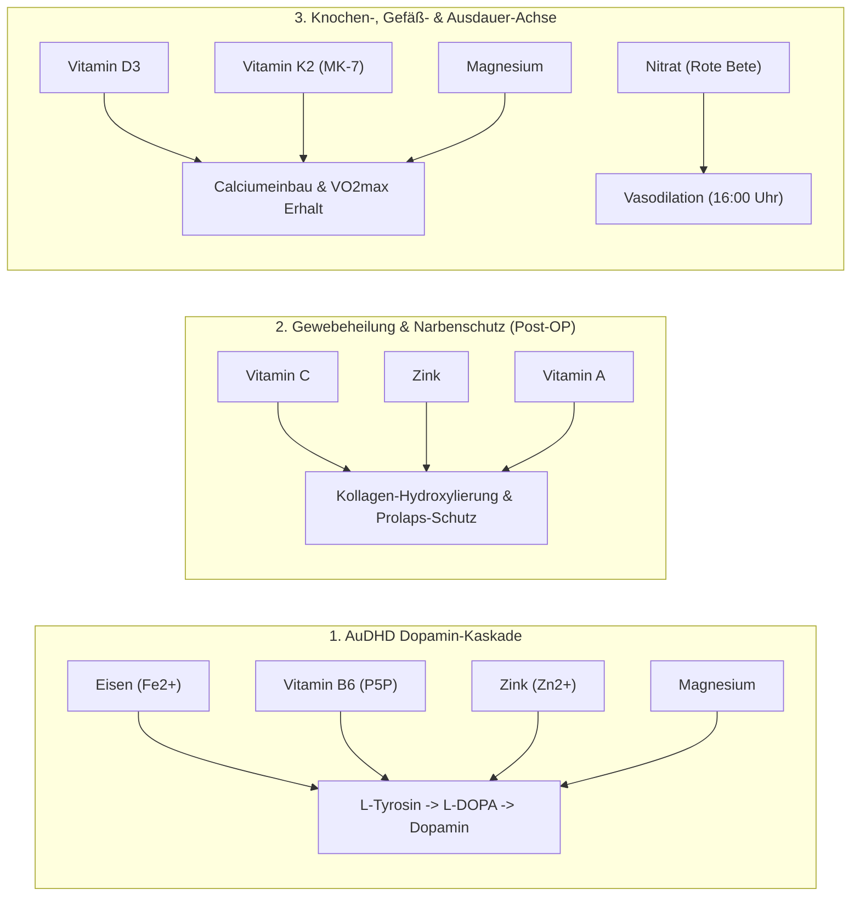

---

## 11. Evidenzbasierte Entzündungs-Forensik & Anti-Inflammatorische Ernährungs-Matrix (Silent Inflammation, Myokine & Phytochemikalien)

> [!NOTE] BIOCHEMISCHES FUNDAMENT DER SYSTEMISCHEN ENTZÜNDUNGSKONTROLLE
> - **Silent Inflammation (Niedriggradige chronische Entzündung):** Erhöhte systemische Entzündungsbiomarker (hochsensitives C-reaktives Protein hs-CRP, Zytokine $\text{IL}-6$, $\text{TNF}-\alpha$, $\text{IL}-1\beta$) treiben die Entstehung des metabolischen Syndroms, neurokognitiver Störungen und degenerativer Gewebeveränderungen voran.
> - **Die Myokin-Achse:** Physisches Training wirkt unabhängig von Gewichtsverlust hochgradig anti-inflammatorisch über die pulsatile Ausschüttung von Muskel-Myokinen ($\text{IL}-6 \to \text{IL}-1\text{ra} + \text{IL}-10 \to \downarrow \text{TNF}-\alpha$).
> - **Ernährungs- & Supplement-Intervention:** Gezielte Zufuhr von Omega-3-Fettsäuren, Polyphenolen, Curcumin, Bromelain, Magnesium und Zink bei gleichzeitiger Elimination proinflammatorischer Trigger schützt vor silent inflammation, unterstützt die Wundheilung nach OP und optimiert die zelluläre Regeneration.

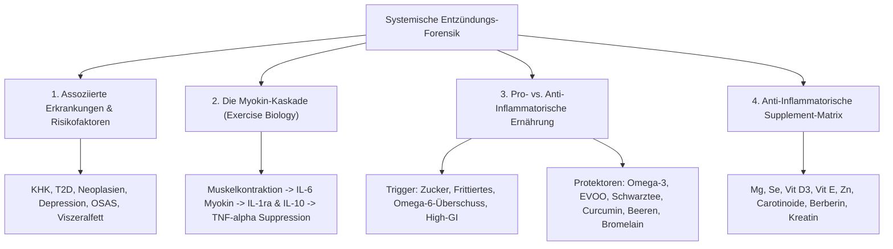

---

### A. Assoziierte Pathologien & klinische Evidenz

Erhöhte Spiegel chronischer Entzündungsmarker korrelieren signifikant mit einer erhöhten Prävalenz schwerer chronisch-degenerativer Erkrankungen:

| ERKRANKUNGSBILD | PATHOPHYSIOLOGISCHER MECHANISMUS | STUDIEN- & EVIDENZBASIS |
| :--- | :--- | :--- |
| **Kardiovaskuläre Erkrankungen (CVD)** | Endotheliale Dysfunktion, Plaque-Instabilität, Arteriosklerose, pAVK, Herzinsuffizienz, Vorhofflimmern, Schlaganfall, KHK. | *Singh (2011); Emerging Risk Factors Collaboration (2010, Lancet)* |
| **Maligne Neoplasien (Krebs)** | Chronische Zytokinstimulation fördert Angiogenese, DNA-Mutationen und Metastasierung (Lymphome, Prostata-, Ovarial-, Pankreas-, Kolorektal-, Lungenkarzinom). | *Aggarwal et al. (2006); Kundu & Surh (2008); Balkwill (2009)* |
| **Typ-2-Diabetes & Metabolisches Syndrom** | Zytokin-induzierte Serin-Phosphorylierung des Insulin-Rezeptor-Substrats 1 (IRS-1); periphere Insulinresistenz und Betazell-Dysfunktion. | *Pickup & Crook (2000); Nappo et al. (2002); Ortega Martinez de Victoria et al. (2009)* |
| **Osteoporose & Knochendichte** | Erhöhtes $\text{TNF}-\alpha$ und $\text{IL}-6$ stimulieren RANKL und beschleunigen die Osteoklasten-vermittelte Knochenresorption. | *Cao et al. (2011)* |
| **Makuladegeneration (AMD)** | Chronische Entzündung und oxidativer Stress in der retinalen Pigmentepithelschicht. | *Hong et al. (2011)* |
| **Depression & Neuroinflammation** | Zytokin-Aktivierung der Indolamin-2,3-Dioxygenase (IDO); Kynurenin-Pfad führt zu Serotonin-Depletion und Neurotoxizität. | *Gimeno et al. (2009); Copeland et al. (2012)* |
| **Kognitiver Verfall & Demenz** | Mikroglia-Aktivierung, Neuroinflammation, vaskuläre Demenz und amyloidogene Plaques bei Morbus Alzheimer. | *Singh (2011)* |

---

### B. Risikofaktoren-Matrix & Endokrine Modulation

| RISIKOFAKTOR | WIRKMECHANISMUS & PHYSIOLOGISCHE INTERAKTION | EVIDENZ & QUELLEN |
| :--- | :--- | :--- |
| **Lebensalter (Inflammaging)** | Progressive Zunahme zirkulierender Zytokine durch Immunoseneszenz. | *Singh (2011)* |
| **Niedrige Sexualhormone** | Testosteron und Östrogen reprimieren die Synthese und Sekretion proinflammatorischer Zytokine ($\text{TNF}-\alpha$, $\text{IL}-6$). Niedriges Testosteron bei Männern korreliert direkt mit hohen Entzündungsmarkern. Hormonersatz senkt Arteriosklerose- und KHK-Risiko. | *Keller (1996); Ray (1997); Deshpande (1997); Khosla (2002); Maggio (2006); Gameiro (2010); Gilliver (2010); Anderson (2004); Vural (2006); Kane (2008)* |
| **Adipositas & Viszeralfett** | Interstitielles und viszerales Abdominalfett (hoher Taillenumfang) infiltriert M1-Makrophagen und sezerniert Adipokine. Fettverlust senkt Entzündungsmarker drastisch. | *Fried (1998); Mohamed-Ali (1997); Weisberg (2003); Trayhurn (2005); Schrager (2007); Pedersen (2003); Rogowski (2010); North (2009); Moschen (2010)* |
| **Schlafstörungen & OSAS** | Intermittierende nächtliche Hypoxie und Schlaffragmentierung aktivieren $\text{NF}-\kappa\text{B}$ und treiben CRP nach oben (**Direkte Relevanz für CPAP-Compliance!**). | *Vgontzas et al. (1997, 2000, 2003)* |
| **Parodontitis & Oralgesundheit** | Bakterielle Biofilme streuen Lipopolysaccharide (LPS) systemisch ein. | *Slade et al. (2003); Pradeep et al. (2011); Vaishnava et al. (2011)* |
| **Chronischer Stress** | HPA-Achsen-Dysregulation, Cortisolresistenz von Immunzellen. | *Pervanidou & Chrousos (2011)* |
| **Hyperglykämie & AGEs** | Hohe Blutzuckerspitzen erzeugen *Advanced Glycation End-products* (AGEs), die RAGE-Rezeptoren aktivieren. | *Basta et al. (2004); Uribarri et al. (2005); Toma et al. (2009)* |
| **Körperliche Inaktivität** | Mangel an Muskelkontraktionen verhindert die protektive Myokinausschüttung. | *Pedersen (2003)* |
| **Tabakrauch & Umwelttoxine** | Exogene oxidative Belastung triggert Makrophagenaktivierung. | *Arnson et al. (2010)* |

---

### C. Myokin-Physiologie & Kalorienrestriktion (Exercise Biology)

Muskelgewebe agiert bei Kontraktion als **endokrines Organ** und schüttet Myokine aus, die systemische Entzündungen unabhängig von einer Gewichtsabnahme senken (*Bruunsgaard 2005*):

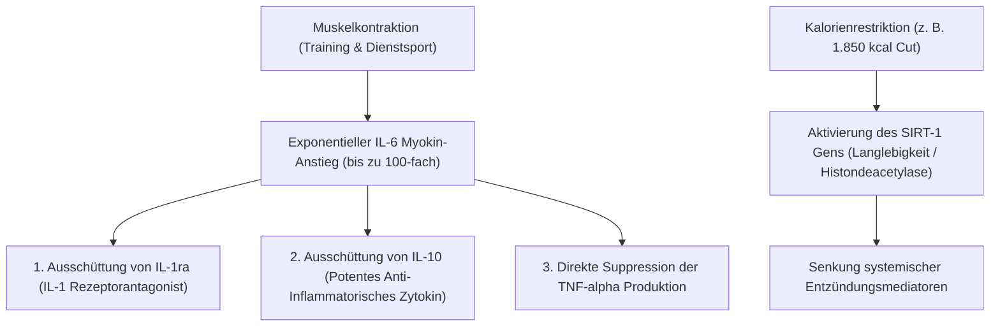

* **Myokin Interleukin-6 ($\text{IL}-6$):** Steigt proportional zu Trainingsintensität, Trainingsdauer und involvierter Muskelmasse (bis zu **100-facher Anstieg**; *Petersen & Pedersen 2006*).
* **Der anti-inflammatorische Signalweg:** Im Gegensatz zu pathogenem Zytokin-$\text{IL}-6$ triggert Muskel-$\text{IL}-6$ keine Entzündung, sondern induziert sofort $\text{IL}-1\text{ra}$ und $\text{IL}-10$ und blockiert $\text{TNF}-\alpha$.
* **Kalorienrestriktion:** Chronische moderate Kalorienbegrenzung senkt Entzündungsmarker (*Ahmadi 2011, González 2012*) und aktiviert das Langlebigkeitsgen **SIRT-1**.

---

### D. Diätetische Trigger vs. Anti-Inflammatorische Power-Lebensmittel

| KATEGORIE | PRO-INFLAMMATORISCH (ZU MINIMIEREN) | EVIDENZ | ANTI-INFLAMMATORISCH (FÖRDERN) | BIOCHEMISCHER MECHANISMUS & EVIDENZ |
| :--- | :--- | :--- | :--- | :--- |
| **Zucker & Carbs** | Freier Zucker, High-GI/GL Produkte | *Levitan (2008); Du (2008); Galland (2010)* | **Ballaststoffe** (Hafer, Hülsenfrüchte) | Fermentation zu kurzkettigen Fettsäuren (SCFA/Butyrat); senkt CRP (*North 2009*). |
| **Fette & Öle** | Frittierte Speisen, erhitzte ungesättigte Öle (Transfette, Peroxide), Omega-6 Überschuss | *ExRx Nutrition Forensik* | **Omega-3 Kaltwasserfisch & EVOO** | EPA/DHA bilden Resolvine/Protectine (*Pischon 2003, Marik 2009*); EVOO liefert Oleocanthal (COX-Hemmer). |
| **Gesättigte Fette** | Hohe Mengen bei Übergewichtigen/Diabetikern | *Nappo (2002); Peairs (2011)* | Neutral bei schlanken Athleten | Keine Entzündungsassoziation bei metabolisch Gesunden (*Poppitt 2008, Myhrstad 2011*). |
| **Getränke** | Zuckerhaltige Softdrinks, Energy-Drinks | *Galland (2010)* | **Schwarzer & Grüner Tee** | Polyphenole (EGCG, Theaflavin); Schwarzer Tee senkt CRP besonders stark (*Steptoe 2007, Bahorun 2010*). |
| **Fermentiertes** | Stark verarbeitete Fertigprodukte | *ExRx Forensik* | **Probiotika (Joghurt, Sauerkraut, Miso)** | Stärkt Darm-Epithelbarriere (*Tight Junctions*), verhindert LPS-Translokation. |
| **Gemüse & Knollen** | Frittierte Pommes, fettige Röstzwiebeln | *ExRx Forensik* | **Grünkohl, Brokkoli, Rote Bete, Knoblauch** | Sulforaphan, Betain, Quercetin und Allicin unterdrücken $\text{NF}-\kappa\text{B}$. |
| **Früchte** | Kandierte Früchte, zuckerreiche Marmeladen | *ExRx Forensik* | **Beeren, Sauerkirschen, Trauben, Ananas** | Resveratrol & Pterostilben (*Khanduja 2004, Ghanim 2011*); Bromelain schmerzlindernd (*Walker 2002, Akhtar 2004*). |
| **Gewürze & Samen** | Industrielle Würzpasten mit Glutamat/Zucker | *ExRx Forensik* | **Kurkuma (Curcumin) & Sesam** | Curcumin ($500\text{ mg}\text{ bis }8\text{--}12\text{ g}$) blockiert $\text{NF}-\kappa\text{B}$ (*Chainani-Wu 2003*); Sesam-Lignane (*Wu 2009*). |

---

### E. Anti-Inflammatorische Supplement-Wirkstoffmatrix

| WIRKSTOFF | TÄGLICHE DOSIERUNG | WIRKMECHANISMUS & KLINISCHER NUTZEN | STUDIENBASIS |
| :--- | :---: | :--- | :--- |
| **Magnesium** | $350\text{--}400\text{ mg}$ (Malat/Bisglycinat) | Intrazelluläre Enzymkomplexierung; senkt hs-CRP und proinflammatorische Zytokine signifikant. | *Cavicchia (2009); Galland (2010); Chacko (2010)* |
| **Selen** | $70\text{ µg}$ (1 Paranuss) | Kofaktor der Glutathionperoxidase (GSH-Px); schützt Zellmembranen vor oxidativem Stress. | *Duntas (2009); Maehira et al. (2002)* |
| **Vitamin D3** | $20\text{ µg}$ ($800\text{--}4.000\text{ IE}$) | Reguliert über den VDR-Rezeptor Immunzell-Differenzierung; niedrige D3-Spiegel korrelieren mit Zytokinsturm. | *Krishnan (2010); Guillot (2010); Awad (2012); Reid (2011)* |
| **Vitamin E ($\alpha$ + $\gamma$)** | $14\text{ mg}$ (Misch-Tocopherole) | Kombination aus Alpha- und Gamma-Tocopherol ist Einzelgabe bei Entzündungs- und Stressbiomarkern überlegen. | *Devaraj et al. (2008)* |
| **Zink** | $14\text{--}16\text{ mg}$ | Moduliert Zink-Finger-Proteine (A20), hemmt $\text{NF}-\kappa\text{B}$, fördert Wundheilung nach OP. | *Mariani (2006); Prasad (2009); Bao (2010); Wong (2011)* |
| **Carotinoide (Beta-Carotin)** | Natürliche Mischung | Lipophile Antioxidantien fangen Singulett-Sauerstoff ab und schützen Zellmembranen. | *Walston et al. (2006); Cavicchia et al. (2009)* |
| **Berberin** | $1,0\text{--}2,0\text{ g}$ (3–4 Einzeldosen) | Potenter AMPK-Aktivator; senkt Blutzucker & Entzündung (*Nicht direkt peri-workout einnehmen wegen mTOR-Dämpfung*). | *ExRx Phytomedizin Forensik* |
| **DHEA** | $50\text{ mg}$ | Vorstufe von Androgenen/Östrogenen; moduliert Zytokinsekretion bei altersbedingtem Abfall. | *Gordon (2001); Weiss (2011)* |
| **Kreatin-Monohydrat** | $5\text{ g}$ täglich | Reduziert Zellschäden und Entzündungsmarker (TNF-$\alpha$, PGE2) nach intensiver exzentrischer Belastung. | *Santos et al. (2004)* |
| **Curcumin (Kurkuma)** | $500\text{ mg}$ (bis $8\text{--}12\text{ g}$ sicher) | Stärkster pflanzlicher $\text{NF}-\kappa\text{B}$- und COX-2-Inhibitor; anti-inflammatorischer Gewebeschutz. | *Chainani-Wu (2003); Bengmark (2006); White (2011)* |
| **Bromelain (Ananas)** | $200\text{--}500\text{ mg}$ | Proteolytisches Enzym; beschleunigt Ödemresorption, Gewebeheilung und Schmerzreduktion. | *Secor (2005, 2008); Walker (2002); Akhtar (2004)* |

---

### F. Kasernen- & Stuben-Aktionsplan zur Entzündungsminimierung

1. **Truppenküche Frühstück & Mittag:**
   - Großzügig Beeren, Sauerkraut/Gemüsebeilagen und Magerquark wählen.
   - Frittierte Speisen (Panaden, Pommes) meiden und stattdessen Kartoffeln oder Reis nutzen.
   - Schwarzen Tee als Vormittagsgetränk integrieren (hohe Theaflavin-Konzentration zur CRP-Senkung).
2. **Stuben-Küche & Airfryer:**
   - Nutzung von 1-Sekunden-Backspray und Heißluft statt Erhitzen von instabilen Speiseölen in der Pfanne.
   - Tägliche Integration von 1 EL nativem Olivenöl extra (kalt über fertige Mahlzeiten) für Oleocanthal.
   - 15-Minuten Kasernen-Dal mit Tomaten, Linsen, Kichererbsen und Kurkuma zubereiten.
3. **Trainings- & Schlafhygiene:**
   - 100 % CPAP-Compliance zur Vermeidung hypoxischer $\text{NF}-\kappa\text{B}$-Entzündungsschübe.
   - Regelmäßiges Stuben-Calisthenics- & Lauf-Training zur kontinuierlichen Myokin-Freisetzung ($\text{IL}-6 \to \text{IL}-10$).

---

## 12. Das UCLA 7-Farben-Phytonährstoff-System & Krebspräventions-Matrix (Dr. David Heber / UCLA Center for Human Nutrition)

> [!NOTE] DOKTRIN DER BIOAKTIVEN PFLANZENSTOFF-DIVERSITÄT
> - **Entwickler & Institution:** Dr. David Heber, MD, PhD, *Center for Human Nutrition*, University of California, Los Angeles (UCLA) (*"What Color Is Your Diet?"*).
> - **Wissenschaftliches Grundprinzip:** Pflanzen bilden charakteristische Pigmente (Farbstoffe) und sekundäre Pflanzenstoffe (*Phytonutrients / Phytochemikalien*) primär als Abwehrmechanismen gegen UV-Strahlung, Oxidation und Schädlinge. Im menschlichen Organismus entfalten diese chemischen Verbindungsklassen hochspezifische **onkoprotektive, zellregenerative, antioxidative und genregulierende Wirkungen**.
> - **Die 3 UCLA Kern-Axiome:**
>   1. **Tägliche 7-Farben-Vollständigkeit (*Eat the Rainbow*):** Jeden Tag mindestens **1 Vertreter aus jeder der 7 Farbgruppen** verzehren.
>   2. **Portions-Ziel:** Mindestens **$\ge 7$ Portionen Obst und Gemüse pro Tag** zuführen.
>   3. **Intra-kolorische Diversität:** Innerhalb jeder Farbgruppe regelmäßig zwischen verschiedenen pflanzlichen Lebensmitteln rotieren.

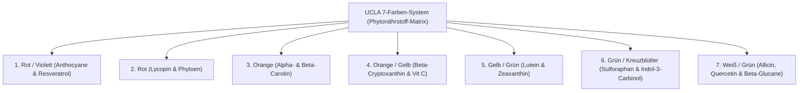

---

### A. Das 7-Farben-Kompendium: Biochemie, Wirkmechanismen & Lebensmittel-Katalog

| FARBGRUPPE | LEIT-PHYTONÄHRSTOFFE & KLASSEN | BIOCHEMISCHER WIRKMECHANISMUS & KREBSPRÄVENTION | VOLLSTÄNDIGER LEBENSMITTEL-KATALOG (UCLA) | KASERNEN- & PENNY-QUICK-PICKS |
| :--- | :--- | :--- | :--- | :--- |
| **1. Rot / Violett** *(Red / Purple)* | Anthocyane, Resveratrol, Ellagsäure, Proanthocyanidine | Höchste ORAC-Radikalfängerkapazität; Schutz endothelialer Gefäßwände; Hemmung der Lipidperoxidation; Neuroprotektion der Blut-Hirn-Schranke. | Trauben, Traubenprodukte (Traubensaft, moderater Rotwein), Backpflaumen, Pflaumen, Cranberries, Heidelbeeren, Brombeeren, Erdbeeren, rote Paprika, Kirschen, Auberginen, Rote Bete, Rosinen, rote Äpfel, rote Birnen. | TK-Heidelbeeren/Beerenmischung (Magerquark), Rote-Bete-Saft, rote Paprika. |
| **2. Rot** *(Red)* | Lycopin (trans/cis-Isomere), Phytoen, Phytofluen | Extrem potenter Singulett-Sauerstoff-Quencher; selektive Akkumulation in Prostata- und Darmepithelgewebe; Senkung von Prostata- und Kolonkarzinomen. *(Fett- & Hitzebehandlung steigert Bioverfügbarkeit!).* | Tomaten, Tomatenprodukte (Tomatensauce, Tomatensuppe, passierte Tomaten, Tomatensaft, Ketchup), pinke Grapefruit, Wassermelone. | Passierte Tomaten (PENNY), Tomatenmark, Kirschtomaten Truppenküche. |
| **3. Orange** *(Orange)* | Alpha-Carotin, Beta-Carotin | Provitamin-A-Synthese; Stimuliert die Gap-Junction-Zellkommunikation (unterbindet unkontrollierte Tumorzellproliferation); Aktivierung von Natural-Killer-Zellen (NK). | Karotten, Mangos, Aprikosen, Cantaloupe-Melonen, Kürbis, Eichelkürbis, Winterkürbis, Süßkartoffeln. | Karotten (Rohkost Stube/Küche), Süßkartoffeln (Airfryer-Wedges). |
| **4. Orange / Gelb** *(Orange / Yellow)* | Beta-Cryptoxanthin, Vitamin C, Hesperidin, Naringenin, Flavonoide | Lungen- und Epithelkarzinomprävention; Kofaktor der Kollagen-Tripelhelix-Synthese; Schutz vor nitrosativen Gewebeschäden. | Orangen, Orangensaft, Mandarinen/Tangerinen, gelbe Grapefruit, Zitronen, Limetten, Pfirsiche, Papaya, Ananas, Nektarinen. | Orangen, Mandarinen, Zitronensaft ins Trinkwasser, frische Ananas (Bromelain). |
| **5. Gelb / Grün** *(Yellow / Green)* | Lutein, Zeaxanthin | Selektive Einlagerung in der *Macula lutea* der Retina; biologischer Blaulicht- und UV-Filter; Prävention von altersbedingter Makuladegeneration (AMD) und Katarakt. | Spinat, Blattkohl (Collard Greens), Senfblätter, Rübengrün, gelber Mais, Avocado, grüne Erbsen, grüne Bohnen, grüne & gelbe Paprika, Gurken, Kiwi, Römersalat, Zucchini, Honigmelone, Netzmelone. | TK-Blattspinat (Dal), Avocado, Tiefkühl-Erbsen, Zucchini (Airfryer), Kiwi. |
| **6. Grün** *(Green - Cruciferous)* | Sulforaphan, Isothiocyanate, Indol-3-Carbinol (I3C), Glucosinolate | **Aktivierung des Nrf2-Signalwegs;** Induktion hepatischer Phase-II-Entgiftungsenzyme (Glutathion-S-Transferasen); Inaktivierung mutagener Karzinogene; Modulation des Östrogenmetabolismus. | Brokkoli, Rosenkohl, Weißkohl, Rotkohl, Blumenkohl, Chinakohl, Pak Choi, Grünkohl. | Brokkoli (TK / Truppenküche), Sauerkraut (PENNY), Blumenkohl. |
| **7. Weiß / Grün** *(White / Green - Allium)* | Allicin, Quercetin, Allylsulfide, Kaempferol, Beta-Glucane (Pilze) | Antimikrobiell, Hemmung der Thrombozytenaggregation; Unterdrückung von HMG-CoA-Reduktase; Beta-Glucane stimulieren Makrophagen-Dectin-1-Rezeptoren gegen Infekte. | Knoblauch, Zwiebeln, Lauch/Porree, Stangensellerie, Spargel, Artischocken, Endiviensalat, Schnittlauch, Speisepilze (Champignons, Shiitake, Austernpilze). | Knoblauchpulver/Zwiebeln (gegart - LPR-sicher!), Champignons, Porree. |

---

### B. Das Kasernen-Blueprint: Tägliche 7-Farben-Abdeckung (PENNY & Truppenküche)

Mit dieser standardisierten Taktung werden mühelos alle 7 Farben und $\ge 7$ Portionen täglich im Bundeswehr-Alltag abgedeckt:

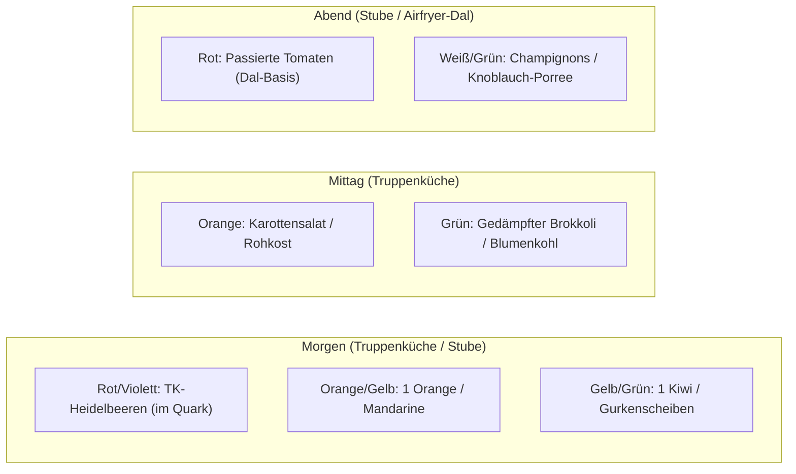

| MAHLZEITEN-SLOT | FARBGRUPPEN & ZUTATEN | ANZAHL PORTIONEN | PHYTONÄHRSTOFF-MEHRWERT |
| :--- | :--- | :---: | :--- |
| **06:30 Uhr (Frühstück)** | **Rot/Violett:** $100\text{ g}$ Heidelbeeren (TK) **Orange/Gelb:** 1 Orange oder Kiwi **Gelb/Grün:** Gurkenscheiben / Paprikastreifen | **3 Portionen** | Anthocyane für ZNS-Fokus; Vitamin C und Lutein für retinalen Schutz bei Bildschirm- & Nachtdienst. |
| **12:00 Uhr (Truppenküche)** | **Orange:** 1 Schale geraspelte Karotten **Grün:** 1 Schöpfkelle Brokkoli / Blumenkohl | **2 Portionen** | Alpha-/Beta-Carotin für Epithelschutz; Sulforaphan für hepatische Nrf2-Phase-II-Entgiftung. |
| **18:00 Uhr (Stuben-Küche)** | **Rot:** $250\text{ g}$ Passierte Tomaten (Dal / Sauce) **Weiß/Grün:** $150\text{ g}$ Champignons & Zwiebel/Porree | **2–3 Portionen** | Lycopin (durch Köcheln maximal bioverfügbar!); Allicin & Beta-Glucane für antivirale Immunabwehr. |
| **GESAMT-BILANZ** | **Alle 7 UCLA-Farbgruppen lückenlos abgedeckt** | **$\mathbf{\ge 7\text{--}8}$ Portionen** | **100 % Diversitäts-Score nach Dr. David Heber** |

---

## 13. ExRx.net Dietary Guidelines & Endokrine Disruptoren-Forensik (Peri-Workout Timing, Rauchpunkte & Bisphenol-A-Elimination)

> [!NOTE] DOKTRIN DER SPORTERNÄHRUNGS-PRAXIS & ENDOKRINEN INTEGRITÄT
> - **Quelle & Fundament:** *ExRx.net Exercise Science & Dietary Guidelines*, National Institutes of Health (NIH), Endocrine Society.
> - **Zentrales Axiom:** Maximale athletische Leistungsfähigkeit und hormonelle Homöostase erfordern nicht nur die quantitative Makronährstoffabdeckung, sondern die **präzise zeitliche Taktung um das Training (4:1 Ratio)**, die **Vermeidung toxischer Abbauprodukte (Rauchpunkte von Ölen)** sowie die **strikte Elimination endokriner Disruptoren (BPA, Phthalate, Plastikweichmacher)**.

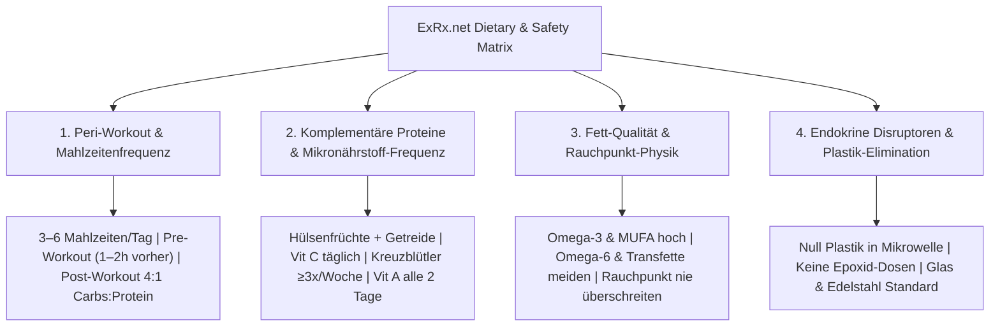

---

### A. Mahlzeitenfrequenz, Kaloriensicherung & Peri-Workout Timing (4:1 Ratio)

1. **Mahlzeitenfrequenz (3–6 Mahlzeiten täglich):**
   - Gleichmäßige Verteilung der Nährstoffe sichert kontinuierliche Muskelproteinsynthese (MPS) und verhindert kognitive Glukosetäler.
   - **Vermeidung des *Starvation Effects*:** Zu drastische Kaloriendefizite dämpfen die Schilddrüsenachse ($T_3$-Abfall), reduzieren Leptin und senken den Grundumsatz.
2. **Pre-Workout Ernährung (1–2 Stunden vor Belastung):**
   - Leicht verdaulicher Snack oder Mahlzeit mit komplexen Kohlenhydraten und moderatem Protein (z. B. Haferflocken mit Magerquark oder eine Banane mit 150ml Eiweißshake).
3. **Post-Workout Recovery Mahlzeit:**
   - **Zeitfenster:** Zeitnah nach Trainingsende ($10\text{--}20\,\%$ des gesamten Tageskalorienbudgets).
   - **Das 4:1 Kohlenhydrat-zu-Protein-Verhältnis:**
     $$\text{Makro-Ratio} \approx 4\text{ Teile Kohlenhydrate} : 1\text{ Teil Protein}$$
     *Mechanismus:* Die Kombination aus schnell resorbierbaren Kohlenhydraten (Reis, Kartoffeln, Bananen, Couscous) und vollständigem Protein maximiert den Insulinausstoß zur GLUT4-Glukoseaufnahme und stimuliert den $\text{mTORC1}$-Pfad für rasche Glykogenresynthese und Myofibrilläre Reparatur.

---

### B. Komplementäre Proteine & Mikronährstoff-Taktung

* **Das Komplementärprotein-Gesetz (*Complementary Proteins*):**
  Pflanzliche Proteinquellen weisen oft limitierende Aminosäuren auf (z. B. Lysinarmut in Getreide, Methioninarmut in Hülsenfrüchten). Durch gezielte Kombination wird eine biologische Wertigkeit auf Vollei-Niveau ($\ge 100$) erreicht:
  - **Hülsenfrüchte (Linsen, Kichererbsen, Bohnen, Erdnüsse) + Getreide/Samen/Nüsse** (z. B. Kasernen-Dal mit Hartweizen-Couscous oder Vollkornbrot mit Erdnussbutter).
  - **Getreide + Milchprodukte/Käse** (z. B. Haferflocken mit Magerquark oder Vollkornbrot mit Harzer/Gouda).
* **Feste Mikronährstoff-Frequenzen nach ExRx.net:**
  - **Vitamin C reiche Lebensmittel:** Mindestens **1 Portion täglich** (Paprika, Zitrusfrüchte, Tomaten, Beeren).
  - **Kreuzblütler (Cruciferous Vegetables):** Mindestens **3 Portionen pro Woche** (Brokkoli, Blumenkohl, Rosenkohl, Grünkohl, Sauerkraut) zur Aktivierung der Nrf2-Entgiftungskaskade.
  - **Vitamin A reiche Lebensmittel:** Mindestens **1 Portion jeden zweiten Tag** (Karotten, Süßkartoffeln, Spinat).
  - **Calciumreiche Nahrungsmittel:** Magerquark, Käse, dunkles Blattgemüse, Tofu, Kichererbsen, Dosenfisch mit weichen Grätenanteilen (Lachs/Sardinen), Mandeln, Sesamsamen.
  - **Ballaststoffe:** Mindestens $25\text{--}35\text{ g}$ täglich aus Vollkorn, Gemüse und Hülsenfrüchten (Sicherung von Bristol-Typ 4).

---

### C. Fett-Hierarchie & Rauchpunkt-Physik (*Cooking Oil Smoke Points*)

Speiseöle dürfen niemals über ihren materialspezifischen **Rauchpunkt** erhitzt werden. Oberhalb des Rauchpunkts zerfällt das Glycerolgerüst in toxisches, schleimhautreizendes **Acrolein**, freie Radikale und krebserregende Lipidhydroperoxide:

| SPEISEÖL / FETT | FETTSÄUREN-PROFIL | RAUCHPUNKT | ANWENDUNGSEMPFEHLUNG IM BUNDESWEHR-ALLTAG |
| :--- | :--- | :---: | :--- |
| **Natives Olivenöl Extra (EVOO)** | Reich an MUFA (Ölsäure) & Oleocanthal | $\mathbf{190\text{--}210^\circ\text{C}}$ | Kalt über fertige Mahlzeiten geben; sanftes Dünsten bei mittlerer Hitze. |
| **Rapsöl (raffiniert)** | MUFA & ausgewogenes Omega-3/6 | $\mathbf{230^\circ\text{C}}$ | Gelegentliches Anbraten bei höheren Temperaturen. |
| **Butter / Ghee** | Gesättigte Fettsäuren | $\mathbf{175^\circ\text{C}}$ (Ghee: $250^\circ\text{C}$) | Butter nicht scharf anbraten; Ghee für hohe Temperaturen. |
| **Leinöl / Walnussöl** | Extrem reich an Omega-3 (ALA) | $\mathbf{107^\circ\text{C}}$ (Kalt) | **Niemals erhitzen!** Ausschließlich kalt im Quark oder über Salate. |
| **Sonnenblumen- / Maiskeimöl** | Hoher Omega-6-Überschuss | $\sim 225^\circ\text{C}$ | **Meiden:** Treibt Arachidonsäure und Silent Inflammation an. |
| **Airfryer-Heißluft (Konvektion)** | **0 Gramm Speiseöl** | **Bis $200^\circ\text{C}$** | **Goldstandard:** Fettfreies Rösten ohne Gefahr der Lipidperoxidation. |

* **Transfette vollständig eliminieren:** Keine industriell teilgehärteten Fette (*Hydrogenated Fats* in billigem Gebäck, Frittiertem und Fertigsaucen).
* **Pökel- & Raucherzeugnisse minimieren:** Nitritpökelsalz ($E249\text{--}E250$) bildet im sauren Magenmilieu mit Aminen krebserregende Nitrosamine. Frisches Fleisch und unverarbeiteten Fisch bevorzugen.

---

### D. Endokrine Disruptoren & Plastik-Eliminations-Doktrin

> [!CAUTION] ZERO-PLASTIK-DOKTRIN FÜR MAHLZEITEN & GETRÄNKE
> Synthetische Kunststoffe enthalten hormonaktive Weichmacher (**Phthalate**) und Monomere (**Bisphenol A / BPA, BPS**), die als **Xenoöstrogene** wirken:
> 1. Sie binden an Östrogenrezeptoren und stören das Testosteron-zu-Östrogen-Gleichgewicht.
> 2. Sie senken die Spermienqualität, fördern viszerale Fetteinlagerung und schädigen die Schilddrüsenachse.
> 3. **Besonders hohe Freisetzungsrate:** Beim Erhitzen von Speisen in Plastikschalen in der Mikrowelle sowie beim Kontakt mit heißen, fetthaltigen oder sauren Lebensmitteln (Tomatensauce, Zitrus, Öle).

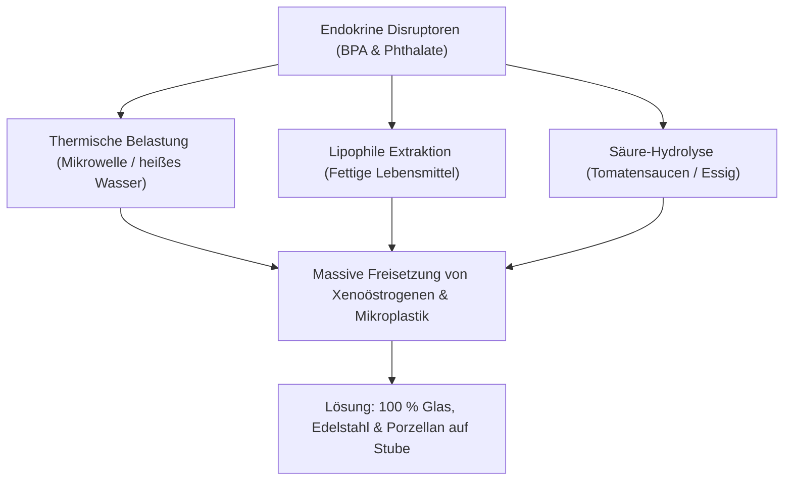

#### Die 4 Anti-Disruptor-Regeln für deine Stube:
1. **Kein Plastik in der Mikrowelle:** Mahlzeiten ausschließlich in Porzellantellern oder hitzebeständigen Glasbehältern (Borosilikatglas) erhitzen.
2. **Glas-Wasserkocher Standard:** Dein 1,7 Liter Glas-Wasserkocher mit Edelstahl-Heizelement verhindert den Kontakt von siedendem Wasser mit Plastikinnenwänden.
3. **Glas- & Edelstahl-Lagerung:** Vorräte (Gnocchi, Couscous, Linsen, Haferflocken) nach Anbruch in Glasbehältern lagern.
4. **Vermeidung kunststoffbeschichteter Dosen:** Bevorzuge passierte Tomaten im Glas oder Tetra-Recart statt verbeulter Weißblechdosen mit Epoxidharz-Innenbeschichtung.

---

### E. ExRx.net Food Exchanges Rechner-Architektur (Portions-Austauschsystem)

Das **Food Exchange System** (entwickelt von der *Academy of Nutrition and Dietetics* und *ExRx.net*) teilt Lebensmittel in standardisierte Nährwertblöcke ein. Dies ermöglicht den flexiblen Austausch von Lebensmitteln in der Kaserne ohne ständiges Gramm-Wiegen:

| EXRX EXCHANGE KATEGORIE | KOHLENHYDRATE | PROTEIN | FETT | ENERGIE | KASERNEN- & STUBEN-PORTIONEN (1 EXCHANGE) |
| :--- | :---: | :---: | :---: | :---: | :--- |
| **Stärke (Starch)** | $15\text{ g}$ | $3\text{ g}$ | $0\text{--}1\text{ g}$ | $\sim 80\text{ kcal}$ | 1 Scheibe Vollkornbrot ($40\text{ g}$), $25\text{ g}$ Haferflocken, $70\text{ g}$ gekochter Reis/Nudeln, $100\text{ g}$ Kartoffeln, $40\text{ g}$ Gnocchi. |
| **Obst (Fruit)** | $15\text{ g}$ | $0\text{ g}$ | $0\text{ g}$ | $\sim 60\text{ kcal}$ | 1 kleiner Apfel ($120\text{ g}$), 1 Orange, $100\text{ g}$ Beerenmischung (TK), 1 Kiwi, $1/2$ Banane ($60\text{ g}$). |
| **Milch (Mager / Skim)** | $12\text{ g}$ | $8\text{ g}$ | $0\text{--}2\text{ g}$ | $\sim 90\text{ kcal}$ | $200\text{ ml}$ fettarme Milch ($1,5\,\%$), $150\text{ g}$ fettarmer Naturjoghurt, $100\text{ g}$ Magerquark. |
| **Fleisch / Protein (Very Lean)** | $0\text{ g}$ | $7\text{ g}$ | $0\text{--}1\text{ g}$ | $\sim 35\text{ kcal}$ | $30\text{ g}$ Hähnchenbrust, $30\text{ g}$ Thunfisch im eigenen Saft, $60\text{ g}$ flüssiges Eiklar, $25\text{ g}$ Harzer Käse, $60\text{ g}$ Magerquark. |
| **Fleisch / Protein (Lean / Medium)** | $0\text{ g}$ | $7\text{ g}$ | $3\text{--}5\text{ g}$ | $\sim 55\text{--}75\text{ kcal}$ | 1 ganzes Vollei, $35\text{ g}$ Rinderhack mager, $30\text{ g}$ Lachs, $30\text{ g}$ Feta light. |
| **Gemüse (Non-Starchy)** | $5\text{ g}$ | $2\text{ g}$ | $0\text{ g}$ | $\sim 25\text{ kcal}$ | $100\text{ g}$ Brokkoli/Blumenkohl, $150\text{ g}$ Gurke/Tomate, $100\text{ g}$ Sauerkraut, $100\text{ g}$ Zucchini. |
| **Fett (Fat)** | $0\text{ g}$ | $0\text{ g}$ | $5\text{ g}$ | $\sim 45\text{ kcal}$ | $1\text{ TL}$ Olivenöl / Rapsöl ($5\text{ g}$), $10\text{ g}$ Walnüsse/Mandeln, $30\text{ g}$ Avocado. |

* **Beispiel Kasernen-Frühstück ($160\text{g}$ Protein-Tagesplan):**
  * $250\text{ g}$ Magerquark = **$4\times$ Protein (Very Lean) $+ 1\times$ Milch (Skim)** ($36\text{ g}$ P, $12\text{ g}$ C, $0\text{ g}$ F $\to 230\text{ kcal}$).
  * $50\text{ g}$ Haferflocken = **$2\times$ Stärke** ($6\text{ g}$ P, $30\text{ g}$ C, $2\text{ g}$ F $\to 160\text{ kcal}$).
  * $100\text{ g}$ TK-Heidelbeeren = **$1\times$ Obst** ($0\text{ g}$ P, $15\text{ g}$ C, $0\text{ g}$ F $\to 60\text{ kcal}$).
  * $10\text{ g}$ Walnüsse = **$1\times$ Fett** ($1,5\text{ g}$ P, $1\text{ g}$ C, $5\text{ g}$ F $\to 65\text{ kcal}$).
  * **Gesamt:** $43,5\text{ g}$ Protein | $58\text{ g}$ Carbs | $7\text{ g}$ Fett | $\mathbf{515\text{ kcal}}$.

---

### F. ExRx.net Calorie Requirements (CalRequire) & Energiebilanz-Forensik

Die exakte Berechnung des Energiebedarfs erfolgt über die validierten BMR-Gleichungen gekoppelt an die stündliche Aktivitätserfassung:

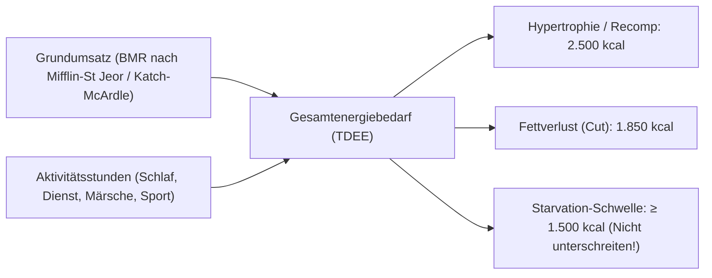

#### 1. BMR-Grundumsatz-Berechnung (Nutzer-Parameter: $76,5\text{ kg}$, $175\text{ cm}$, 26 Jahre [Geb. 13.03.2000], $\sim 13\,\%\ \text{KFA}$):
* **Mifflin-St Jeor Formel:**
  $$\text{BMR} = 10 \times 76,5 + 6,25 \times 175 - 5 \times 26 + 5 = 765 + 1.093,75 - 130 + 5 = \mathbf{1.733,8\text{ kcal/Tag}} \approx \mathbf{1.734\text{ kcal/Tag}}$$
* **Katch-McArdle Formel (Fettfreie Masse $\text{LBM} = 66,5\text{ kg}$):**
  $$\text{BMR} = 370 + 21,6 \times 66,5 = \mathbf{1.806\text{ kcal/Tag}}$$

#### 2. Stündliche ExRx-Aktivitätszerlegung (Bundeswehr-Alltagstag):
* **Schlaf ($8,0\text{ h}$, MET 0,9):** $550\text{ kcal}$
* **Schreibtisch- & Stabsdienst ($8,0\text{ h}$, MET 1,4):** $850\text{ kcal}$
* **Gehen, Märsche & Kaserne Topographie ($2,5\text{ h}$, MET 3,0):** $570\text{ kcal}$
* **Stuben-Calisthenics & Zone-2-Lauf ($1,0\text{ h}$, MET 7,0):** $535\text{ kcal}$
* **Stuben-Regeneration / Freizeit ($4,5\text{ h}$, MET 1,2):** $410\text{ kcal}$
* **Thermic Effect of Food (TEF 10–15 %):** $\sim 250\text{ kcal}$
* **Ergebnis TDEE Gesamtumsatz:** $\mathbf{\sim 2.700\text{--}2.800\text{ kcal/Tag}}$.

#### 3. Ziel-Kalorien-Steuerung:
* **Athletischer Recomp / Krafterhalt:** $\mathbf{2.500\text{ kcal/Tag}}$ ($160\text{ g}$ P, $260\text{ g}$ C, $65\text{ g}$ F).
* **Fettverlust-Phase (Cut):** $\mathbf{1.850\text{ kcal/Tag}}$ ($160\text{ g}$ P, $160\text{ g}$ C, $45\text{ g}$ F).
* **Starvation-Grenze:** Unter keinen Umständen unter $1.500\text{ kcal}$ fallen, um die Schilddrüsenfunktion ($T_3$) und den Testosteronspiegel zu schützen.

---

### G. ExRx.net Preis- & Protein-Kosteneffizienz (PriceComparison Rechner)

Zur Optimierung des Budgets ($< 2,50\text{ €/Mahlzeit}$) und maximaler Nährstoffausbeute gilt der **Price Comparison Index (PEI)** von ExRx:

$$\text{Kosten pro Gramm Protein} = \frac{\text{Packungspreis (€)}}{\text{Gesamt-Protein der Packung (g)}}$$
$$\text{Kosten pro 1.000 kcal} = \frac{\text{Packungspreis (€)}}{\text{Gesamtkalorien}} \times 1.000$$

#### Das Kasernen- & PENNY-Effizienz-Ranking:

| LEBENSMITTEL & QUELLE | PACKUNG & PREIS | GESAMT-PROTEIN | KOSTEN PRO GRAMM PROTEIN | KOSTEN PRO 1.000 KCAL | EFFIZIENZ-BEWERTUNG |
| :--- | :--- | :---: | :---: | :---: | :--- |
| **Rote Linsen (trocken, PENNY)** | $500\text{ g}$ / $1,49\text{ €}$ | $130\text{ g}$ | $\mathbf{0,011\text{ €/g}}$ | $0,88\text{ €}$ | **Platz 1 (Pflanzlicher Preissieger)** |
| **Magerquark (PENNY)** | $500\text{ g}$ / $1,39\text{ €}$ | $60\text{ g}$ | $\mathbf{0,023\text{ €/g}}$ | $4,08\text{ €}$ | **Platz 2 (Bester Tierischer Allrounder)** |
| **Harzer Käse (PENNY)** | $200\text{ g}$ / $1,79\text{ €}$ | $60\text{ g}$ | $\mathbf{0,030\text{ €/g}}$ | $7,45\text{ €}$ | **Platz 3 (Reines Casein ohne Fett)** |
| **Flüssiges Eiklar (Packung)** | $1.000\text{ g}$ / $3,49\text{ €}$ | $100\text{ g}$ | $\mathbf{0,035\text{ €/g}}$ | $7,75\text{ €}$ | **Platz 4 (Volumen-Favorit Greg Doucette)** |
| **Whey Protein Konzentrat** | $1.000\text{ g}$ / $24,99\text{ €}$ | $780\text{ g}$ | $\mathbf{0,032\text{ €/g}}$ | $6,40\text{ €}$ | **Platz 5 (Schnelles Post-Workout-Protein)** |
| **Thunfisch im eigenen Saft** | $150\text{ g}$ / $1,39\text{ €}$ | $38\text{ g}$ | $\mathbf{0,036\text{ €/g}}$ | $8,68\text{ €}$ | **Platz 6 (Praktische Kaltkonserve)** |
| **Hähnchenbrustfilet frisch** | $600\text{ g}$ / $5,49\text{ €}$ | $138\text{ g}$ | $\mathbf{0,040\text{ €/g}}$ | $8,31\text{ €}$ | **Platz 7 (Klassisches Magereiweiß)** |

#### Sättigungs- & Protein-Effizienz-Matrix (High-Satiety Budget Matrix nach Holt-Index):

| Grundnahrungsmittel (Grocery Staple) | Protein / 100g | Kosten / 100g | Sättigungs-Rating (Holt Satiety Index) | Standard-Kasernen-Rezept & Stuben-Zubereitung |
| :--- | :---: | :---: | :--- | :--- |
| **Haferflocken (Zartblatt, PENNY)** | $13,5\text{ g}$ | $0,15\text{ €}$ | **Extrem Hoch** (SI $209\,\%$) | Morgen-Porridge mit Proteinpulver, Banane & Zimt |
| **Magerquark / Speisetopfen** | $12,0\text{ g}$ | $0,28\text{ €}$ | **Maximal** (SI $> 220\,\%$) | Betthupferl-Creme ($250\text{ g}$) mit TK-Beeren |
| **Frische Eier (Größe M)** | $13,0\text{ g}$ | $0,35\text{ €}$ | **Hoch** (SI $150\,\%$) | 4-Eier-Rührei in Olivenöl / Stuben-Shakshuka |
| **Rote Linsen / Tellerlinsen** | $24,0\text{ g}$ | $0,25\text{ €}$ | **Extrem Hoch** (SI $> 230\,\%$) | 10-Minuten Rotes Linsen-Dal mit passierten Tomaten |
| **Thunfisch (Dose im eigenen Saft)** | $25,5\text{ g}$ | $0,93\text{ €}$ | **Maximal** | Anabolic Tuna-Bowl / Airfryer Tuna-Melt Wrap |
| **Hähnchen- / Putenbrustfilet** | $23,0\text{ g}$ | $0,92\text{ €}$ | **Hoch** | Gedämpfte/gebratene Geflügelbrust mit Quinoa & Brokkoli |

---

### H. Hydrations-Physiologie, Wasser-induzierte Thermogenese & Hyponatriämie-Forensik (Boschmann 2003, Noakes 1988/2012)

> [!NOTE] EVIDENZ DER HYDRATIONSDYNAMIK IM MILITÄR- & AUSDAUERSPORT
> - **Klassische Leitlinie (ExRx.net & ACSM):** Flüssigkeitszufuhr anhand des Urin-Biomarkers steuern (hellgelb bis klar). Bei Einheiten $> 90\text{ Minuten}$ Elektrolyte zuführen; bei extrem langen Märschen Elektrolyte + Kohlenhydrate + Aminosäuren kombinieren.
> - **Paradigmenwechsel nach Dr. Tim Noakes (*Lore of Running* 2003 / *Waterlogged* 2012):** Trinken nach natürlichem Durstgefühl (*Drink to Thirst*). Hyperthermie wird primär durch die **Belastungsintensität**, nicht durch Dehydratation verursacht (*Noakes et al. 1988*). Eine Zufuhr von **$0,5\text{ l/h}$** verhindert signifikante Dehydratation bei den meisten Athleten.

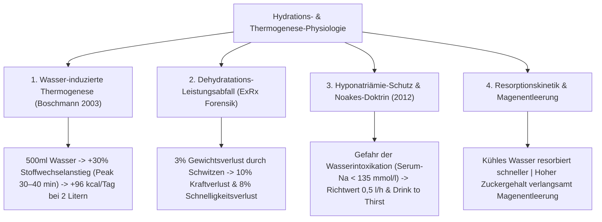

#### 1. Wasser-induzierte Thermogenese (*Boschmann et al. 2003, JCEM*):
* **Studienergebnis:** Das Trinken von $500\text{ ml}$ Wasser steigerte den Energieumsatz bei gesunden, normalgewichtigen Probanden um **$+30\,\%$**.
* **Kinetik:** Der Anstieg setzte nach $10\text{ Minuten}$ ein und erreichte sein Maximum nach $30\text{--}40\text{ Minuten}$.
* **Biochemischer Mechanismus:** $\sim 40\,\%$ des thermogenen Effekts entstehen durch die Erwärmung des Wassers von Raumtemperatur ($22^\circ\text{C}$) auf Körperkerntemperatur ($37^\circ\text{C}$), während der Rest durch sympathische Aktivierung vermittelt wird.
* **Metabolische Bilanz:**
  $$\text{Thermogene Antwort} \approx 24\text{ kcal pro } 500\text{ ml Wasser} \implies \mathbf{+96\text{ kcal/Tag bei 2 Litern Wasserzufuhr!}}$$

#### 2. Leistungseinbußen durch Dehydratation:
* Bereits ein Flüssigkeitsverlust von **$3\,\%$ des Körpergewichts** ($\approx 2,3\text{ kg}$ bei $76,5\text{ kg}$) induziert:
  * **$-10\,\%$ Verlust an Maximalkraft und Kraftausdauer**.
  * **$-8\,\%$ Verlust an Sprint- und Reaktionsschnelligkeit**.

#### 3. Hyponatriämie-Gefahr & Wasserintoxikation (*Water Intoxication*):
* **Pathologie:** Übermäßiges Trinken von reinem, elektrolytfreiem Wasser ohne adäquate renale Ausscheidung verdünnt das Serum-Natrium ($< 135\text{ mmol/l}$).
* **Symptome:** Übelkeit, Kopfschmerzen, Desorientierung, Muskelkrämpfe, zerebrale Ödeme, Koma und im Extremfall Tod (dokumentierte Todesfälle bei Marathonläufen).
* **Prävention:** Einhaltung des Noakes-Standards von $\sim 0,5\text{ Liter/Stunde}$ bei Hitze/Märschen und Elektrolytsubstitution bei schweißtreibenden Belastungen $> 90\text{ Minuten}$.

#### 4. Resorptionskinetik & Magenentleerung:
* **Kühles/kaltes Wasser ($10\text{--}15^\circ\text{C}$)** verlässt den Magen signifikant schneller und wird rascher im Dünndarm resorbiert als warmes Wasser.
* **Zuckergehalt:** Hyperosmolare Getränke mit hohem Zuckergehalt ($> 8\,\%$) hemmen die Magenentleerungsrate (*Gastric Emptying*) und führen zu Völlegefühl und Sodbrennen (LPR-Risiko).

---

## 14. Psychologie des Essverhaltens & Das BLS Free-Meal-Protokoll (Michael Matthews)

> [!NOTE] DOKTRIN DER VERHALTENSÄNDERUNG & PSYCHOLOGISCHEN ERHOLUNG
> - **Realistisches Tempo (FGÖ & BLS):** Maximal **$0,5\text{--}1,0\,\%\ \text{BW}$ Verlust pro Woche** ($0,4\text{--}0,8\text{ kg}$). Schnellere Crash-Diäten ruinieren den Grundumsatz ($T_3$/Leptin-Crash) und erzwingen den Jo-Jo-Effekt.
> - **Verzicht auf rigide Verbote:** Strenge Verbote erzeugen Verlangen und das Gefühl des „Versagens“ bei kleinsten Abweichungen. Flexibles 90/10-Prinzip schützt vor Essanfällen.
> - **Umgebungs-Steuerung:** Feste Essenszeiten, niemals hungrig einkaufen gehen, strukturierte Einkaufsliste, kein Essen nebenbei am Bildschirm (Mindful Eating).
> - **Taillenumfang als Risikomaß (Kardiovaskuläres Screening):**
>   - Männer: **$\ge 94\text{ cm}$** $\to$ erhöhtes Krankheitsrisiko | **$\ge 102\text{ cm}$** $\to$ deutlich erhöhtes Krankheitsrisiko (Apfeltyp/viszerales Fett).

### Das kontrollierte BLS Free-Meal-Protokoll (Michael Matthews):

Um mentale Diät-Ermüdung zu brechen, ohne den Fettabbau zu torpedieren:
1. **Maximal 1 freie Mahlzeit pro Woche:** Bevorzugt am Wochenende (z. B. Samstagabend nach dem schweren Beintraining oder langen Lauf).
2. **Kein „Cheat Day“:** Eine einzelne freie Mahlzeit, **niemals ein 24-stündiger Fressanfall** (ein unkontrollierter Cheat Day mit 5.000 kcal kann das Defizit einer gesamten Woche auslöschen!).
3. **Protein-Pflicht zuerst:** Vor der freien Mahlzeit muss das Tagesziel an Protein ($\sim 160\text{ g}$) bereits zu mindestens $75\,\%$ durch magere Quellen gedeckt sein.
4. **Fettkontrolle bei Carbs:** Wenn die freie Mahlzeit reich an Kohlenhydraten ist (Pasta, Pizza, Sushi), halte zusätzliches Fett so niedrig wie möglich, um Fetteinlagerung unter hohen Insulinspiegeln zu minimieren.

---

## 15. Anabolic Volume Eating & Low-Calorie-Density-Doktrin (Greg Doucette)

> [!NOTE] CHEF GREG DOUCETTE: EAT MORE FOOD, WEIGH LESS
> Das fundamentale Prinzip für dauerhaft niedrigen Körperfettante ($7\text{--}9\,\%\ \text{KFA}$) ohne Heißhunger und ohne quälende Diät-Müdigkeit ist **Low-Calorie-Density (LCD)** kombiniert mit maximaler Proteindichte:
> 1. **Physiologie der Magen-Dehnungsrezeptoren (*Gastric Stretch Receptors*):** Das Gehirn registriert Sättigung primär über das **physische Volumen** und Gewicht der Nahrung im Magen, nicht über die Kalorienzahl.
> 2. **Die $10\text{g}$-Protein-pro-$100\text{ kcal}$-Regel:** Jede anabole Hauptmahlzeit strebt mindestens $10\text{ g}$ Protein pro $100\text{ kcal}$ an, um zelluläre Sättigung und Muskelerhalt zu maximieren.

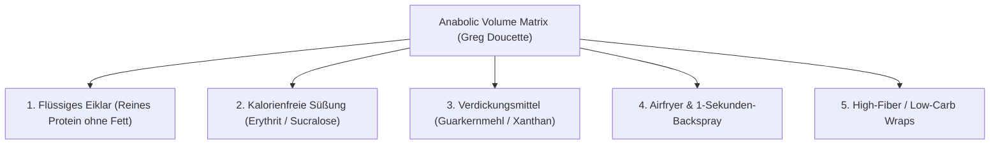

### Die 5 Kern-Swaps von Chef Greg Doucette:

| HERKÖMMLICHE KALORIENFALLE | ANABOLER GREG-DOUCETTE-SWAP | KALORIEN- & VOLUMENVORTEIL |
| :--- | :--- | :--- |
| **Ganze Eier (3x = 210 kcal / 18g P / 15g F)** | **1 Vollei + 150ml flüssiges Eiklar (140 kcal / 24g P / 5g F)** | $+33\,\%$ mehr Protein, $-33\,\%$ weniger Kalorien, doppeltes Rührei-Volumen! |
| **Haushaltszucker / Honig / Dicksaft** | **Erythrit / Sucralose / zuckerfreier Sirup** | $0\text{ kcal}$ statt Blutzucker- und Insulinspitzen; beseitigt Food-Coma. |
| **Speiseöl in die Pfanne gießen (15–30g = 130–260 kcal)** | **1-Sekunden-Backspray / Airfryer-Heißluft** | Spart bis zu $200\text{ kcal}$ unsichtbares Fett pro Mahlzeit. |
| **Schwere Weizen-Tortillas / Pizzateig** | **High-Fiber Dinkel- / Vollkorn-Wraps** | Halbe Kalorienmenge bei doppeltem Ballaststoffgehalt (schützt Bristol-Typ 4). |
| **Dünne Protein-Shakes (in 10s getrunken)** | **Anabolic Fluff (mit 1g Guarkernmehl aufgeschlagen)** | $4\times$ größeres Schüssel-Volumen; löffelbares Mousse sättigt 3–4 Stunden. |

---

## 16. Erfolgskontrolle: Bristol-Skala & Reflux-Indikatoren

1. **Bristol-Stuhlformen-Skala:** Dein täglicher Stuhlgang muss konstant **Typ 4 (weich, glatt, wurstförmig)** entsprechen.
2. **Rachen- & Lungenschleim (LPR-Kontrolle):** Rückgang von Heiserkeit und Räuspern belegt Reflux-Freiheit.
3. **Vormittags-Wachheit:** Ausbleiben von Sekundenschlaf am Schreibtisch nach dem Frühstück.

---

## 17. Stuben-Küchengeräte, Hardware-Architektur & Ausstattungs-Inventar

> [!NOTE] DAS KASERNEN-KÜCHEN-ÖKOSYSTEM & HARDWARE-RESTRIKTIONEN
> Zur unabhängigen, kostengünstigen ($< 2,00\text{ €/Mahlzeit}$) und refluxsicheren Zubereitung auf Stube ist dein Setup exakt auf folgende vorhandene Ausrüstung beschränkt.
> **AI-Restriktionsdoktrin:** Alle generierten Rezepte, Einkaufslisten und Mahlzeitenpläne dürfen ausschließlich die hier gelisteten Geräte voraussetzen. Backöfen, Mikrowellen, Geschirrspüler oder stationäre Herde sind für die Stuben-Verpflegung strikt ausgeschlossen.

### A. Elektrische Zubereitungsgeräte (Available & Owned)

| Gerät / Hardware | Technische Spezifikation | Primärer Einsatzzweck & Zubereitungs-Nutzen |
| :--- | :--- | :--- |
| **1. Glas-Wasserkocher** | 1,7 Liter, Edelstahl-Heizelement & LED-Beleuchtung | **Blitz-Carb & Rehydrierungs-Station:** - Erhitzt Wasser in 90 Sek. für *Blitz-Couscous (5 Min. Ziehzeit ohne Herd)*. - Vorbrühen von roten Linsen & Haferflocken (verkürzt Kochzeit um 50 %). - ACBT-Morgenhydrierung & Zubereitung refluxsicherer Tees. |
| **2. AEG Standmixer (MiniMixer SB4-1-4ST)** | 350 W Leistung, 23.000 U/Min, 4-Klingen-Edelstahlmesser, Pulse-Taste, inkl. 2x 600 ml spülmaschinenfeste BPA-freie Tritan-Trinkflaschen | **Protein- & Pre-Workout-Blender:** - Cremige Zerkleinerung von Magerquark, Haferflocken und TK-Beeren. - Schnelle Herstellung von Rote-Bete-Nitrat-Shakes für den VO2-Max-Schub vor Laufeinheiten. |
| **3. AirFryer (Heißluftfritteuse)** | Heißluft-Konvektion (bis 200 °C) | **Fettfreies Power-Rösten:** - Gnocchi, Kartoffel-Wedges, Kichererbsen, Tuna-Melts & Vollkorn-Wraps ohne Speiseölzusatz (spart 15–25 g Fett pro Mahlzeit). |
| **4. Ceran-/Induktions-Kochfeld** | Mobile Stuben-Herdplatte (1-flammig / 2-flammig) | **Eintopf-, Dal- & Pfannen-Station:** - Gleichmäßiges Köcheln von proteinreichen Linsen-Dals, Currys, Shakshuka und Rührei. |

### B. Kochgeschirr & Vorbereitung (Cookware & Bakeware)

* **11-teiliges Edelstahl-Kochgeschirr-Set:**
  * 1x Bratpfanne ($20 \times 5,0\text{ cm}$, Antihaftbeschichtung – für Rührei, Omelettes, Tuna-Patties)
  * 1x Bratpfanne ($24 \times 5,0\text{ cm}$, Antihaftbeschichtung – für Pfannengerichte & Gemüse-Stir-Frys)
  * 1x Kasserolle offen ($14 \times 6,8\text{ cm}$)
  * 1x Kasserolle mit Deckel ($16 \times 7,85\text{ cm}$, $1,4\text{ l}$ – für Linsen-Portionen & Couscous)
  * 1x Kasserolle mit Deckel ($20 \times 9,7\text{ cm}$, $2,9\text{ l}$ – für Suppen & Dals)
  * 1x Kasserolle mit Deckel ($24 \times 11,0\text{ cm}$, $4,7\text{ l}$ – für Meal-Prep & Großportionen)
  * 1x Kasserolle offen & flach ($20 \times 7,7\text{ cm}$, $2,2\text{ l}$)
  * 1x Dampftopf / Dämpfeinsatz ($20 \times 9,5\text{ cm}$ – für schonendes Dämpfen von Brokkoli, Zucchini und Karotten)
* **Glasschale:** Durchmesser $23\text{ cm}$, spülmaschinengeeignet (für Anabolic Volume Salads & Quark-Beeren-Bowls)

### C. Präzisions-Messwerkzeuge, Besteck & Gewürze

* **Vitafit Digitale Küchenwaage:** Messbereich bis $15\text{ kg}$, $1\text{ g}$ Messgenauigkeit, Tara-Zuwiegefunktion, $215 \times 180\text{ mm}$, schwarz (Zwingende Basis für die Open Food Facts & NutriVault-Doktrin zur grammgenauen Makroerfassung).
* **Westmark Gewürzmühlen-Set:** Hochwertiges Keramikmahlwerk für Meersalz und schwarzen Pfeffer.
* **Edelstahl-Besteck-Set:** 2x Gabeln, 2x Esslöffel, 2x Teelöffel, 2x Buttermesser.

---

## 18. Verknüpfte Akten

* [[G | Gesundheit]] - Master Dashboard: Gesamte Vital- und Reha-Akte
* [[Supplements]] - Zirkadianes Einnahmeprotokoll (Rhodiola, Magnesium, D3+K2, Omega-3)
* [[Schlafapnoe Diagnostik und Facharzt]] - OSAS-Facharzttermine (15./16.09.2026)
* [[Trainingsplan]] - 80/20 Ausdauer & Rumpf-Reha
* [[Morgenroutine]] - ACBT-Atmung & Reflux-Schutz
* [[Hardware Triade Homelab]] - Technisches Homelab- & Geräte-Ökosystem

---

# Die ExRx Kasernen-Rezept-Bibliothek (14 Standard-Rezepte unter 2,00 € & 10–15 Min.)

> [!NOTE] EXRX.NET MEAL LIBRARY 3D-TAXONOMIE & KASERNEN-DOKTRIN
> Alle Rezepte sind nach der 3-dimensionalen **ExRx.net Food Library Taxonomie** klassifiziert:
> 1. **Type (Hauptzutat / Proteinquelle):** *Beans, Lentils, Peas* (Hülsenfrüchte), *Chicken* (Geflügel), *Dairy* (Milch/Quark), *Eggs* (Eier/Eiklar), *Fish & Seafood* (Fisch), *Grains & Cereals* (Getreide/Stärke), *Beef/Pork* (Magerfleisch).
> 2. **Cuisine (Länderküche):** *Asian* (Asiatisch), *Indian* (Indisch), *Italian* (Italienisch), *Mexican* (Mexikanisch), *Mediterranean / European*.
> 3. **Category (Mahlzeitenart):** *Soups & Stews* (Eintöpfe/Dals), *Sandwiches & Wraps*, *Salads & Volume Bowls*, *Desserts & Sweet Breakfast*.
> - **Stuben-Hardware:** AirFryer (Heißluftfritteuse), 1,7L Glas-Wasserkocher mit Edelstahl-Heizelement, Herdplatte.
> - **Budget & Tempo:** Garantiert unter **2,00 € pro Mahlzeit** (PENNY), **10–15 Min. Zubereitung**, **$160\text{ g}$ Tages-Protein gesichert**!
> - **NutriVault-Integration:** Alle Rezepte können im **NutriVault-Plugin** mit einem Klick in den Tagesplan geloggt werden.

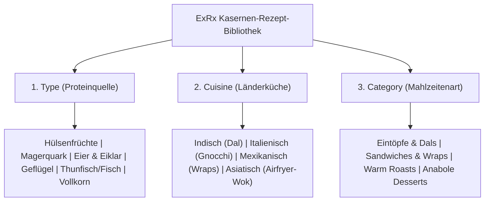

---

### ExRx Matrix-Überblick der 14 Kasernen-Mahlzeiten:

| NR. | REZEPT-NAME | EXRX TYPE | EXRX CUISINE | EXRX CATEGORY | HARDWARE | DAUER & KOSTEN | MAKROS & PROTEIN |
| :---: | :--- | :--- | :--- | :--- | :--- | :---: | :---: |
| **1** | **AirFryer-Gnocchi mit Gemüse** | Grains & Veg | Italian | Warm Roast | AirFryer | 12 Min. / 1,50 € | 850 kcal / **22g P** |
| **2** | **Protein-Rührei mit Schinken & Brot** | Eggs, Pork & Grains | Central European | Sandwich/Breakfast | Herdplatte | 5 Min. / 1,65 € | 580 kcal / **38g P** |
| **3** | **Ofen-Kumpir (Riesen-Kartoffel)** | Starchy Veg & Dairy | Mediterranean | Warm Roast | AirFryer | 25 Min. / 1,30 € | 510 kcal / **25g P** |
| **4** | **Blitz-Couscous-Pfanne mit Feta** | Grains & Dairy | Mediterranean | Stew / Pan | Wasserkocher | 8 Min. / 1,60 € | 550 kcal / **25g P** |
| **5** | **Mexikanische Hähnchen-Wraps** | Chicken & Grains | Mexican | Sandwiches & Wraps | AirFryer | 15 Min. / 1,85 € | 540 kcal / **35g P** |
| **6** | **AirFryer Tuna-Melt Toasties** | Fish, Dairy & Grains | American | Sandwiches | AirFryer | 8 Min. / 1,94 € | 520 kcal / **45g P** |
| **7** | **Paprika-Kichererbsen mit Quark** | Beans/Peas & Dairy | Mediterranean | High-Fiber Bowl | AirFryer | 15 Min. / 1,44 € | 480 kcal / **30g P** |
| **8** | **Stuben-Shakshuka mit Linsen & Eiern** | Lentils & Eggs | Middle Eastern | Soups & Stews | Herdplatte | 12 Min. / 1,38 € | 490 kcal / **36g P** |
| **9** | **Hähnchen-Kartoffel Wedges** | Chicken & Starchy Veg | European | Warm Roast | AirFryer | 20 Min. / 1,70 € | 460 kcal / **35g P** |
| **10** | **Baked-Protein-Oatmeal** | Grains & Eggs / Whey | International | Sweet Breakfast | AirFryer | 12 Min. / 1,19 € | 510 kcal / **38g P** |
| **11** | **Anabolic French Toast** | Eggs (Eiklar) & Grains | American | Desserts / Sweet | AirFryer | 10 Min. / 1,35 € | 380 kcal / **38g P** |
| **12** | **Anabolic Berry Fluff Mousse** | Dairy & Fruits | Modern Volume | Desserts & Snacks | Shaker/Mixer | 5 Min. / 1,20 € | 260 kcal / **35g P** |
| **13** | **Asiatische AirFryer Teriyaki-Pfanne** | Chicken/Tofu & Veg | Asian | Warm Stir-Fry | AirFryer | 12 Min. / 1,75 € | 440 kcal / **38g P** |
| **14** | **15-Minuten Kasernen-Power-Dal** | Beans, Lentils & Grains | Indian | Soups & Stews | Wasserkocher/Topf | 12 Min. / 2,40 € | 1.732 kcal / **83g P** |

---

## 1. AirFryer-Gnocchi mit Gemüse („Knusper-Pfanne“)
* `[Type: Grains & Non-Starchy Veg]` | `[Cuisine: Italian]` | `[Category: Warm Roast]` | `[Hardware: AirFryer]`
* **Zutaten:** 500g Gnocchi Kühlregal (~0,99 €), 150g TK-Gemüsemischung (~0,50 €), 1–2 EL Olivenöl, Gewürze.
* **Zubereitung:** Alles in einer Schüssel mischen $\rightarrow$ 190°C für 12–15 Min. in den AirFryer.
* **Preis:** ~1,50 € | **Sättigung:** Extrem hoch (500g Gnocchi) | **Makros:** ~850 kcal | 22g Protein.

---

## 2. Protein-Rührei mit Schinken & Vollkornbrot
* `[Type: Eggs, Pork Mager & Grains]` | `[Cuisine: Central European]` | `[Category: Sandwiches / Breakfast]` | `[Hardware: Herdplatte]`
* **Zutaten:** 4 Eier (~0,80 €), 50g Schinkenwürfel mager (~0,50 €), 3 dicke Scheiben Vollkornbrot (~0,35 €).
* **Zubereitung:** Schinken anbraten $\rightarrow$ 4 Eier stocken lassen $\rightarrow$ auf Vollkornbrot servieren.
* **Preis:** ~1,65 € | **Dauer:** 5 Min. | **Protein:** ~36–40g | **Makros:** ~580 kcal.

---

## 3. Ofen-Kumpir (Gefüllte Riesen-Kartoffeln)
* `[Type: Starchy Veg & Dairy]` | `[Cuisine: Mediterranean / Turkish]` | `[Category: Warm Roast]` | `[Hardware: AirFryer]`
* **Zutaten:** 2 große Kartoffeln (~0,40 €), 3 EL Reibekäse (~0,40 €), 4 gehäufte EL Kräuterquark (~0,50 €).
* **Zubereitung:** Kartoffeln anstechen $\rightarrow$ AirFryer 200°C für 25–30 Min. $\rightarrow$ aufschneiden, füllen.
* **Preis:** ~1,30 € | **Sättigung:** Höchster Sättigungsindex | **Makros:** ~510 kcal | 25g Protein.

---

## 4. Blitz-Couscous-Pfanne mit Feta
* `[Type: Grains & Dairy]` | `[Cuisine: Mediterranean]` | `[Category: Soups & Quick Pans]` | `[Hardware: Wasserkocher & Herdplatte]`
* **Zutaten:** 120g Couscous (~0,40 €), 1 Dose gestückelte Tomaten (~0,70 €), 50g Feta (~0,50 €).
* **Zubereitung:** Couscous mit kochendem Wasser 5 Min. quellen lassen $\rightarrow$ Tomaten in der Pfanne erhitzen $\rightarrow$ Couscous & Feta unterrühren.
* **Preis:** ~1,60 € | **Dauer:** 8 Min. | **Makros:** ~550 kcal | 25g Protein.

---

## 5. Mexikanische Knusper-Hähnchen-Wraps aus dem AirFryer
* `[Type: Chicken & High-Fiber Grains]` | `[Cuisine: Mexican]` | `[Category: Sandwiches & Wraps]` | `[Hardware: AirFryer]`
* **Zutaten:** 2 High-Fiber Wraps (~0,50 €), 100g Hähnchenbrustfilet (~1,00 €), 2 EL Magerquark/Salsa (~0,20 €), Salat & Gurke.
* **Zubereitung:** Hähnchen im AirFryer bei 180°C für 10 Min. garen $\rightarrow$ Wraps füllen $\rightarrow$ 2 Min. knusprig backen.
* **Preis:** ~1,85 € | **Dauer:** 15 Min. | **Makros:** ~540 kcal | 35g Protein.

---

## 6. AirFryer Tuna-Melt Toasties
* `[Type: Fish & Seafood, Dairy, Grains]` | `[Cuisine: American]` | `[Category: Sandwiches]` | `[Hardware: AirFryer]`
* **Zutaten:** 3 Scheiben Vollkornbrot (~0,35 €), 1 Dose Thunfisch im eigenen Saft (~1,19 €), 2 EL Mais (~0,15 €), 30g Reibekäse light (~0,25 €).
* **Zubereitung:** Thunfisch mit Mais vermengen $\rightarrow$ auf Brot verteilen $\rightarrow$ Käse darüber $\rightarrow$ AirFryer 185°C für 6–8 Min.
* **Preis:** ~1,94 € | **Dauer:** 8 Min. | **Protein:** ~45g | **Makros:** ~520 kcal.

---

## 7. Knusprige Paprika-Kichererbsen mit Kräuterquark
* `[Type: Beans & Peas, Dairy]` | `[Cuisine: Mediterranean]` | `[Category: High-Fiber Snack & Salads]` | `[Hardware: AirFryer]`
* **Zutaten:** 1 Dose Kichererbsen (240g Abtropfgewicht, ~0,69 €), 1 EL Olivenöl (~0,10 €), Paprikapulver & Salz, 150g Kräuterquark (~0,65 €).
* **Zubereitung:** Kichererbsen abspülen, mit Öl & Gewürzen marinieren $\rightarrow$ AirFryer 195°C für 12–15 Min. rösten $\rightarrow$ in Kräuterquark dippen.
* **Preis:** ~1,44 € | **Dauer:** 15 Min. | **Protein:** ~30g | **Makros:** ~480 kcal.

---

## 8. Stuben-Shakshuka mit roten Linsen & 3 Eiern
* `[Type: Lentils & Eggs]` | `[Cuisine: Middle Eastern / Mediterranean]` | `[Category: Soups & Stews]` | `[Hardware: Herdplatte]`
* **Zutaten:** 80g Rote Linsen (~0,25 €), 200g Pizzatomaten (~0,33 €), 3 Eier (~0,65 €), Zwiebel & Gewürze (~0,15 €).
* **Zubereitung:** Linsen mit Tomatensauce 8 Min. köcheln $\rightarrow$ 3 Eier hineinschlagen $\rightarrow$ stocken lassen.
* **Preis:** ~1,38 € | **Dauer:** 12 Min. | **Protein:** ~36g | **Makros:** ~490 kcal.

---

## 9. AirFryer Hähnchen-Kartoffel Wedges
* `[Type: Chicken & Starchy Veg]` | `[Cuisine: Classic European]` | `[Category: Warm Roast]` | `[Hardware: AirFryer]`
* **Zutaten:** 300g Kartoffeln (~0,35 €), 120g Hähnchenbrustfilet (~1,20 €), 1 EL Olivenöl + Pommes-Gewürz (~0,15 €).
* **Zubereitung:** Kartoffeln vierteln, Hähnchen würfeln $\rightarrow$ marinieren $\rightarrow$ AirFryer 190°C für 18–20 Min. backen.
* **Preis:** ~1,70 € | **Dauer:** 20 Min. | **Protein:** ~35g | **Makros:** ~460 kcal.

---

## 10. Warmes Baked-Protein-Oatmeal aus dem AirFryer
* `[Type: Grains & Eggs / Whey]` | `[Cuisine: International]` | `[Category: Desserts & Sweet Breakfast]` | `[Hardware: AirFryer]`
* **Zutaten:** 80g Haferflocken (~0,12 €), 1 Ei (~0,22 €), 80g TK-Beeren (~0,25 €), 20g Whey Protein (~0,60 €), Wasser/Milch.
* **Zubereitung:** Alles in einer kleinen ofenfesten Form verrühren $\rightarrow$ AirFryer 175°C für 10–12 Min. wie einen Kuchen backen.
* **Preis:** ~1,19 € | **Dauer:** 12 Min. | **Protein:** ~38g | **Makros:** ~510 kcal.

---

## 11. Anabolic French Toast (Greg Doucette Signature-Klassiker)
* `[Type: Eggs / Eiklar & Grains]` | `[Cuisine: American]` | `[Category: Desserts & Sweet Meals]` | `[Hardware: AirFryer]`
* **Zutaten:** 3 Scheiben Vollkorn- oder Dinkel-Toastbrot (~0,35 €), 150ml flüssiges Eiklar (~0,65 €), Zimt & Süßstoff (Erythrit/Sucralose), 100g Magerquark als Topping (~0,35 €).
* **Zubereitung:** Eiklar mit Zimt & Süßstoff verquirlen $\rightarrow$ Brotscheiben darin tränken, bis sie vollgesaugt sind $\rightarrow$ AirFryer 185°C für 6–8 Min. goldbraun backen $\rightarrow$ mit Magerquark-Creme bestreichen.
* **Preis:** ~1,35 € | **Dauer:** 10 Min. | **Protein:** ~38g | **Makros:** ~380 kcal | **Volumen:** Enorm hoch, befriedigt Süßhunger ohne Rebound!

---

## 12. Anabolic Berry Fluff / Protein-Volumen-Mousse
* `[Type: Dairy / Whey & Fruits]` | `[Cuisine: Modern Volume]` | `[Category: Desserts & Volume Snacks]` | `[Hardware: Shaker / Mixer]`
* **Zutaten:** 150g tiefgekühlte Beeren (~0,50 €), 150g Magerquark oder 25g Casein/Whey (~0,65 €), 1 Messerspitze Guarkernmehl oder Xanthan Gum (~0,05 €), 50ml kaltes Wasser.
* **Zubereitung:** Beeren kurz anpürieren $\rightarrow$ Quark/Protein, Süßstoff und Guarkernmehl zugeben $\rightarrow$ mit Quirl auf höchster Stufe 3–4 Min. schaumig schlagen, bis sich das Volumen vervierfacht.
* **Preis:** ~1,20 € | **Dauer:** 5 Min. | **Protein:** ~35g | **Makros:** ~260 kcal | **Volumen:** Riesige Salatschüssel voll cremigem Dessert.

---

## 13. Asiatische AirFryer Teriyaki Hähnchen- / Tofu-Gemüse-Pfanne
* `[Type: Chicken / Tofu & Non-Starchy Veg]` | `[Cuisine: Asian]` | `[Category: Warm Stir-Fry]` | `[Hardware: AirFryer & Wasserkocher]`
* **Zutaten:** 120g Hähnchenbrustfilet oder Räuchertofu (~1,20 €), 200g TK-Asia-Gemüse (Pak Choi, Bohnen, Karotten, ~0,55 €), 1 EL Sojasauce light + 1 TL Honig/Erythrit (~0,10 €).
* **Zubereitung:** Hähnchen/Tofu würfeln, mit Sojasauce marinieren $\rightarrow$ mit dem Gemüse vermengen $\rightarrow$ AirFryer 185°C für 12 Min. unter einmaligem Schütteln garen. Dazu optional 50g Blitz-Reisnudeln.
* **Preis:** ~1,75 € | **Dauer:** 12 Min. | **Protein:** ~38g | **Makros:** ~440 kcal.

---

## 14. 15-Minuten Kasernen-Power-Dal (Kokos-Erdnuss-Linsen & Kichererbsen mit Blitz-Couscous)
* `[Type: Beans & Lentils, Grains]` | `[Cuisine: Indian]` | `[Category: Soups & Stews]` | `[Hardware: Wasserkocher & Topf]`
* **Zutaten & EAN-Barcodes:**
  * **150g Rote Linsen** (dmBio / Standard) $\implies$ 501 kcal | 36,0g P | 81,0g C | 3,1g F
  * **265g Kichererbsen Abtropfgewicht** (Greenland / PENNY, EAN: `26358741`) $\implies$ 337 kcal | 19,3g P | 42,4g C | 5,8g F (18,8g Ballaststoffe!)
  * **120g Bio Hartweizen Couscous** (Natur Gut / PENNY, EAN: `25794120`) $\implies$ 419 kcal | 14,4g P | 84,0g C | 1,8g F
  * **188ml Kokosmilch fettreduziert light** (Asia Green Garden / ALDI, EAN: `4061458070461`) $\implies$ 227 kcal | 1,3g P | 2,6g C | 22,6g F
  * **250g Passierte Tomaten** (San Fabio / PENNY, EAN: `22559142`) $\implies$ 68 kcal | 4,5g P | 9,5g C | 1,3g F
  * **30g Erdnussbutter Creamy** (Mike Mitchell's / Freshona, EAN: `20166076`) $\implies$ 180 kcal | 7,5g P | 5,4g C | 15,0g F
* **Zubereitung (12–15 Min.):**
  1. *Wasserkocher:* Wasser aufkochen. 120g Couscous mit 150ml kochendem Salzwasser übergießen, abdecken, 5 Min. ziehen lassen $\rightarrow$ fertig!
  2. *Topf:* 150g rote Linsen mit 350ml kochendem Wasser 5 Min. köcheln lassen.
  3. *Dal-Sauce:* Passierte Tomaten, Kokosmilch, Kichererbsen und 1 EL Erdnussbutter einrühren. Mit Salz, Pfeffer & Curry würzen. 3–4 Min. sämig einköcheln lassen.
* **Preis:** ~2,40 € | **Dauer:** 12 Min. | **Protein:** **~83,0g** | **Makros:** **~1.732 kcal** | **Sättigung:** Extrem langanhaltend, perfekter Bristol-Typ-4 Ballaststoffschub.

---

# Supplements: Zirkadianes Wirkstoff- & Nährstoff-Protokoll

> [!NOTE] STA-Verortung
> - **Source (S):** Zirkadiane Chronobiologie, Neurotransmitter-Syntheseketten (L-Tyrosin/Dopamin), Sportkardiologische Vasodilatationsforschung ($\text{NO}_3^-$ Nitrat).
> - **Topic (T):** [[G | Gesundheit]], [[Morgenroutine]], [[Trainingsplan]], [[G | Bundeswehr]].
> - **Argument / Synthese (A):** Durch die präzise zeitliche Taktung evidenzbasierter Wirkstoffe entlang des 24-Stunden-Rhythmus werden morgendliche Trägheit, ADHS-Konzentrationsschwankungen, intramuskuläre Übersäuerung und nächtliche Schlafarchitektur ohne gastrointestinale Nebenwirkungen optimiert.

---

## 1. Der Zirkadiane Einnahmeplan

| UHRZEIT | WIRKSTOFF / SUPPLEMENT | PHARMAKOLOGISCHER MECHANISMUS | SPEZIFISCHER NUTZEN |
| :--- | :--- | :--- | :--- |
| 06:00 Uhr | Rhodiola Rosea (Rosenwurz) (30 Min. vor dem Frühstück) | Moduliert Dopamin & Serotonin im ZNS (Adaptogen) | Bekämpft morgendliche Trägheit; schärft Fokus vor Dienstbeginn |
| 06:30 Uhr | Magnesium-Malat (elementar, zum Frühstück) | Malat (Apfelsäure) ist Substrat des mitochondrialen Citratzyklus | Liefert zelluläre ATP-Energie; magenschonend (kein Sodbrennen) |
| 08:00 Uhr | Beta-Alanin (Dosis 1/4) | Vorstufe von Carnosin; | Puffert Protonen (H+-Ionen); |
| 12:00 Uhr | Beta-Alanin (Dosis 2/4) | zögert Muskelübersäuerung | steigert Kraftausdauer & BFT- |
| 16:00 Uhr | Beta-Alanin (Dosis 3/4) | bei hochintensiver Belastung hinaus | Leistung ohne Parästhesien |
| 20:00 Uhr | Beta-Alanin (Dosis 4/4) |  |  |
| 11:45 Uhr | Vitamin D3 + K2 (MK-7) (zum Mittagessen mit Fett) | D3 steigert Calciumresorption; K2 lenkt Calcium in die Knochen | Fördert Gewebeheilung nach OP, Immunsystem & Knochendichte |
| 16:00 Uhr | Rote-Bete-Saft-Konzentrat (140 ml, 2h vor Training) | Anorganisches Nitrat (NO3-) wird zu Stickstoffmonoxid (NO) | Weitet Blutgefäße (Vasodilation); senkt Sauerstoffkosten bei VO2max |
| 16:45 Uhr | Omega-3-Fettsäuren (zum Abendessen) | Hoher EPA/DHA-Gehalt in Triglycerid- Form; entzündungshemmend | Membranfluidität im Gehirn; unterstützt Dopaminrezeptoren |
| 21:00 Uhr | Magnesium-Bisglycinat (1 Std. vor Nachtruhe) | Glycin bindet als hemmender Neurotransmitter am NMDA-Rezeptor | ZNS-Wind-Down, tiefer REM- & Delta-Schlaf ohne Laxanswirkung |

---

## 2. Dopamin-Synthese & Kofaktoren für AuDHD-Fokus

Zur nachhaltigen Linderung von ADHS-Symptomen und Überwindung von Starthemmung (Task Paralysis) benötigt das Gehirn die Bausteine der Katecholamin-Synthese:

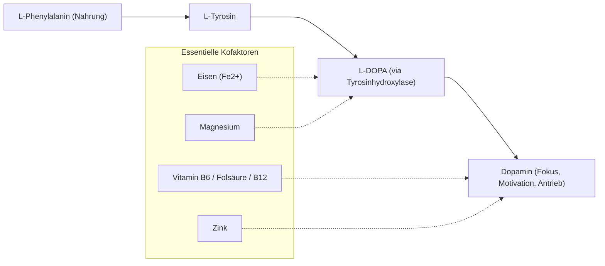

---

## 3. Stickstoffmonoxid-Booster für die $\text{VO}_2\text{max}$

* **Wirkstoff:** Anorganisches Nitrat ($\text{NO}_3^-$) aus $140\text{ ml}$ konzentriertem Rote-Bete-Saft.
* **Mechanismus:** Über den enterosalivaren Nitrat-Nitrit-NO-Weg wird Stickstoffmonoxid gebildet. Dies reduziert den Sauerstoffverbrauch der mitochondrialen Atmungskette bei gegebener Laufgeschwindigkeit.
* **Timing:** Exakt **16:00 Uhr** (ca. 120 Minuten vor dem Sport- oder Marschfenster).

---

## 4. Magnesium-Differenzierung nach Tageszeit

> [!TIP] Die richtige Magnesium-Form zur richtigen Zeit
> 1. **Morgens (06:30 Uhr):** **Magnesium-Malat** $\rightarrow$ Energiegewinnung über Apfelsäure, nicht sedierend, optimal magenverträglich.
> 2. **Abends (21:00 Uhr):** **Magnesium-Bisglycinat** $\rightarrow$ An die Aminosäure Glycin gebunden; passiert die Blut-Hirn-Schranke, wirkt neurosedierend und verursacht im Gegensatz zu Magnesiumoxid oder -citrat **keinen weichen Durchfallstuhl**.

---

## 5. Verknüpfte Akten

* [[G | Gesundheit]] - Master Dashboard: Gesamte Vital- und Reha-Akte
* [[Morgenroutine]] - Einnahme-Slots 06:00 & 06:30 Uhr
* [[Trainingsplan]] - Polarisiertes Training & Leistungssteuerung
