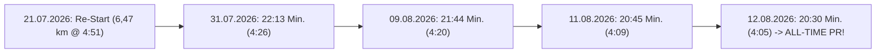

# Laufprotokoll: Strava-Aktivitäten & Ausdauer-Leistungshistorie

> [!NOTE] STA-Verortung
> - **Source (S):** Strava- & Apple-Watch-GPS-Aktivitätsdaten (Parris-Campbell Nkembi, Februar 2025 bis August 2026, Standorte: Bad Reichenhall & Celle).
> - **Topic (T):** [[G | Gesundheit]], [[Trainingsplan]], [[G | Bundeswehr]], [[Morgenroutine]].
> - **Argument / Synthese (A):** Die lückenlose Aktivitätskette dokumentiert den erfolgreichen Wiederaufbau von den ersten postoperativen Spaziergängen an der Saalach (Februar 2025) über den strukturierten Wiedereinstieg (Juli 2026) bis zur aktuellen All-Time-Bestzeit von 4:05 min/km über 5 km (12.08.2026). Das 25-Minuten-Gebirgsjäger-Ziel wurde damit dauerhaft pulverisiert.

---

## 1. Vollständige Chronologie aller dokumentierten Aktivitäten

### Phase 1: Postoperative Frühmobilität (Februar 2025 – Bad Reichenhall / Saalach)

| DATUM & UHRZEIT | TITEL | GERÄT / QUELLE | DISTANZ | SCHRITTE | ZEIT | PACE |
| :--- | :--- | :--- | :--- | :--- | :--- | :--- |
| 20.02.2025 (16:44 Uhr) | Spaziergang Nachmittag | Apple Watch Series 8 | 2,20 km | 2.860 | 28:09 min | 12:47 |
| 21.02.2025 (19:16 Uhr) | Abendspaziergang | Apple Watch Series 8 | 2,05 km | 2.604 | 25:57 min | 12:39 |
| 22.02.2025 (22:15 Uhr) | Nachtspaziergang | Apple Watch Series 8 | 2,00 km | 1.818 | 17:35 min | 8:47 |

---

### Phase 2: Wiedereinstieg & Grundlagenausdauer (Juli 2026 – Bad Reichenhall)

| DATUM & UHRZEIT | TITEL / TYP | TERRAIN / ROUTE | DISTANZ | ZEIT | PACE | STATUS |
| :--- | :--- | :--- | :--- | :--- | :--- | :--- |
| 21.07.2026 (16:56 Uhr) | Erster Lauf n. Zeit | Bad Reichenhall | 6,47 km | 31:26 min | 4:51 /km | 3rd 5k PR |
| 28.07.2026 (07:08 Uhr) | Lauf am Morgen (Z2) | Bad Reichenhall | 6,31 km | 43:44 min | 6:55 /km | Zone 2 |
| 31.07.2026 (07:05 Uhr) | Meh (5K Test) | Bad Reichenhall | 5,01 km | 22:13 min | 4:26 /km | 5K PR |

---

### Phase 3: All-Time PRs & Spitzen-Formkurve (August 2026 – Celle)

| DATUM & UHRZEIT | TITEL / TYP | TERRAIN / ROUTE | DISTANZ | ZEIT | PACE | ERFOLGE |
| :--- | :--- | :--- | :--- | :--- | :--- | :--- |
| 02.08.2026 (08:55 Uhr) | Run (10K) | Celle, Nds. | 10,78 km | 54:09 min | 5:01 /km | 2nd 10k PR |
| 09.08.2026 (19:42 Uhr) | Evening Run | Celle, Nds. | 5,02 km | 21:44 min | 4:20 /km | 5K PR |
| 11.08.2026 (13:40 Uhr) | Afternoon Run | Celle, Nds. | 5,00 km | 20:45 min | 4:09 /km | 5K PR |
| 12.08.2026 (17:25 Uhr) | Afternoon Run | Celle, Nds. | 5,01 km | 20:30 min | 4:05 /km | ALL-TIME! |

---

## 2. Die 5-km-Entwicklungskurve

* **Leistungssprung 5 km:** Verbesserung um **1 Minute 43 Sekunden** in nur 12 Tagen.
* **Geschwindigkeit:** Steigerung der Durchschnittsgeschwindigkeit von $13,53\text{ km/h}$ auf **$14,66\text{ km/h}$**.
* **Jack Daniels' VDOT-Wert:** **49,5** $\rightarrow$ Rechnerisches 10-km-Potenzial bei **42:30–44:00 min**.

---

## 3. Zielabgleich: Gebirgsjäger- & Ausdauer-Benchmarks

| Benchmark / Distanz | Ursprüngliches Ziel | Aktueller Ist-Stand | Status & Bewertung |
| :--- | :--- | :--- | :--- |
| **5 km Testlauf** | $< 25:00\text{ min}$ | **20:30 min (12.08.2026)** | **Ziel massiv übertroffen!** (Nächstes Ziel: Sub-20 min) |
| **10 km Dauerlauf** | $< 50:00\text{ min}$ | **54:09 min (10,78 km @ 5:01/km)** | **10k-Split ca. 50:10 min** (Auf Kurs!) |
| **Zone 2 Morgenlauf** | $60\text{--}70\,\%\ \text{HF}_{\text{max}}$ | **43:44 min (6,31 km @ 6:55/km)** | **Mustergültiger Zone-2-Lauf (28.07.2026)** |
| **Halbmarathon** | $< 1:50:00\text{ h}$ | Ausstehend | Durch aktuelle 5k/10k-Pace realistisch bei 1:38–1:45 h |
| **Trailmarathon** | $30\text{--}40\text{ km}$ ($1.000\text{--}2.000\text{ hm}$) | Ausstehend | Benötigt 80 % Zone-2-Volumenaufbau |

---

## 4. Trainingssteuerung nach dem 80/20-Modell & FGÖ-Intensitätsnormen

> [!TIP] Die Lehre aus dem Morgenlauf vom 28.07.2026 (Pace 6:55 /km)
> Der Morgenlauf über 6,31 km in 43:44 min ($6:55\text{ /km}$) war das perfekte Beispiel für einen **echten Zone-2-Grundlagenausdauerlauf**.
> **Wochen-Struktur (Harmonisiert mit Fonds Gesundes Österreich - FGÖ):**
> - **80 % der Einheiten (Mittlere Intensität nach FGÖ):** Im Stil des 28.07.2026 (Pace $5:45\text{--}6:45\text{ min/km}$, FatMax-Mitochondrienaufbau).
>   - *Sprechtest-Kriterium:* Atmung beschleunigt, **Sprechen problemlos möglich, Singen nicht mehr**.
> - **20 % der Einheiten (Höhere Intensität nach FGÖ):** Im Stil des 12.08.2026 ($4 \times 4\text{-Minuten-Intervalle}$ oder 1 harter Tempolauf pro Woche).
>   - *Sprechtest-Kriterium:* Schnelle/tiefe Atmung, **nur noch kurze Wortwechsel möglich**.
> - **FGÖ 2:1 Äquivalenzregel:** 20 Minuten moderate Zone-2-Arbeit entsprechen 10 Minuten intensiver Spitzenbelastung.
> - **Wochenvolumen-Ziel:** 150 bis 300 Minuten moderate Intensität (bzw. 75 bis 150 Minuten intensive Belastung) zur optimalen Herz-Kreislauf-Prävention.

---

## 5. Peri-Run Hydrations- & Ernährungs-Doktrin

* **Vor dem Lauf:** 300–500 ml stilles Wasser 30–45 Minuten vorab; bei Nüchternläufen am Morgen ggf. 5g EAAs/Leucin zum Muskelschutz.
* **Läufe $< 60\text{ Minuten}$:** Keine Zufuhr während des Laufs nötig; nach dem Lauf Rehydrierung mit Leitungswasser oder stillem Mineralwasser (keine zuckerhaltigen Sportdrinks nötig).
* **Läufe $> 60\text{ Minuten}$ / Gebirgsmärsche:** Flüssigkeitszufuhr alle 20–30 Minuten (isotonische Mischung: 1/3 Fruchtsaft, 2/3 Wasser + 1 Messerspitze Salz), um Leistungseinbrüche durch Dehydrierung zu verhindern.

---

## 6. Verknüpfte Akten

* [[G | Gesundheit]] - Master Dashboard: Biometrie & Vitalwerte
* [[Trainingsplan]] - 80/20 Modell, Übungs-Matrix & Rumpf-Reha
* [[G | Bundeswehr]] - BFT/EGB-Leistungsnormen & Marschbiomechanik
* [[Morgenroutine]] - ACBT-Atmung & Zirkadianer Rhythmus
