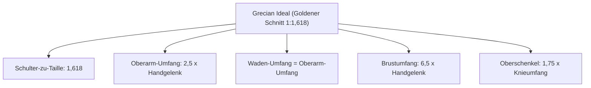
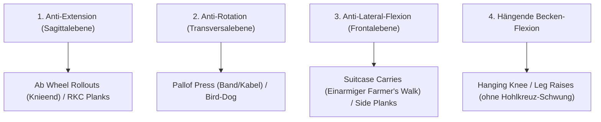
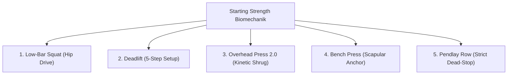
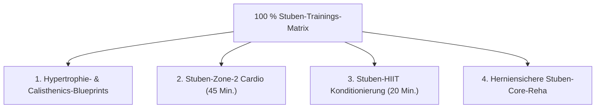
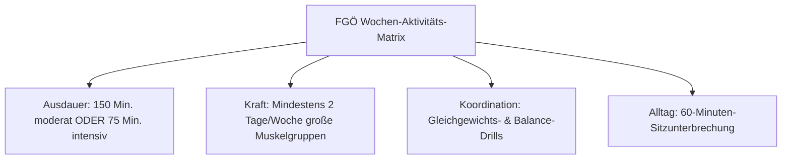
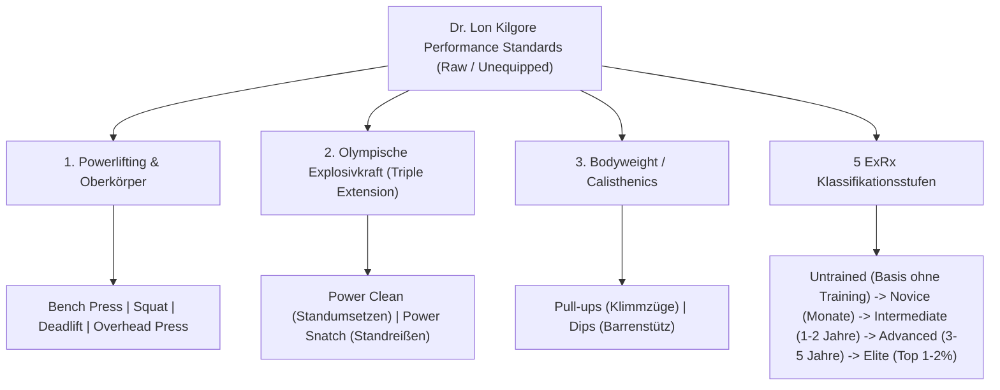
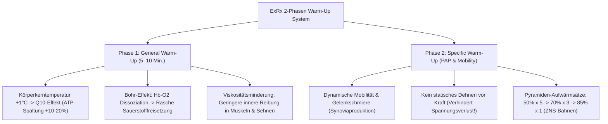
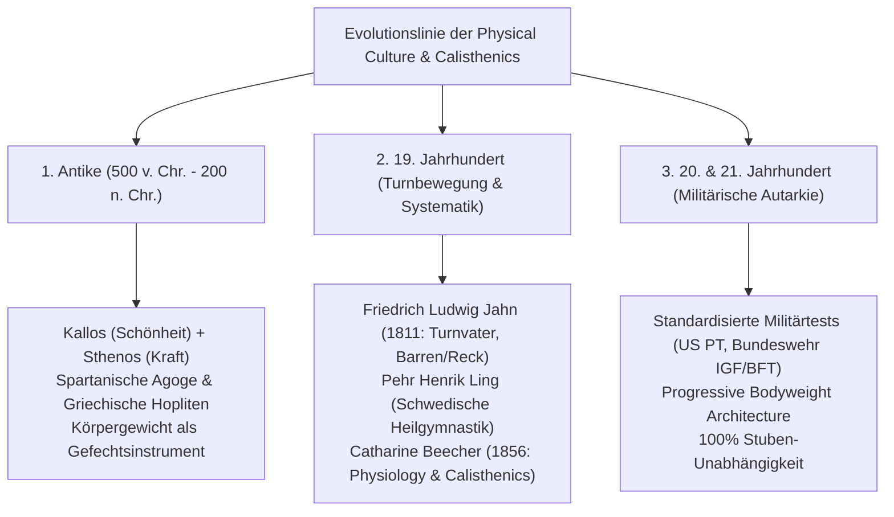

# Trainingsplan: Beyond Bigger Leaner Stronger, Starting Strength & Taktische Konditionierung Master

> [!NOTE] DOKTRIN & DUAL-ENGINE HYBRID-SYSTEM
> - **Wissenschaftliches Fundament:** Michael Matthews (*Beyond Bigger Leaner Stronger – BBLS*), Mark Rippetoe (*Starting Strength: Basic Barbell Training, 3rd Edition*), Dr. Brad Schoenfeld (*Mechanisms of Muscle Hypertrophy*), Dr. Kelly Starrett (*Becoming a Supple Leopard*), Eric Banister (*TRIMP/EWMA*), Dr. Jose Antonio (Hypercaloric High-Protein), Dr. Donald Layman (Muscle-Sparing Ratio).
> - **Ziel:** Aufbau eines ästhetischen, athletischen Körpers nach dem **Grecian Ideal (Golden Ratio 1:1,618)** bei gleichzeitig robuster militärischer Ausdauer ($\text{VO}_2\text{max} > 50$, 5-km-Pace $< 4:05\text{ min/km}$) und lückenlosem Schutz der operierten Rumpfstruktur (BWK Ulm).
> - **Wochen-Architektur (Dienst- & Stuben-Doktrin):**
>   - **Dienstsport (Di & Fr während Dienstzeit):** Schwere Grundübungen nach Rippetoe-Biomechanik (Langhantel-Squats, Deadlifts, Bench Press, Military Press, Pendlay Rows).
>   - **Stuben-Training (Feierabend):** High-End Calisthenics, Power-Bodyweight, Mobilität & Core-Reha direkt im Zimmer (**kein zeitraubendes Gym nach Feierabend**).
>   - **80/20 Polarisierte Ausdauer:** 80 % Zone 2 (Grundlage) / 20 % HIIT (Sprints, Intervalle).

### Wochen-Workout-Matrix (7-Tage-Schnellübersicht):

| Wochentag | Trainingstyp | Zone / Intensität | Dauer | Physiologischer Schwerpunkt & Kasernen-Ausführung |
| :--- | :--- | :--- | :---: | :--- |
| **Montag** | Cardio (Zone 2) | Aerobic Base (Laktat $< 2,0\text{ mmol/l}$) | 45 Min. | Grundlagenausdauer-Lauf; strikte Pulskontrolle zur Steigerung der mitochondrialen Dichte und Fettflussrate. |
| **Dienstag** | Dienstsport (Kraft) | Rippetoe Heavy Compounds ($80\text{--}85\,\%\ \text{1RM}$) | 60 Min. | Langhantel-Grundübungen (Squats, Bench Press, Rows) in der Kaserne + LPR-konforme Abend-Regeneration. |
| **Mittwoch** | Cardio (HIIT) | $\text{VO}_2\text{max}$-Intervalle ($> 90\,\%\ \text{HF}_{\text{max}}$) | 30 Min. | 4x4 Min. HIIT-Intervalle (3 Min. aktive Trabpause); Pre-Workout-Einnahme von $0,5\text{ l}$ Rote-Bete-Saft (Diätetisches Nitrat). |
| **Donnerstag** | Rest & Reha | Passive ZNS-Regeneration | - | Vollständige Schonung des ZNS; Faszien- und Mobilitätsarbeit auf Stube nach Starrett-Protokoll. |
| **Freitag** | Dienstsport (Kraft) | Strength RPE 8 / Hypertrophie | 60 Min. | Ganzkörper-Schwerpunkt (Deadlifts, Military Press, Dips, Pull-Ups) + Stuben-Calisthenics. |
| **Samstag** | Cardio (Long Run) | Aerobic Long Run (Zone 2) | 90 Min. | Extensiver Dauerlauf zur maximalen Kapillarisierung der Arbeitsmuskulatur und VO2-Max-Fundierung. |
| **Sonntag** | Reha & Mobilität | Recovery & Core-Stabilität | 30 Min. | Aktive Regeneration, Rumpfstabilisation und Schutz der operierten Beckenbodenstruktur (BWK Ulm). |

---

## 1. Die Mathematik der Ästhetik: Das „Grecian Ideal“ (Golden Ratio)

Das *Grecian Ideal* (inspiriert von Eugen Sandow, Steve Reeves und dem Goldenen Schnitt $\Phi = 1,618$) definiert die mathematisch perfekte männliche Körpersymmetrie:



### Die BBLS-Proportions-Formeln:

| KÖRPERREGION | BBLS-FORMEL & BERECHNUNGSGRUNDLAGE | ZIEL-ÄSTHETIK |
| :--- | :--- | :--- |
| **Schulter-Taille (V-Taper)** | $\text{Schulterumfang} = \text{Taillenumfang} \times 1,618$ | Breiter V-Rumpf, schmale Taille, ausgeprägte seitliche Deltoide. |
| **Oberarme (angespannt)** | $\text{Oberarm} = \text{Nicht-dominantes Handgelenk} \times 2,5$ | Voller Bizeps-Peak & dichte Trizepsköpfe ohne unnatürliche Aufblähung. |
| **Waden (angespannt)** | $\text{Wadenumfang} = \text{Oberarmumfang}$ | Perfekte Symmetrie zwischen oberer und unterer Extremität. |
| **Brustumfang** | $\text{Brust} = \text{Nicht-dominantes Handgelenk} \times 6,5$ | Flache, massive „Armor Plate“-Brust (Fokus: Obere Brust / Incline). |
| **Oberschenkel** | $\text{Oberschenkel} = \text{Knieumfang} \times 1,75$ | Ausgeprägter Quad-Sweep bei schlanken Gelenken. |
| **Körperfett-Bereich** | **7 % bis 9 % KFA** | Sichtbares Sixpack, vaskuläre Definition, dauerhaft haltbar via Anabolic Volume Eating ([[Ernährungsleitfaden]]). |

---

## 2. Die 3 Hypertrophie-Pfade & Das BLS Double-Progression-Gesetz (Michael Matthews)

Nach Michael Matthews stimuliert ein optimales Kraft- und Masse-Training primär die myofibrilläre Proteinsynthese durch **schwere Grundübungen im 4–6 Wiederholungsbereich** ($80\text{--}85\,\%\ \text{1RM}$), ergänzt durch Power- und sarkoplasmatische Reize (*Concurrent Periodization*):

```text
+-----------------------+--------------------+---------------------+---------------------------+-----------------------------------+
| SATZ-TYP              | WIEDERHOLUNGEN     | INTENSITÄT (% 1RM)  | TEMPO (Exz-Pause-Konz)    | PHYSIOLOGISCHER HAUPTFOKUS        |
+-----------------------+--------------------+---------------------+---------------------------+-----------------------------------+
| 1. Power Sets         | 2 bis 3 Reps       | 90 % - 95 % 1RM     | 2 - 1 - 1 (Explosiv)      | Neuromuskuläre Rekrutierung (CNS) |
| 2. 1RM Test Sets      | 1 Rep              | 95 % - 100 % 1RM    | 2 - 1 - 1 (Maximal)       | Maximalkraft-Überprüfung (Woche 5)|
| 3. Myofibrillär (BLS) | 4 bis 6 Reps       | 80 % - 85 % 1RM     | 2 - 1 - 1 (Kontrolliert)  | Dichte, dauerhafte Myofibrillen   |
| 4. Sarkoplasmatisch   | 8 bis 10 Reps      | 70 % - 75 % 1RM     | 3 - 1 - 2 (Time-under-T.) | Zelluläre Ermüdung & Glykogen-Vol.|
+-----------------------+--------------------+---------------------+---------------------------+-----------------------------------+
```

### Das unfehlbare BLS Double-Progression-Protokoll:

> [!NOTE] DIE DOUBLE PROGRESSION METHODE (Bigger Leaner Stronger)
> 1. **Einstieg:** Wähle ein Arbeitsgewicht, mit dem du mindestens **4 saubere Wiederholungen** (ohne Abfälschen) schaffst.
> 2. **Wiederholungs-Progression:** Behalte dieses exakte Gewicht bei, bis du in **allen vorgeschriebenen Arbeitssätzen 6 saubere Wiederholungen** erreichst (z. B. $3 \times 6$ Squats oder $3 \times 6$ Incline Bench).
> 3. **Gewichts-Progression:** Sobald das 6-Rep-Kriterium in allen Sätzen erfüllt ist, erhöhe das Gewicht für das nächste Workout:
>    * **$+2,5\text{ bis } 5,0\text{ kg}$** bei Unterkörperübungen (Squats, Deadlifts, Leg Press).
>    * **$+1,0\text{ bis } 2,5\text{ kg}$** bei Oberkörperübungen (Bench Press, Military Press, Barbell Rows).
> 4. **Reset & Wiederholung:** Mit dem neuen Gewicht fällst du automatisch wieder auf 4–5 Wiederholungen zurück. Arbeite dich erneut auf 6 Wiederholungen hoch.

### Die 3-Minuten-Satzpausen-Doktrin (ATP-CP Resynthese):
* **Physiologie:** Schwere Grundübungen im 4–6 Rep-Bereich leeren die intramuskulären Phosphagen-Speicher (Adenosintriphosphat und Phosphokreatin).
* **Pausenvorgabe:** Zwischen schweren Grundübungs-Sätzen werden strikt **3 bis 4 Minuten Pause** eingehalten. Dies sichert eine **$\ge 95\,\%$ige ATP-CP-Wiederherstellung**, verhindert Leistungseinbrüche im Folgesatz und maximiert die mechanische Last auf die Muskelfasern.

---

## 3. Der 6-Wochen BBLS- & RP-Mesozyklus

Ein vollständiger Trainingsblock umfasst exakt **6 Wochen** und folgt den **Hypertrophy Volume Landmarks** von Dr. Mike Israetel (Renaissance Periodization):


### Die RP Trainingsvolumen-Schwellen (Dr. Mike Israetel):

| VOLUMEN-SCHWELLE | BEDEUTUNG & DEFINITION | SÄTZE / MUSKEL / WOCHE | ZUORDNUNG IM MESOZYKLUS |
| :--- | :--- | :---: | :--- |
| **MV (Maintenance Volume)** | Mindestvolumen zum vollständigen Erhalt bestehender Muskelmasse | $4\text{--}6\text{ Sätze}$ | **Woche 6 (Deload-Woche)**: Ermöglicht Erholung ohne Muskelverlust. |
| **MEV (Minimum Effective Volume)** | Untergrenze, ab der messbarer Muskelaufbau induziert wird | $8\text{--}10\text{ Sätze}$ | **Woche 1 (Einstieg)**: Geringe Systemermüdung, saubere Progression. |
| **MAV (Maximum Adaptive Volume)** | Optimaler Bereich für maximalen Muskelzuwachs | $12\text{--}18\text{ Sätze}$ | **Wochen 2 bis 4 (Hypertrophie-Peak)**: Stetige Satzsteigerung. |
| **MRV (Maximum Recoverable Volume)**| Obergrenze des Erholungsvermögens (Überlastungsschwelle) | $20\text{--}22+\text{ Sätze}$ | **Woche 5 (Power Week)**: Letzter Reiz vor ZNS-Erschöpfung. |

* **Wochen 1–4 (Akkumulation / MEV bis MAV):** 
  * Fokus: Myofibrilläres Muskelwachstum (4–6 Reps) + Power Sets (2–3 Reps) + Sarkoplasmatische Finisher (8–10 Reps). Wöchentlich $+1\text{--}2$ Sätze pro Muskelgruppe hinzufügen.
* **Woche 5 (Overreaching / MRV & Power Week):** 
  * Fokus: Maximaler Reiz an der Regenerationsgrenze mit 1RM-Prüfsätzen und schweren Power-Sätzen.
* **Woche 6 (Deload / MV-Resensitisierung):** 
  * Reduktion auf **Maintenance Volume (MV)** mit nur **40 % des 1RM** (10 Reps, RIR 4–5, kein Muskelversagen, ZNS-Erholung und Wiederherstellung der zellulären Wachstumssensitivität).

---

## 4. Der Wochenplan: 100 % Stuben-Training & Kasernen-Hybrid

> [!NOTE] KASERNEN- & STUBEN-DOKTRIN (MAXIMALE PRIVATSPHÄRE & EFFIZIENZ)
> - **Dienstsport Gym (Di & Fr während der Dienstzeit):** Schwere Langhantel-Grundübungen nach Rippetoe / BLS im Kraftraum der Kaserne (kein privater Zeitverlust nach Dienst!).
> - **Feierabend & Wochenende (Mo, Mi, Do, Sa, So):** **100 % Stuben-Training** – du musst dein Zimmer nach Dienstschluss für kein Training mehr verlassen. Volle Hypertrophie, Core-Reha und Zone-2/HIIT-Konditionierung finden direkt auf Stube statt!

### Wochenübersicht (Mo–So):

| TAG | FOKUS & LOCATION | SATZ-AUFBAU & MECHANIK |
| :--- | :--- | :--- |
| **Montag** | **Stube: Chest & Upper Push + Core Reha** | Feet-Elevated Deficit Push-ups (Power), Stuhl-Dips (Myo), Diamond Push-ups (Sarko), Ab-Wheel Rollouts & RKC Planks. |
| **Dienstag** | **Dienstsport Gym: Heavy Legs & Pull (Kaserne)** | **Low-Bar Back Squats** (Rippetoe Hip Drive) + **Barbell Deadlifts** (5-Step Setup) + Pendlay Rows. |
| **Mittwoch** | **Stube: Zone 2 Indoor-Cardio & Trittsicherheit** | 45 Min. Stuben-Cardio (Chair Step-ups, Shadow Boxing, Rucksack-Marching, Fersengang) + Thoracic Mobility. |
| **Donnerstag** | **Stube: Shoulders, Arms, Back & Legs** | Elevated Pike Push-ups (Power), Towel/Doorframe Rows (Myo), Rucksack Bulgarian Split Squats & Biceps Curls. |
| **Freitag** | **Dienstsport Gym: Heavy Upper Body (Kaserne)** | **Incline Bench Press** (Scapula Retracted) + **Press 2.0** (Kinetic Shrug) + Strict Barbell Rows. |
| **Samstag** | **Stube: HIIT Indoor-Konditionierung** | 20 Min. Stuben-HIIT (Sprawls, High Knees, Rucksack Swings, Shadowbox Flurries) + Faszien-Release. |
| **Sonntag** | **Stube: Active Rest, Mobility & Erholung** | Vollständige Regeneration, Hüftbeuger-Dehnung, Yoga & Nervenmobilisation auf Stube. |

---

## 5. Herniensichere Rumpf-Reha & Core-Architektur (Post-OP BWK Ulm)

> [!DANGER] STRIKTES VERBOT TRADITIONELLER CRUNCHES & SIT-UPS
> Crunches erzeugen unphysiologische intraabdominale Druckspitzen auf die Operationsnarbe (Viszeralchirurgie 11/2024).

### Das BBLS-konforme, wirbelsäulenschonende Core-Protokoll:



* **Ab-Wheel Rollouts (Knieend):** Bauchnabel vor Beginn aktiv nach innen-oben saugen; maximale Spannung im Transversus Abdominis ohne Absacken der Lendenwirbelsäule.
* **Hanging Leg Raises:** 3 Sätze à 8–10 Wiederholungen mit kontrollierter exzentrischer Phase (3 Sekunden Absenken).

---

## 6. Biomechanische Grundübungs-Doktrin nach Mark Rippetoe (Starting Strength 3rd Ed.)

> [!NOTE] DIE PHYSIK DER LANGHANTEL: GRAVITATION & MOMENTARME
> 1. **Das Mid-Foot-Gesetz (Center of Mass Balance):** In allen stehenden Grundübungen (Kniebeuge, Kreuzheben, Schulterdrücken) muss der Gesamtschwerpunkt (Körper + Hantel) exakt in einer **vertikalen Linie über dem Mittelfuß** liegen.
> 2. **Momentarm-Minimierung ($M = F \times d_{\perp}$):** Horizontale Abweichungen von der Mittelfuß-Linie erzeugen unerwünschte Hebelarme (Moment Arms). Dies belastet Lendenwirbelsäule und Gelenke mit Scherkräften und verschwendet mechanische Arbeitsleistung ($W = F \times d$).



### Die 5 Ausführungs-Blueprints für den Dienstsport (Kaserne):

#### 1. Low-Bar Back Squat (Kniebeuge)
* **Hantelablage:** Auf dem Knochenvorsprung des hinteren Deltamuskels (*Posterior Deltoid Shelf*), direkt unterhalb der Schulterblattgräte (*Spina Scapulae*).
* **Griff & Handgelenke:** Daumenloser Griff (**Thumbs-on-top**); Handgelenke in gerader Verlängerung der Unterarme (keine Beugung/Streckung); Ellbogen nach hinten-oben heben, um die Hantel fest einzuklemmen.
* **Stand & Knie:** Fersen schulterbreit, Fußspitzen ca. **$30^\circ$ nach außen rotiert**. Knie aktiv nach außen drücken (**Knees Out**), um Platz für das Becken zu schaffen und die Adduktoren unter Vorspannung zu setzen.
* **Hip Drive (Der Hauptmotor):** Die Aufwärtsbewegung aus der Hocke wird nicht durch das Heben der Brust, sondern durch das **vertikale Hochtreiben des Kreuzbeins/der Hüfte** initiiert (*"Drive the hips straight up!"*). Dies maximiert die Kraft der posterioren Kette (Hamstrings, Gluteus, Adduktoren).
* **Tiefe:** Die Hüftbeugefalte (*Hip Crease*) muss tiefer liegen als die Oberkante der Kniescheibe (**Below Parallel**).
* **Blickrichtung:** Fixierter Punkt am Boden ca. 1,5 bis 2 Meter vor dem Körper (neutrale Halswirbelsäule).

#### 2. The Deadlift (Das unfehlbare 5-Schritte-Setup)
* **Schritt 1 (Stance):** Schmaler Stand (Fersen 20–25 cm auseinander, Füße leicht nach außen). Stange liegt exakt **$2,5\text{ cm}$ (1 Inch) vor den Schienbeinen** direkt über dem Mittelfuß.
* **Schritt 2 (Grip):** Ohne die Stange zu bewegen, im Hüftgelenk nach vorne beugen und die Hantel im doppelten Obergriff knapp außerhalb der Beine fassen (Arme bleiben vollkommen gestreckt).
* **Schritt 3 (Shins to Bar):** Knie nach vorne schieben, bis die Schienbeine die Stange berühren. **ACHTUNG:** Die Hantelstange darf dabei um keinen Millimeter rollen!
* **Schritt 4 (Chest Up & Set Back):** Brust stolz nach oben aufrichten (*"Squeeze the chest up!"*). Dies arretiert die Lendenwirbelsäule in normaler anatomischer Streckung und spannt den Latissimus maximal an.
* **Schritt 5 (The Pull):** Mit dem Gedanken, *den Boden mit den Füßen wegzudrücken*, anheben. Die Stange bleibt im permanenten Schleifkontakt an Schienbeinen und Oberschenkeln.

#### 3. The Overhead Press 2.0 (Schulterdrücken)
* **Griff:** Stange liegt im Handballenansatz direkt über Elle und Speiche (*Radius/Ulna*); Unterarme stehen von vorne und der Seite betrachtet exakt vertikal; Ellbogen leicht vor der Stange.
* **Kinetischer Hüft-Rebound:** Vor Beginn jeder Wiederholung schnellt die Hüfte ohne Kniebeugung kurz explosiv nach vorne. Dieser Reflex spannt Rumpf und Hüfte elastisch vor und schleudert die Stange senkrecht nach oben.
* **Kopf durchs Fenster:** Sobald die Stange Stirnhöhe passiert, bewegt sich der Oberkörper leicht nach vorne unter die Stange.
* **Aktiver Lockout-Shrug (Impingement-Schutz):** Im obersten Endpunkt werden die Schulterblätter aktiv nach oben gezuckt (**Shrug at the top**). Dadurch rotiert das Schulterdach (*Akromion*) nach oben-außen und macht ein Einklemmungssyndrom der Supraspinatussehne anatomisch unmöglich.

#### 4. The Bench Press (Bankdrücken)
* **5-Punkte-Kontakt:** Hinterkopf, oberer Rücken (Schulterblätter), Gesäß fest auf der Bank; beide Füße flach und mit vollem Druck im Boden (**Leg Drive**).
* **Skapuläre Retraktion:** Schulterblätter vor dem Ausheben maximal zusammen- und nach unten ziehen (*Retract and Depress*).
* **Ellbogenwinkel:** $45^\circ$ bis $75^\circ$ zum Torso (kein $90^\circ$ Flaring).
* **Stangenbahn:** Die Hantel berührt den unteren Brustbeinrand und wird in einer leichten J-Kurve zurück über das Schultergelenk gedrückt.

#### 5. Strict Barbell Row (Pendlay Row / Dead-Stop)
* Jeder Zug startet mit ruhender Hantel auf dem Boden (*Dead-Stop*) direkt über dem Mittelfuß.
* Rücken exakt parallel zum Boden arretiert; explosives Ziehen an das untere Brustbein ohne Schwungholen aus Knien oder LWS.

---

### Das Starting Strength Aufwärm-Protokoll (Warm-up Pyramide):

Um das Nervensystem zu aktivieren, ohne metabolische Vorermüdung in den Arbeitsmuskeln zu erzeugen:

| SATZ | LAST (% VOM ARBEITSGEWICHT) | WIEDERHOLUNGEN | PAUSE |
| :---: | :---: | :---: | :---: |
| **Satz 1 & 2** | **Leere Hantelstange ($20\text{ kg}$)** | $2 \times 5\text{ Reps}$ | $30\text{ s}$ |
| **Satz 3** | **$40\,\%$ Arbeitsgewicht** | $1 \times 5\text{ Reps}$ | $60\text{ s}$ |
| **Satz 4** | **$60\,\%$ Arbeitsgewicht** | $1 \times 3\text{ Reps}$ | $90\text{ s}$ |
| **Satz 5** | **$80\,\%$ Arbeitsgewicht** | $1 \times 2\text{ Reps}$ | $120\text{ s}$ |
| **Arbeitssätze** | **$100\,\%$ Arbeitsgewicht** | $3 \times 5$ (Squat/Bench/Press) / $1 \times 5$ (Deadlift) | $3\text{--}5\text{ Min.}$ |

---

### Modifiziertes Valsalva-Manöver & Reha-Druckentlastung (Post-OP BWK Ulm):

> [!IMPORTANT] DRUCKVERTEILUNG STATT DRUCKSTAU
> - **Klassisches Valsalva nach Rippetoe:** Tiefes Zwerchfell-Einatmen $\to$ Glottis schließen $\to$ Rumpfwand versteifen.
> - **Reha-Modifikation:** Um den operierten Anal- und Beckenbodenbereich vor übermäßigem Kaudal-Druck zu schützen, wird **vor dem Druckaufbau der Beckenboden (M. Levator Ani) aktiv nach innen-oben gezogen** (synchron mit dem M. Transversus Abdominis). 
> - **Atmungs-Timing:** Luft anhalten während der exzentrischen Phase und dem Umkehrpunkt $\to$ nach Überwindung des Totpunkts (*Sticking Point*) kontrolliert zischend ausatmen.

---

## 6.1 Maschinen- & Geräte-Arsenal im Bundeswehr-Kraftraum (Inventar & Mapping)

> [!NOTE] KASERNEN-GERÄTEINVENTAR & BIOMECHANISCHES MAPPING
> Der Kraftraum der Kaserne verfügt über ein vollständiges Arsenal an Freihanteln, biomechanischen Maschinen, Rumpf-Reha-Bänken und Conditioning-Ergometern. Alle Übungen für den Dienstsport (**Dienstag: Workout A** und **Freitag: Workout B**) sind 1:1 auf diese Ausrüstung abgestimmt.

### 1. Das vollständige Geräte-Inventar:

| KATEGORIE | VORHANDENE GERÄTE & MASCHINEN | PRIMÄRER EINSATZ / ZIELMUSKEL |
| :--- | :--- | :--- |
| **Freihantel & Grundgerüst** | • Squat Rack / Kniebeugenständer<br>• Flachbank mit Langhantel (Bankdrück-Station)<br>• Verstellbare Hantelbank (Adjustable Bench)<br>• Kurzhanteln ($1\text{ bis }37{,}5\text{ kg}$)<br>• Kettlebells ($4\text{ bis }32\text{ kg}$)<br>• Smith Machine (Multipresse) | Schwere Compound-Lifts (Squat, Bench, Deadlift, Press, Bulgarian Split Squats). |
| **Oberkörper Druck & Zug** | • Schulterdrück-Maschine<br>• Bruststück-Maschine (Brustpresse)<br>• Butterfly-Maschine (Pec-Deck)<br>• Pullover-Maschine (Überzüge / Latissimus & Serratus)<br>• 3D Rudermaschine & Rhomboideus-Maschine<br>• Latzug-Maschine (Lat Pulldown)<br>• Scott-Curl-Bank (Preacher Curl)<br>• Klimmzüge- & Dips-Maschine (unterstützt)<br>• Klimmzugstange & Dipsstation<br>• Turnringe (Gym Rings am Rig)<br>• Campusboard / Hangboard (Griffkraft) | Kraftaufbau Oberkörper, Scapula-Stabilisation, geführte Hypertrophie ohne unkontrollierte Scherkräfte. |
| **Beine & Posteriore Kette** | • **Hip-Thrust / Glute-Drive-Maschine** (Glute Bridge)<br>• Beinpress-Maschine<br>• Beinbeuge-Maschine (Leg Curls)<br>• Adduktions- & Abduktions-Maschine<br>• Wadenmaschine (Sitzendes Wadenheben) | Maximale Aktivierung von Gesäß und Beinbeugern **ohne axiale Wirbelsäulenkompression** (Reha-Schutz). |
| **Rumpf, Reha & Kabelzüge** | • Zugapparat (Cable-Crossover / Kabelzugturm)<br>• Single Cable Tower (Einzel-Kabelzug)<br>• Neunstöckige-Maschine (Multi-Kabelstation)<br>• **45°-Hyperextensionsbank** & Römische Bank (Back Extension)<br>• Römische Bank für Schrägbauch/Obliques<br>• Rumpfdrehmaschine & Seitneige-Maschine<br>• Rücken-Maschine | Anti-Rotation (Pallof Press), posteriore Kette, Reha der Becken- und Rumpfwandmuskulatur. |
| **Cardio, Ergometer & Conditioning** | • Concept2 RowErg (Ruderergometer)<br>• Assault Bike (Air Bike / Fan Bike)<br>• Oberkörper-Ergometer (Handkurbel / Arm-Ergometer)<br>• Stationäres Fahrrad-Ergometer & Crosstrainer<br>• Laufband & Draußen Laufen<br>• **Prowler / Sled (Schlitten)** | Zone-2-Grundlagenausdauer, HIIT-Finisher, Entlastung der unteren Extremitäten bei hoher Laktat-Toleranz. |
| **Matte & Mobilisation** | • Große Mattenfläche mit Widerstandsbändern & Faszienrolle<br>• BOSU-Ball & Gymnastikball<br>• Leder-Medizinbälle ($3\text{--}5\text{ kg}$)<br>• Stab (Kampfkunst & Mobilisation) | Somatisches De-Freezing, ACBT-Atemarbeit, Rumpf-Stabilität. |

---

### 2. Dienstsport-Blueprints mit Kasernen-Geräten

#### Dienstag (Dienstsport 07:00 – 09:00 Uhr): Workout A – Heavy Legs, Glutes & Pull
* **Warm-up (10 Min.):** 5 Min. Concept2 RowErg (Zone 2) $\to$ Rumpfaktivierung auf der Matte (Bird-Dog, Glute Bridges, Stab-Mobilisation).
* **Übung 1: Low-Bar Back Squat (Squat Rack)** – $3 \times 5$ Wiederholungen (Starting Strength Warm-up Pyramide).
  * *Alternative bei LWS-Entlastung:* **Beinpress-Maschine** ($4 \times 8\text{--}10$, RIR 2).
* **Übung 2: Hip-Thrust / Glute-Drive-Maschine** – $3 \times 8\text{--}10$ Wiederholungen (2 Sek. Peak-Contraction).
  * *Vorteil:* 100 % Gluteus-Maximus-Fokus ohne Druck auf den operierten Bauchraum.
* **Übung 3: 3D Rudermaschine ODER Pendlay Row (Langhantel)** – $4 \times 6\text{--}8$ Wiederholungen.
* **Übung 4: Beinbeuge-Maschine** – $3 \times 10\text{--}12$ Wiederholungen (kontrollierte 3-Sekunden-Exzentrik).
* **Übung 5: 45°-Hyperextensionsbank** – $3 \times 12$ Wiederholungen (Erector Spinae & Gluteus, neutrale Wirbelsäule).
* **Übung 6: Wadenmaschine sitzend** – $3 \times 12\text{--}15$ Wiederholungen.
* **Core-Finisher:** Pallof Press am Kabelzugturm ($3 \times 12$ pro Seite, Anti-Rotation).

---

#### Freitag (Dienstsport 09:00 – 10:00 Uhr): Workout B – Heavy Upper Body & Conditioning
* **Warm-up (8 Min.):** 4 Min. Oberkörper-Ergometer (Handkurbel) $\to$ Schulterblatt-Retraktion mit Miniband auf der Matte.
* **Übung 1: Bankdrücken (Flachbank mit Langhantel)** – $3 \times 5$ (Rippetoe Technik, Skapuläre Retraktion).
  * *Alternative:* **Verstellbare Hantelbank (Incline DB Press)** mit Kurzhanteln ($3 \times 8$).
* **Übung 2: Schulterdrück-Maschine ODER Overhead Press (Smith Machine / Langhantel)** – $3 \times 6\text{--}8$ (Lockout-Shrug).
* **Übung 3: Latzug-Maschine (Breiter Obergriff) ODER Turnringe / Klimmzugstange** – $4 \times 6\text{--}8$.
* **Übung 4: Pullover-Maschine (Überzug-Maschine)** – $3 \times 10\text{--}12$ (Latissimus-Isolation & Brustkorberweiterung).
* **Übung 5: Dipsstation (oder unterstützte Dips-Maschine)** – $3 \times 8\text{--}10$ (kontrolliert).
* **Übung 6: Zugapparat (Cable Tower) – Face Pulls & Trizepsdrücken** – $3 \times 12\text{--}15$.
* **Conditioning-Finisher (Optional 5–10 Min.):** Prowler / Sled Push (Schlitten) ODER Assault Bike Intervalle ($5 \times 20\text{ s Sprint / }40\text{ s Pause}$).

---

## 7. Das 100 % Stuben-Trainings- & Ausrüstungs-Kompendium (Barracks Room Only)

> [!NOTE] STUBEN-TRAININGS-DOKTRIN (100 % AUTARK IM ZIMMER)
> Für alle Einheiten außerhalb des befohlenen Dienstsports (Montag, Mittwoch, Donnerstag, Samstag, Sonntag) benötigst du **kein Fitnessstudio und kein Verlassen der Stube**. 
> - **Ziel:** Maximale Privatsphäre, Zeitersparnis nach Dienstschluss und kompromissloser Muskel- und Konditionsaufbau direkt auf der Stube.



### A. Die Stuben-Ausrüstung (Minimalistisch & Extrem Effektiv):
1. **Bundeswehr-Dienstrucksack:** Beladbar mit Büchern, Wasserflaschen oder Hantelscheiben für präzise **BLS-Double Progression** ($+1\text{--}2\text{ kg}$ Schritte).
2. **Stabiler Stuben-Stuhl / Bundeswehr-Hocker:** Für Dips, Feet-Elevated Push-ups, Chair Step-ups und Bulgarische Split Squats.
3. **Türreck / Klimmzugstange (oder Handtuch-Tür-Anker):** Für Pull-ups, Chin-ups und hängendes Beinheben.
4. **Widerstandsbänder / Minibänder:** Für Schulterheben, Face-Pulls, Pallof Press und Skater Drills.
5. **Ab-Wheel & Gymnastikmatte:** Für wirbelsäulenschonende Core-Reha und Faszientraining.

---

### B. Die 4 Stuben-Hypertrophie-Blueprints (Mo & Do):

#### 1. Feet-Elevated Deficit Push-ups (Oberer Brust-Peak & Incline-Ersatz)
* **Setup:** Füße auf den Stuben-Stuhl oder die Bettkante; Hände auf zwei Bücherstapel oder Liegestützgriffe.
* **Mechanik:** Tiefe Dehnung am Umkehrpunkt (Brustbein unter Handhöhe); Ellenbogen $45^\circ$ zum Rumpf.
* **Progression:** Rucksack mit $5\text{--}20\text{ kg}$ beladen $\to$ $3 \times 4\text{--}6$ Wiederholungen nach BLS Double Progression.

#### 2. Elevated Pike Push-ups (Schulter-Power & Military-Press-Ersatz)
* **Setup:** Füße auf den Stuhl, Hände schulterbreit am Boden; Hüfte $90^\circ$ gebeugt (Körper bildet ein umgekehrtes V).
* **Mechanik:** Kopf wandert diagonal nach vorne unten (Dreiecks-Bahn); beim Hochdrücken Kopf aktiv „durchs Fenster“ schieben und Schulterblätter nach oben locken (*Shrug*).
* **Progression:** Füße höher lagern $\to$ Übergang zu Handstand Push-ups an der Wand.

#### 3. Towel / Doorframe Inverted Rows (Latissimus & Rautenmuskeln)
* **Setup:** Stabiles Handtuch um den Türgriff knoten (Tür schließt zu dir hin) oder an stabilem Bettpfosten greifen.
* **Mechanik:** Füße nach vorne wandern lassen, Körper gerade wie ein Brett arretieren; Brustbein kontrolliert zum Griff ziehen und Schulterblätter maximal zusammenkneifen (*Retraction*).
* **Progression:** Steilerer Körperwinkel / einarmige Ausführung.

#### 4. Rucksack Bulgarian Split Squats & Nordic Curls (Quad- & Hamstring-Fokus)
* **Setup:** Hinterer Spann auf der Bettkante abgelegt, vorderer Fuß ca. 80 cm vor dem Bett; Rucksack auf dem Rücken.
* **Mechanik:** Hinteres Knie senkt sich fast bis zum Boden; vorderes Knie bleibt stabil in Achse.
* **Nordic Hamstring Curls:** Fersen unter dem stabilen Bettgestell einklemmen $\to$ Oberkörper langsam und kontrolliert nach vorne absenken (reine Hamstring-Bremskraft).

---

### C. Das Stuben-Konditionierungs-System (Indoor Zone 2 & HIIT):

#### 1. Stuben-Zone-2 Cardio Protokoll (Mittwoch – 45 Minuten)
* **Ziel:** Herzfrequenz konstant bei **$120\text{--}135\text{ bpm}$** ($60\text{--}70\,\%\ \text{HF}_{\text{max}}$). Sprechen ist leicht möglich, Singen nicht.
* **Ablauf ($4 \times 10\text{ Minuten}$ Rotation ohne Pause):**
  1. *Min. 00–10:* **Chair Step-ups** (kontrolliertes Auf- und Absteigen auf Stuben-Stuhl im Sekundentakt, Führungsbein minütlich wechseln).
  2. *Min. 10–20:* **Shadow Boxing** (Lockere 1-2er Kombinationen, Meidbewegungen, stetige Beinarbeit im Zimmer).
  3. *Min. 20–30:* **Rucksack-Marching-in-Place mit Trittsicherheits-Drills** (Marschieren auf der Stelle mit 10kg Rucksack; minütlicher Wechsel zwischen Normalgang, Fersengang und Zehenspitzengang).
  4. *Min. 30–40:* **Low-Impact Banded Skater Steps** (Seitliche Ausfallschritte mit Miniband um die Knöchel).
  5. *Min. 40–45:* **Cool-Down & Thoracic Spine Mobilisation**.

#### 2. Stuben-HIIT / Tabata Protokoll (Samstag – 20 Minuten)
* **Ziel:** Anaerobe Laktat-Toleranz, BFT-Sprintschnelligkeit & maximale Fettverbrennung (HF $> 165\text{ bpm}$).
* **Intervall:** **40 Sekunden Belastung / 20 Sekunden Pause** (4 Runden à 5 Übungen):
  1. **Low-Impact Sprawls:** Hände auf den Boden, Füße nach hinten springen in die Liegestützposition, sofort wieder nach vorne und explosiv aufrichten (**ohne Bauchaufprall zum Schutz der OP-Narbe**).
  2. **High-Knee Sprints auf der Stelle:** Knie explosiv bis auf Hüfthöhe hochziehen; Arme kraftvoll mitschwingen.
  3. **Rucksack-Kettlebell Swings:** Gewichten Rucksack an den Trägern fassen und mit explosivem Hüftstoß auf Brusthöhe schwingen (*Posterior Chain Power*).
  4. **Shadowbox Speed Flurry:** 40 Sekunden maximale Schlagfrequenz mit geraden Führ- und Schlaghänden.
  5. **Banded Mountain Climbers:** Knie abwechselnd kontrolliert zur Brust ziehen bei stabiler Planken-Arretierung.

---

## 8. Plateau-Breaker & BBLS-Intensitätstechniken (Michael Matthews)

Wenn die Progression über 3 Wochen stagniert (*True Plateau*), greifen folgende Interventions-Stufen:
1. **Stufe 1 (Microloading):** Gewichtssteigerung um nur **$1,0\text{ bis } 2,0\text{ kg}$** (bei Stuben-Training: $+1\text{ Buch / 1L Wasserflasche}$ in den Rucksack).
2. **Stufe 2 (Rest-Pause Training):** Satz bis 1 Rep vor Muskelversagen $\to$ 20–30s Pause $\to$ 1–2 Reps $\to$ 20s Pause $\to$ finale Rep.
3. **Stufe 3 (Leptin-Refeed & Reverse Dieting):** Kohlenhydrat-Erhöhung um $+25\text{ g}$ ($100\text{ kcal}$) zur Normalisierung der Stoffwechselrate ($T_3$/Leptin).

---

## 9. Mobilitäts- & Foam-Rolling-Protokoll (Prehab & Squat-Mechanik)

| ÜBUNG / MOBILISATION | ZIEL-STRUKTUR | PROTOKOLL & AUSFÜHRUNG |
| :--- | :--- | :--- |
| **Kneeling Hip Flexor Stretch** | Hüftbeuger & Psoas Major | 2–3 Minuten pro Seite: Hüfte aktiv nach vorne-unten schieben; Oberkörper leicht rotieren. |
| **Wall Squats Drill** | Perfekte Kniebeugen-Tiefe | Zehen 5 cm vor die Wand, Arme gestreckt an die Wand, tiefe Hocke ohne Wandberührung mit Brust/Knien. |
| **Thoracic Spine Foam Roll** | Brustwirbelsäulen-Extension | „Bear Hug“-Position auf der Rolle: Wirbel für Wirbel von LWS-Ansatz bis Nacken überstrecken. |
| **Anterior Deltoid Smash** | Vordere Schulter & Kapsel | Lacrosse-Ball zwischen vorderer Schulter und Boden/Wand platzieren; Druck in Wellenbewegungen abrollen. |
| **Plantar Fascia Smash** | Fußgewölbe & Sprunggelenk | 2 Minuten pro Fuß mit Lacrosse-Ball im Stehen abrollen (verbessert Dorsalflexion beim Squat!). |

---

## 10. Evidenzbasierte Bewegungsempfehlungen (FGÖ / NAP Bewegung)

> [!NOTE] NATIONALE BEWEGUNGSNORMEN (Fonds Gesundes Österreich & Bundesministerium)
> - **Mittlere Intensität:** Mindestens **150 Minuten (2,5 Std.) pro Woche**.
>   - *Indikator (Sprechtest):* Atmung ist beschleunigt; Sprechen ist problemlos möglich, Singen nicht mehr (z. B. Zone-2-Lauf, Marschieren, zügiges Gehen, Radfahren).
> - **Höhere Intensität:** Mindestens **75 Minuten (1,25 Std.) pro Woche**.
>   - *Indikator:* Tiefere/schnellere Atmung; nur noch kurze Wortwechsel möglich (z. B. HIIT-Sprints, 5K-Testlauf, Berglauf).
> - **2:1 Umrechnungs- & Kombinationsregel:** $20\text{ Minuten moderate Intensität} = 10\text{ Minuten höhere Intensität}$.
> - **10-Minuten-Mindestdauer:** Jede gezählte Ausdauereinheit muss **mindestens 10 Minuten** am Stück betragen.
> - **Optimal-Nutzen-Korridor:** Zur Maximierung von Gesundheit und kardiopulmonaler Leistungsfähigkeit: **300 Min. moderat** oder **150 Min. intensiv** wöchentlich anstreben.
> - **Muskelkräftigung:** An **$\ge 2$ Tagen pro Woche** alle großen Muskelgruppen fordern (im Hybrid-Plan durch BBLS & Calisthenics optimal erfüllt).



---

## 11. Gleichgewichts-, Koordinations- & Trittsicherheits-Säule (Alpine Gebirgsjäger-Prävention)

Körperliche Aktivitäten zur Erhaltung und Steigerung des Gleichgewichtsvermögens und der Gelenkkoordination reduzieren das Sturz- und Fehltrittsrisiko im alpinen Gelände der Gebirgsjäger drastisch:

| ÜBUNG / DRILL | ZIEL & PROPRIOZEPTION | AUSFÜHRUNG & TIMING |
| :--- | :--- | :--- |
| **Zehenspitzengang (Toe Walking)** | Kräftigung der Wadenmuskulatur, Achillessehne & Fußgewölbe | $3 \times 30\text{ Sekunden}$ barfuß auf Stube oder im Warm-up vor Läufen. |
| **Fersengang (Heel Walking)** | Aktivierung des M. tibialis anterior & Sprunggelenks-Stabilisatoren | $3 \times 30\text{ Sekunden}$ mit angehobenen Zehen kontrolliert gehen. |
| **Einbeinstand (Single-Leg Balance)** | Propriozeptive Stabilisation von Sprunggelenk, Knie & Gesäß | $60\text{ Sekunden}$ pro Bein beim Zähneputzen oder als Stuben-Pausendrill; Steigerung mit geschlossenen Augen. |
| **Dynamisches Balancieren** | Reaktive Fuß- und Rumpfkoordination auf unebenem Untergrund | Auf Bordsteinkanten, Baumstämmen oder Slacklines balancieren. |

---

## 12. Die Sedentary Interruption Rule (60-Minuten-Sitz-Doktrin)

> [!WARNING] DIE 60-MINUTEN-SITZ-FALLE
> Ununterbrochenes Sitzen führt zu rascher Verkürzung des Psoas Major (Hüftbeuger), Inaktivierung der Gesäßmuskulatur (*Gluteal-Amnesie*) und lumbofazialer Kompression.
> 
> **Doktrin (FGÖ Richtlinie):** Spätestens nach **60 Minuten ununterbrochenem Sitzen** (KTF-Bürodienst, Stuben-Lernblöcke, Theorieunterricht) wird eine **2–3-minütige aktive Bewegungsunterbrechung** durchgeführt:
> 1. Aufstehen & 10–20 Schritte gehen.
> 2. Einbeinstand für 30 Sekunden pro Seite.
> 3. Hüftbeuger im Stehen überstrecken & Gesäßmuskeln 5 Sekunden maximal anspannen.

---

## 13. Sporternährungs-, Protein-Hypertrophie- & Peri-Workout-Matrix (FGÖ & Evidenzbasierte Studien)

> [!NOTE] EVIDENZBASIERTE SPORT-MAKRONÄHRSTOFF-FORENSIK
> Ausführliche Studien-Analysen, Autorenmodelle und Mechanismen sind in [[Ernährungsleitfaden#5. Evidenzbasierte Makronährstoff-Verhältnis-Studien & Diät-Vergleichs-Forensik|Kapitel 5 im Ernährungsleitfaden]] detailliert aufgeschlüsselt.

* **Hyperkalorischer Protein-Schutz im Krafttraining (Antonio et al. 2014, JISSN):**
  * Krafttrainierte Athleten mit $4,4\text{ g Protein/kg/Tag}$ ($5,5\times\text{ RDA}$, $+800\text{ kcal}$ Überschuss) zeigten **keine Zunahme an Körperfettmasse**.
  * Konsequenz: Das tägliche Proteinziel von **$160\text{ g}$** ($2,1\text{ g/kg}$) schützt lean mass absolut und induziert maximale nahrungsinduzierte Thermogenese (TEF 20–30 %).
* **Muskelschutz & Lipidprofil bei reduzierter CHO:Protein-Ratio (Layman et al. 2003, J Nutr):**
  * Proteinsparing sichert kontraktile Myofibrillen während Defizitphasen, hält den Blutzuckerspiegel stabil (beseitigt Food-Coma) und senkt Serum-Triglyceride drastisch.
* **Meta-Regressions-Grenzwert für fettfreie Masse (Krieger et al. 2006, AJCN):**
  * Proteinzufuhr $> 1,05\text{ g/kg}$ bewahrt $+0,6\text{ kg}$ zusätzliche Magermasse im Defizit im Vergleich zu niedrigerer Proteinzufuhr.
* **Leistungssicherheit: Nicht-ketogenes Low-Carb (Johnston et al. 2006, AJCN):**
  * $150\text{--}250\text{ g}$ komplexe Kohlenhydrate (Haferflocken, Kartoffeln, Reis) peri-workout verhindern den kognitiven und entzündungsbiologischen Abfall streng ketogener Diäten.
* **Historische Grundsatzdoktrin (Hough & Sedgwick 1906):**
  * Begrenzung von Nicht-Protein-Nahrungsmitteln bei gleichzeitig forderndem muskulären Widerstandstraining ist die physiologisch einzig wirksame Rekompositions-Methode.
* **Flüssigkeitsmanagement im Sport (FGÖ & ExRx.net):**
  * **Einheiten $< 60\text{ Minuten}$:** Reines Leitungswasser oder stilles Wasser nach dem Training reicht aus.
  * **Einheiten $> 60\text{--}90\text{ Minuten}$ (Märsche / Hitze):** Flüssigkeitsausgleich während des Trainings (verdünnter Fruchtsaft 1:3 mit 1 Prise Salz).
* **RP Peri-Workout Hydration:** $1,5\text{ ml}$ Wasser pro aufgenommene Kilokalorie ($2.500\text{ kcal} \to 3,75\text{ Liter}$ Gesamtflüssigkeit).
* **Dr. Tim Noakes Hydrations-Doktrin (*Waterlogged* 2012, *Noakes 1988*):**
  * Richtwert **$0,5\text{ Liter/Stunde}$** ($0,5\text{ l}\cdot\text{h}^{-1}$) verhindert Dehydratation bei Belastung zuverlässig.
  * Trinken nach Durst (*Drink to Thirst*) schützt vor lebensgefährlicher Verdünnungshyponatriämie (Serum-Natrium $< 135\text{ mmol/l}$).
  * Hyperthermie wird durch Belastungsintensität gesteuert, nicht durch Dehydratation.
* **Physiologische Kosten von Dehydratation:**
  * Bereits **$3\,\%$ Dehydratation** bezogen auf das Körpergewicht führt zu **$10\,\%$ Kraftverlust** und **$8\,\%$ Schnelligkeitsverlust**.
* **Wasser-induzierte Thermogenese (Boschmann et al. 2003, JCEM):**
  * $500\text{ ml}$ kühles Wasser steigert den Ruheumsatz um **$+30\,\%$** (Peak nach 30–40 Min.; $\sim 24\text{ kcal}$ Erwärmungs- & Stoffwechselarbeit pro $500\text{ ml} \to \mathbf{+96\text{ kcal/Tag}}$ bei $2\text{ Litern}$).
* **ExRx.net Peri-Workout Timing & 4:1 Recovery-Ratio:**
  * **Pre-Workout (1–2 Stunden vorher):** Leicht verdaulicher Snack aus komplexen Kohlenhydraten und moderatem Protein zur Auffüllung hepatischer Glukosespeicher.
  * **Post-Workout (sehr zeitnah):** $10\text{--}20\,\%$ der täglichen Gesamtenergie mit einem Kohlenhydrat-zu-Protein-Verhältnis von ca. **$4:1$** (z. B. $60\text{ g}$ Kohlenhydrate aus Reis/Kartoffeln/Obst $+ 15\text{--}20\text{ g}$ hochwertiges Protein) zur maximalen Insulinstimulation, GLUT4-Translokation und Glykogen-Resynthese.
* **Myokin-Kaskade & Anti-Inflammatorische Trainingsphysiologie (Petersen 2006, Bruunsgaard 2005):**
  * Körperliches Training wirkt unabhängig von Gewichtsverlust systemisch entzündungshemmend.
  * Kontrahierende Muskelmasse schüttet das Myokin **Interleukin-6 ($\text{IL}-6$)** bis zum **100-fachen** Grundwert aus.
  * Dieses Muskel-$\text{IL}-6$ induziert die anti-inflammatorischen Mediatoren **$\text{IL}-1\text{ra}$** und **$\text{IL}-10$** und unterdrückt die Bildung von $\text{TNF}-\alpha$ direkt.
* **Kreatin-Monohydrat Zellschutz & Entzündungssenkung (Santos et al. 2004):**
  * Tägliche Einnahme von $5\text{ g}$ Kreatin-Monohydrat reduziert zelluläre Schäden und proinflammatorische Marker ($\text{TNF}-\alpha$, $\text{PGE}_2$) nach hochintensiven Belastungen signifikant.

---

## 14. ExRx & Dr. Lon Kilgore Weightlifting Performance Standards (1950–Present)

> [!NOTE] DOKTRIN: DR. LON KILGORE, PHD & MARK RIPPETOE PERFORMANCE STANDARDS
> - **Empirisches Fundament:** Die Leistungsstandards basieren auf über **70 Jahren kumulierter Wettkampfdaten** (1950 bis heute) aus dem olympischen Gewichtheben und Powerlifting.
> - **Wissenschaftliche Abgrenzung:** Dies sind **keine theoretisch-regressiven Hochrechnungen**, sondern reale, ununterstützte (*unequipped / raw*, Gewichthebergürtel zulässig) 1RM-Leistungsstandards für erwachsene Athleten ($> 18\text{ Jahre}$).
> - **Relevanz für Bundeswehr & Gebirgsjäger:** Neben den 3 klassischen Powerlifts (Kniebeuge, Bankdrücken, Kreuzheben) und der Military Press sind **Power Clean (Standumsetzen)** und **Power Snatch (Standreißen)** die biomechanischen Goldstandards für explosive **Dreifachstreckung (*Triple Extension*: Sprunggelenk, Knie, Hüfte)** zur Steigerung von Sprintantritt, BFT-Sprint/Klimmzug-Leistung und alpiner Rucksackmarsch-Belastbarkeit.



---

### A. Die 5 Kilgore/Rippetoe Trainingsstufen:

1. **Untrained (Untrainiert):** Eine Person, die noch nie systematisch mit Gewichten trainiert hat, die Übungen jedoch unter Anleitung technisch korrekt ausführen kann ($0\text{ Monate}$, saubere Hantel-Nullbasis).
2. **Novice (Anfänger):** Regelmäßiges, strukturiertes Krafttraining über mehrere Monate ($3\text{--}9\text{ Monate}$, lineare Lastprogression von Einheit zu Einheit).
3. **Intermediate (Fortgeschritten - Aktueller Soll-Zustand):** Regelmäßiges Training über $1\text{--}2\text{ Jahre}$. Solide Muskelmasse, wöchentliche Periodisierung und hohe Bewegungssicherheit.
4. **Advanced (Weit Fortgeschritten - BBLS Zielkorridor):** Mehrjährige, zielgerichtete Spezialisierung ($3\text{--}5+\text{ Jahre}$). Gehört zu den oberen $10\,\%$ der aktiv trainierenden Bevölkerung.
5. **Elite (Spitzenklasse):** Wettkampfathlet im Kraftdreikampf oder Gewichtheben. Gehört zu den stärksten $1\text{--}2\,\%$ der Athleten weltweit.
*(Hinweis: Bei Rekonvaleszenz oder nach viszeralchirurgischen Eingriffen wie der Prolaps-OP im BWK Ulm greift die vorgelagerte Stufe **Frail / Reha** mit absolutem Fokus auf Gewebeheilung).*

---

### B. Offizielle Dr. Lon Kilgore Performance Standards Matrix ($76,5\text{ kg}$ Körpergewicht, Kilogramm):

Die Tabelle zeigt die exakten 1RM-Werte in Kilogramm ($\text{kg}$) und die relative **Strength Ratio** ($\times\text{ Körpergewicht } 76,5\text{ kg}$):

| DISZIPLIN / ÜBUNG (RAW) | UNTRAINED ($0\text{ Mo.}$) | NOVICE ($3\text{--}9\text{ Mo.}$) | INTERMEDIATE ($1\text{--}2\text{ J.}$) | ADVANCED ($3\text{--}5\text{ J.}$) | ELITE (TOP $1\text{--}2\,\%$) |
| :--- | :---: | :---: | :---: | :---: | :---: |
| **Bench Press (Bankdrücken)** | $52\text{ kg}$ ($0,68\times$) | $67\text{ kg}$ ($0,88\times$) | $90\text{ kg}$ ($1,18\times$) | $118\text{ kg}$ ($1,54\times$) | $145\text{ kg}$ ($1,90\times$) |
| **Squat (Kniebeuge)** | $63\text{ kg}$ ($0,82\times$) | $95\text{ kg}$ ($1,24\times$) | $117\text{ kg}$ ($1,53\times$) | $150\text{ kg}$ ($1,96\times$) | $182\text{ kg}$ ($2,38\times$) |
| **Deadlift (Kreuzheben)** | $78\text{ kg}$ ($1,02\times$) | $115\text{ kg}$ ($1,50\times$) | $140\text{ kg}$ ($1,83\times$) | $178\text{ kg}$ ($2,33\times$) | $212\text{ kg}$ ($2,77\times$) |
| **Press (Military Press)** | $35\text{ kg}$ ($0,46\times$) | $47\text{ kg}$ ($0,61\times$) | $58\text{ kg}$ ($0,76\times$) | $75\text{ kg}$ ($0,98\times$) | $90\text{ kg}$ ($1,18\times$) |
| **Power Clean (Standumsetzen)** | $42\text{ kg}$ ($0,55\times$) | $63\text{ kg}$ ($0,82\times$) | $78\text{ kg}$ ($1,02\times$) | $100\text{ kg}$ ($1,31\times$) | $122\text{ kg}$ ($1,60\times$) |
| **Power Snatch (Standreißen)** | $32\text{ kg}$ ($0,42\times$) | $48\text{ kg}$ ($0,63\times$) | $60\text{ kg}$ ($0,78\times$) | $78\text{ kg}$ ($1,02\times$) | $95\text{ kg}$ ($1,24\times$) |
| **Barbell Row (Pendlay Row)** | $42\text{ kg}$ ($0,55\times$) | $57\text{ kg}$ ($0,75\times$) | $73\text{ kg}$ ($0,95\times$) | $92\text{ kg}$ ($1,20\times$) | $111\text{ kg}$ ($1,45\times$) |
| **Pull-ups (Klimmzüge)** | $0\text{--}1\text{ Wdh}$ | $4\text{--}8\text{ Wdh}$ | $10\text{--}15\text{ Wdh}$ ($+10\text{ kg}$) | $16\text{--}20\text{ Wdh}$ ($+25\text{ kg}$) | $> 20\text{ Wdh}$ ($+45\text{ kg}$) |
| **Dips (Barrenstütz)** | $1\text{--}3\text{ Wdh}$ | $6\text{--}10\text{ Wdh}$ | $15\text{--}20\text{ Wdh}$ ($+15\text{ kg}$) | $> 20\text{ Wdh}$ ($+35\text{ kg}$) | $> 25\text{ Wdh}$ ($+55\text{ kg}$) |

---

### C. 1RM-Prädiktions-Mathematik & Formeln

Anstatt gefährliche Maximalversuche bis zum Muskelversagen durchzuführen, wird das 1RM im Dienstsport sicher aus Submaximal-Sätzen ($3\text{--}10\text{ Wiederholungen}$) berechnet:

1. **Brzycki-Gleichung (Gold-Standard für $R \le 10$):**
   $$\text{1RM}_{\text{Brzycki}} = \frac{W}{1,0278 - (0,0278 \times R)}$$
   *Beispiel Bankdrücken mit $75\text{ kg}$ auf 6 Wiederholungen:*
   $$\text{1RM} = \frac{75}{1,0278 - (0,0278 \times 6)} = \frac{75}{1,0278 - 0,1668} = \frac{75}{0,8610} = \mathbf{87,1\text{ kg}} \implies \text{Strength Ratio: } 1,14\times \text{ (Intermediate)}$$

2. **Epley-Gleichung:**
   $$\text{1RM}_{\text{Epley}} = W \times \left(1 + \frac{R}{30}\right)$$
   *Beispiel:*
   $$\text{1RM} = 75 \times \left(1 + \frac{6}{30}\right) = 75 \times 1,20 = \mathbf{90,0\text{ kg}}$$

3. **Lander-Gleichung:**
   $$\text{1RM}_{\text{Lander}} = \frac{100 \times W}{101,3 - (2,67123 \times R)}$$

---

### D. Intermediate Screen & Intensitäts-Zonen Transfer-Protokoll

Nach der Ermittlung des 1RM werden die Trainingslasten direkt in die BBLS-Zyklen übertragen (*Value Transfer*):

| INTENSITÄTS-ZONE | % 1RM BEREICH | REPS (WDH) | BERECHNUNG BEI $87\text{ kg 1RM}$ | ZIEL & PHYSIOLOGIE |
| :--- | :---: | :---: | :---: | :--- |
| **Power Sets** | $90\text{--}95\,\%$ | $2\text{--}3$ | $78\text{--}83\text{ kg}$ | Maximale ZNS-Rekrutierung, neuromuskuläre Effizienz |
| **BLS Myofibrillär** | $80\text{--}85\,\%$ | $4\text{--}6$ | $70\text{--}74\text{ kg}$ | Dichte Myofibrillen-Hypertrophie, Double Progression |
| **Sarkoplasmatisch** | $70\text{--}75\,\%$ | $8\text{--}10$ | $61\text{--}65\text{ kg}$ | Metabolischer Stress, Time-under-Tension |
| **Deload / Kraftausdauer** | $60\text{--}65\,\%$ | $12\text{--}15$ | $52\text{--}57\text{ kg}$ | Sehnen- und Gelenk-Regeneration, IGF-Vorbereitung |

---

## 15. ExRx Warm-Up Physiologie & Neuromuskuläre Potenzierung (General vs. Specific Warm-Up & PAP)

> [!NOTE] DOKTRIN: WARM-UP PHYSIOLOGIE & POST-ACTIVATION POTENTIATION (ExRx.net)
> Das Aufwärmen vor dem Dienstsport oder Stuben-Training dient nicht dem bloßen "Warmwerden", sondern induziert präzise biophysikalische und neurochemische Kaskaden zur Maximierung von Kraftentfaltung, Geschwindigkeit und Verletzungsschutz:



---

### A. Die 5 Biophysikalischen Mechanismen des Aufwärmens:

1. **Der $Q_{10}$-Temperatur-Koeffizient:**
   * Eine Erhöhung der lokalen Muskeltemperatur um $+1^\circ\text{C}$ beschleunigt enzymatische Stoffwechselreaktionen (insb. Myosin-ATPase und Phosphofructokinase) um **$10\text{ bis } 20\,\%$**. Die Energiebereitstellung über ATP-CP erfolgt messbar explosiver.
2. **Der Bohr-Effekt (Rechtsverschiebung der Sauerstoff-Bindungskurve):**
   * Die Erwärmung des Gewebes gekoppelt an eine leichte lokale Azidose senkt die Affinität von Hämoglobin zu Sauerstoff. Dadurch wird signifikant mehr molekularer Sauerstoff ($\text{O}_2$) an die arbeitenden Mitochondrien abgegeben.
3. **Viskositätsminderung & Elastizitätssteigerung:**
   * Kalte Muskelfasern und kollagene Faszienstrukturen weisen eine hohe innere Zähigkeit (*Viskosität*) auf. Durch Erwärmung sinkt der viskose Widerstand, was die Bewegungsökonomie optimiert und Mikrotraumata an Sehnenansätzen verhindert.
4. **Nervenleitgeschwindigkeit & Rekrutierungsfrequenz:**
   * Erhöhte Gewebetemperaturen steigern die Leitgeschwindigkeit der motorischen Nervenfasern und erleichtern die synchrone Rekrutierung hochschwelliger **Typ-IIx Fast-Twitch-Muskelfasern**.
5. **Synovialflüssigkeits-Ausschüttung (Gelenkknorpelschutz):**
   * Durch zyklische Be- und Entlastung im Warm-up diffundiert Nährflüssigkeit in die avaskulären Knorpelschichten der Gelenke (Knie, Schulter, Hüfte) und baut einen viskoelastischen Schutzfilm gegen Spitzenkräfte auf.

---

### B. Das 2-Phasen ExRx Warm-Up Protokoll:

#### 1. Phase 1: General Warm-Up (5 bis 10 Minuten):
* **Ziel:** Systemische Anhebung von Puls, Herzzeitvolumen und Körperkerntemperatur bis zum Auftreten eines leichten Schweißfilms.
* **Durchführung auf Stube / im Dienstsport:**
  * 3–5 Min. Seilspringen, Airbike, Hampelmänner oder zügiges ACBT-Gehen.
  * 2 Min. Schulterkreisen, Rumpfrotationen und kontrollierte Beinpendel.

#### 2. Phase 2: Specific Warm-Up & Post-Activation Potentiation (PAP):
* **Strikter Ausschluss statischen Dehnens:** Langes statisches Dehnen ($> 15\text{ Sek.}$) vor Maximalkraftsätzen oder Sprints senkt die muskuläre Ruhespannung (*Passive Elastic Stiffness*) und reduziert die Spitzenkraftentfaltung um bis zu $5\text{--}8\,\%$.
* **Dynamische Bewegungsmuster & Spezifische Aufwärmsätze:**
  * **Satz 1:** $50\,\%\ \text{1RM} \times 5\text{ Wiederholungen}$ (Technisches Einschleifen des Bewegungspfades).
  * *Pause: 60 Sekunden.*
  * **Satz 2:** $70\,\%\ \text{1RM} \times 3\text{ Wiederholungen}$ (Neuromuskuläre Aktivierung).
  * *Pause: 90 Sekunden.*
  * **Satz 3:** $85\,\%\ \text{1RM} \times 1\text{ Wiederholung}$ (ZNS-Potenzierung ohne metabolische Laktatanhäufung).
  * *Pause: 2 bis 3 Minuten $\rightarrow$ Start in die schweren BLS-Arbeitssätze ($80\text{--}85\,\%\ \text{1RM}$).*

---

## 16. Geschichte & Philosophie der Calisthenics & Physical Culture (ExRx.net History)

> [!NOTE] HISTORISCHE KRAFT-DOKTRIN: VOM ANTIKEN KALLOS & STHENOS ZUR BUNDESWEHR
> Das Konzept deines 100 % Stuben-Trainings und der Calisthenics steht in einer über zweieinhalb Jahrtausende alten Tradition athletischer und militärischer Leibeserziehung:



---

### A. Etymologische & Antike Wurzeln:
* **Etymologie:** Der Begriff Calisthenics leitet sich aus den altgriechischen Wörtern **$\kappa\alpha\lambda\lambda\text{o}\varsigma$ (*kallos* = Schönheit, ästhetische Harmonie)** und **$\sigma\theta\acute{\epsilon}\nu\text{o}\varsigma$ (*sthenos* = Kraft, Stärke, Mut)** ab.
* **Griechische Antike & Sparta:**
  * Der Geschichtsschreiber Herodot berichtet, dass persische Späher vor der Schlacht bei den Thermopylen (480 v. Chr.) die spartanischen Krieger unter König Leonidas dabei beobachteten, wie sie ihre Körper mit rhythmischen Calisthenics-Übungen und Gymnastik auf das Gefecht vorbereiteten.
  * In der spartanischen *Agoge* und den Gymnasien Athens war die Beherrschung des eigenen Körpergewichts die primäre Grundlage für Standfestigkeit im Phalanx-Kampf.
* **Römische Gladiatorenschulen (*Ludi*):** Gladiatoren und Legionäre bauten durch Bodyweight-Drills, Schanzenarbeiten und Märsche die geforderte Ausdauer- und Rumpfkraft auf.

---

### B. Die Pioniere des 19. Jahrhunderts:
* **Friedrich Ludwig Jahn (*Turnvater Jahn*, 1778–1852):**
  * Gründete 1811 in der Berliner Hasenheide den ersten deutschen Turnplatz.
  * Erfand **Barren und Reck** als standardisierte Geräte zur Wehrerziehung und patriotischen Leibesertüchtigung.
* **Pehr Henrik Ling (1776–1839):**
  * Begründer der *Schwedischen Gymnastik*, die Bewegungsmuster erstmals nach anatomisch-physiologischen Prinzipien systematisierte.
* **Catharine Beecher (1800–1878) & Dr. Dio Lewis (1823–1886):**
  * Beecher veröffentlichte 1856 *Physiology and Calisthenics for Schools and Families* und etablierte Calisthenics als wissenschaftliche Disziplin für funktionelle Haltung und Gesundheit.
  * Lewis entwickelte in den 1860er Jahren die *New Gymnastics* zur Steigerung von Agilität ohne schwere Maschinen.

---

### C. Moderne Synthese für dein Kasernen- & Stuben-System:
* **Biometrische Passung ($175\text{ cm}$, $76,5\text{ kg}$, 26 Jahre):**
  * Mit einer Körpergröße von $175\text{ cm}$ besitzt du optimale biomechanische Hebelverhältnisse (günstiges Lastarm-zu-Kraftarm-Verhältnis) für High-End Calisthenics (Deficit Push-ups, Pike Push-ups, Muscle-ups, Dips).
* **Vollständige Autarkie (Anti-Zeitleck-Doktrin):**
  * Dein Stuben-Calisthenics-Setup macht dich unabhängig von überfüllten Fitnessstudios oder Kaserne-Öffnungszeiten. Du trainierst direkt im Zimmer, schonst dein nach der Prolaps-OP im BWK Ulm operiertes Gewebe durch geschlossene kinetische Ketten (*Closed Kinetic Chain*) und sicherst die **$160\text{ g}$ Protein-Hypertrophie**.

---

## 17. Verlinkte Master-Akten

* [[Gesundheit/G | Gesundheit|Master Dashboard Gesundheit]]
* [[Gesundheit/Ernährung/Ernährungsleitfaden|Ernährungsleitfaden (Evidenzbasierte Makro-Studien, FGÖ Ernährungspyramide, Biologische Wertigkeit & Kasernen-Rezepte)]]
* [[Gesundheit/Training/Laufprotokoll|Laufprotokoll (Strava 5k All-Time PRs & 80/20 Ausdauer)]]
* [[Gesundheit/Medizin/Schlafapnoe Diagnostik und Facharzt|Schlafapnoe Diagnostik & Facharzt-Leitfaden]]
* [[Bundeswehr/G | Bundeswehr|Militärische Leistungsstandards (BFT/EGB)]]

