# Systemarchitektur & Schaltplaene: Grow Ecosystem (Version 7.0)

---

## 1. Systemuebersicht & Grundprinzip

Das Grow-Ecosystem ist eine modulare, leistungsorientierte Software-Architektur zur Erfassung, Steuerung und Optimierung von Ernaehrung, Krafttraining, persoenlichen Routinen und Finanzen. Das Gesamtsystem verteilt Aufgaben gemaess den jeweiligen Hardware- und Software-Staerken auf vier Kern-Ebenen:

1. **iPhone 16 Pro Max (Point-of-Performance):** Die native iOS-App-Suite bestehend aus **Grow** (Training & Ernaehrung), **Growcery** (Vorrat, Barcodes, Belege & Einkaufsliste) und **GrowTasks** (Routinen, Studien- und BFD-Meilensteine). Alle Apps agieren als ultra-schlanke Anzeige-, Erfassungs- und Ausfuehrungs-Huelle (Shell) ohne ueberfluessige lokale Kataloge.
2. **Supabase (Zentrale PostgreSQL-Cloud-Datenbank & Storage):** Der globale Datenanker fuer Stammdaten aller Lebensmittel, historische Filial- und Kassenbonpreise, den vollstaendigen 1.324-Uebungskatalog (`public.exercises`) sowie komprimierte Belegarchive.
3. **MacBook Air M4 (Lokale Verarbeitungs- und MCP-Ebene):** Der lokale Schnittstellen-Server (Model Context Protocol auf Port 8765) mit 40 Werkzeugen, C++20-Rechenmodulen und der lokalen Haushaltsbuch-Datenbank (`haushaltsbuch.db`).
4. **Google Gemini (Autonome multimodale KI-Steuerung):** Das Sprachmodell agiert als uebergeordneter Orchestrator. Es analysiert Vorraete, Budgets, Workouts sowie Haltungsfotos und fuehrt vor jeder Empfehlung autonome Konsistenz- und Sicherheitspruefungen durch.

---

## 2. Plattform-Kapazitaeten, Moeglichkeiten und Grenzwerte

Um eine Ueberlastung einzelner Teilsysteme oder unvorhergesehene Speichergrenzen zu verhindern, basiert die Architektur auf einer transparenten Kapazitaets- und Limit-Matrix aller beteiligten Plattformen.

### 2.1 Supabase (PostgreSQL & Storage Starter / Free Tier)

| Metrik / Ressource | Limitierung | System-Nutzung & Auslastungsgrad | Schutzmassnahme / Architektur-Garantie |
| :--- | :--- | :--- | :--- |
| **PostgreSQL Datenbank** | 500 MB | Tabellen `products`, `store_prices` und `exercises`: ca. 150 bis 250 Byte pro Zeile. 10.000 Artikel + 1.324 Uebungen benoetigen lediglich ca. 5,5 MB (< 1,2 % des Limits). | Textbasierte Tabellen mit B-Tree- und GIN-Indizes belasten das Kontingent praktisch nicht. |
| **File Storage (Buckets)** | 1.000 MB (1 GB) Gesamtvolumen, max. 50 MB / Datei | **Kritischer Pfad bei Kassenbons & Screenshots:** Ein unkomprimiertes iPhone-Foto (HEIC/RAW) belegt 3 bis 6 MB. 200 Belege wuerden 1 GB vollstaendig erschoepfen. | **Client-seitige Komprimierungs-Pipeline:** Vor dem Upload skaliert das iPhone Belegbilder auf maximal 1600x1200 Pixel herab und komprimiert sie auf JPEG-Qualitaet 0.65. Dies reduziert die Dateigroesse auf **150 bis 250 KB pro Beleg**. 1.000 Belege belegen somit nur ca. 200 MB (20 % des Kontingents). |
| **Monatlicher Egress (Traffic)** | 2 GB / Monat | Abruf von Stammdaten und gelegentliche Belegansichten verbrauchen < 150 MB / Monat. | Bilder werden nur nach explizitem Nutzerabruf aus der Cloud gestreamt. |
| **Gleichzeitige Verbindungen** | Direct: 60 / Pooled: 200 | App und MCP greifen ueber Supabase REST (PostgREST) zu. | Keine persistenten Datenbank-Sockets, verbindungslos und ressourcenschonend. |

### 2.2 iPhone 16 Pro Max (Native iOS App Suite)

| Metrik / Ressource | Spezifikation / Limit | System-Nutzung | Architektur-Vorteil |
| :--- | :--- | :--- | :--- |
| **Prozessor & NPU** | Apple A18 Pro (6-Core CPU, 16-Core Neural Engine) | On-Device Apple Vision OCR fuer Barcodes und schnelle Sofort-Pruefungen. | Hardware-Sensorik fuer Sub-Sekunden-Barcode-Erkennung (30 ms) ohne Internet und ohne API-Kosten. |
| **Arbeitsspeicher (RAM)** | 8 GB Unified Memory | iOS Memory Watchdog begrenzt einzelne App-Prozesse auf ca. 2 bis 3 GB. | **Zero-Catalog-Architektur:** Keine statischen 17-MB-Kataloge und keine Routine-Uebungen lokal im RAM gehalten. App belegt < 25 MB RAM. |
| **Lokaler Flash-Speicher** | 256 GB+ NVMe SSD | Lokale JSON-Container (`pantry_catalog.json`, `shopping_list.json`, `haushaltsbuch.db`). | Lese- und Schreibzugriffe erfolgen im Mikrosekundenbereich (< 3 ms). |

### 2.3 MacBook Air M4 (Local Host & Unified MCP)

| Metrik / Ressource | Spezifikation / Limit | System-Nutzung | Architektur-Vorteil |
| :--- | :--- | :--- | :--- |
| **Hardware** | Apple M4, 16 GB Unified RAM, 256 GB NVMe + 1 TB ORICO SSD | Betrieb des MCP-Servers (Port 8765), SQLite-WAL-Modus, C++20-Kerne. | Ermoeglicht komplexe analytische SQL-Abfragen ueber Jahre von Finanztransaktionen ohne Verzoegerung. |
| **Erreichbarkeit (Availability)** | Ruhezustand (Lid Closed) trennt Netzwerkprozesse | Lokaler MCP-Server ist bei geschlossenem MacBook ueber Cloudflare nicht erreichbar. | Die iOS-Apps funktionieren vollstaendig autark (Offline-First). Der MCP-Server wird nur fuer Gemini-Abfragen und Synchronisationslaeufe aktiviert. |

### 2.4 Google Gemini (Cloud AI Engine)

| Metrik / Ressource | Spezifikation / Limit | Risiken bei Fehlarchitektur | Loesung: Staging-Architektur |
| :--- | :--- | :--- | :--- |
| **Kontextfenster** | 1.000.000 bis 2.000.000 Tokens | Grosse Prompts (> 30.000 Tokens) fuehren zu Latenzen (3 bis 8 Sekunden) und Halluzinationsrisiken. | **Active Working Memory (< 2.000 Tokens):** Gemini erhaelt niemals rohe Datenbank-Dumps, sondern praezise, vorberechnete Kennzahlen via MCP-Tools. |
| **Multimodale Bildverarbeitung** | Ca. 258 Tokens pro 512x512 Kachel | Zu viele Bilder in einem Kontext verlangsamen die Antwort. | Bilder werden strukturiert analysiert; Metadaten werden direkt ueber MCP-Tools in Supabase und `haushaltsbuch.db` geschrieben. |

### 2.5 Fazit & Architektonische Leitplanken der Plattform-Verteilung

Aus der Kapazitaets- und Limit-Matrix ergeben sich vier verbindliche Architektur-Leitsaetze:

1. **Kein Datenmuell auf dem Smartphone (Ultra-Lean App Shell):** Das iPhone speichert weder 1.324 Uebungen noch feste Routine-Listen lokal ab. Auf dem Geraet existiert nur die aktuelle Tages-Session. Alles andere verbleibt in Supabase und wird ueber die Suchleiste oder von Gemini on-demand bereitgestellt.
2. **Semantische Intelligenz in die Cloud (Gemini), Sensorik aufs iPhone:** Die Analyse von komplexen Kassenbelegen, Bank-Screenshots und Haltungsfotos gehoert zu 100 % in Google Gemini. Das Smartphone uebernimmt ausschliesslich zeitkritische Sensoraufgaben (30-ms-Barcode-Beep, haptische Timer, Bildschirm-Wachhaltung).
3. **Client-seitige Komprimierungspflicht:** Kein Foto verlaesst das iPhone in nativer 48-Megapixel-Aufloesung. Durch die automatische Komprimierung auf 150 bis 250 KB bleibt das Supabase-Free-Tier-Volumen (1 GB) ueber Jahre hinweg stabil bei unter 25 % Auslastung.
4. **Schlanker KI-Kontext (Zero Context Blowout):** Google Gemini fungiert als reiner Entscheidungs- und Logik-Orchestrator. Die MCP-Tools verdichten Rohdaten lokal auf dem Mac M4, sodass Gemini pro Abfrage weniger als 2.000 Tokens Active Working Memory verarbeitet.

---

## 3. Wirtschaftsinformatische Begruendung: Warum native Phone-App & wann Gemini-Scan?

Die Kernfrage lautet: *Warum benoetigen wir ueberhaupt noch native Scanner oder Apps auf dem Smartphone, wenn Gemini mit multimodaler Intelligenz Kassenbons, Screenshots und Fotos viel praeziser analysieren und direkt via MCP in Supabase loggen kann?*

Die Antwort liegt in der wirtschaftsinformatischen Differenzierung zwischen **Semantischer Erkennungs-Tiefe** (AI Brain) und **physischen Point-of-Performance-Bedingungen** (Native Client).

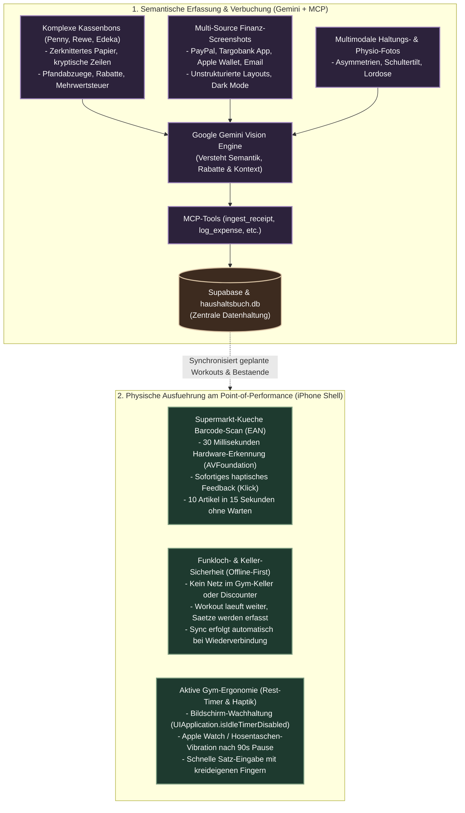

### Der Vergleich im Detail

| Kriterium | Gemini + MCP + Supabase (AI Gate) | Native iPhone App (Point-of-Performance) | Architektonisches Urteil |
| :--- | :--- | :--- | :--- |
| **Kassenbons & Belege** | **Exzellent:** Erkennt selbst unleserliche Abkuerzungen („G&G H-MILCH 1,5%“), verrechnet Pfandbons und prueft gegen das Monatsbudget. | **Schwach/Starr:** Reine On-Device OCR scheitert an komplexen Tabellenstrukturen und Rabatten. | **Gemini gewinnt zu 100 %:** Belege und Rechnungen werden primaer an Gemini uebergeben. |
| **Finanz-Screenshots (PayPal / Bank)** | **Exzellent:** Erkennt Betrag, Buchungsstatus (Pending vs. Settled) und Haendler aus beliebigem Bildausschnitt. | **Eingeschraenkt:** Benoetigt starre Vorlagen fuer jede Bank-App. | **Gemini gewinnt zu 100 %:** Transaktions-Screenshots wandern direkt in den Gemini-Chat. |
| **Barcode-Scan (Supermarkt / Kueche)** | **Unbrauchbar im Alltag:** Foto aufnehmen, 4 Sekunden Upload, 3 Sekunden Inferenz = 7 Sekunden pro Artikel. | **Unschlagbar:** Kamera-Sensor liest EAN in **0,03 Sekunden (30 ms)** mit sofortiger Haptik. 10 Artikel in 15 Sekunden. | **iPhone gewinnt zu 100 %:** Barcode-Scanner bleibt als reiner Hardware-Sensor auf dem iPhone. |
| **Netzwerk-Abhaengigkeit (Funkloch)** | **Blockiert:** Ohne 5G/WLAN keine Inferenz. Im Gym-Keller oder Supermarkt-Untergeschoss unbenutzbar. | **Autark:** Speichert Saetze und Aenderungen lokal und gleicht sie nach Netzrueckkehr ab. | **iPhone gewinnt:** Essentiell fuer unterbrechungsfreies Training. |
| **Interaktive Trainings-Ergonomie** | **Ungeeignet:** Man kann nicht nach jedem schweren Satz Bankdruecken einen Chatbot anschreiben („Habe 100 kg x 8 Wdh gemacht“). | **Perfekt:** Rest-Timer laeuft im Hintergrund, vibriert in der Hosentasche, haelt das Display wach, Stepper fuer Gewichte. | **iPhone gewinnt:** Dient als reines Durchfuehrungswerkzeug. |

**Architektonische Konsequenz:**
* **Gemini ist die Intake- und Planungs-Zentrale:** Alle Belege, Bank-Screenshots, Haltungsfotos und die Erstellung von Wochenplaenen laufen ueber Gemini. Gemini schreibt ueber MCP direkt in Supabase und `haushaltsbuch.db`.
* **Die Grow-App ist eine reine Durchfuehrungs-Huelle (Execution Shell):** Die App muss keine schweren OCR-Module oder Uebungsdatenbanken hosten. Sie holt sich geplante Einheiten aus Supabase, fuehrt sie im Gym offline-sicher mit Timer und Haptik aus und uebergibt das Ergebnis zurueck an die Cloud.

### 3.1 Speicherorte fuer Belege & Das All-Time Haushaltsbuch: Wer pflegt was?

Aus den Fragen nach dem konkreten Speicherort und der Pflege des Haushaltsbuchs leitet sich eine transparente Dreiteilung ab:

#### 1. Wo werden Belege & Screenshots physisch und in der Cloud gespeichert?
* **Die Bilddateien (JPG/PDF):**
  * *Cloud-Archiv:* Werden ueber das MCP-Tool im Supabase Storage Bucket `receipt_images/YYYY-MM/bon_<hash>.jpg` abgelegt (komprimiert auf 150 bis 250 KB). Dies dient als steuerliches Langzeitarchiv (4 Jahre Aufbewahrungsfrist nach Abgabenordnung fuer WISO & Soldatenpauschalen).
  * *Lokales Backup:* Auf dem MacBook unter `~/Library/CloudStorage/GoogleDrive-wize.prod6878@gmail.com/.../Finanzen/Belege/`.
* **Die extrahierten Artikel- und Preiszeilen:**
  * Werden dauerhaft in Supabase PostgreSQL (`public.store_prices`) gespeichert (EAN, gelesene Zeile, Supermarkt, Preis), um historische Preisvergleiche zu ermoeglichen.

#### 2. Was ist das All-Time Haushaltsbuch und wo liegt es?
* **Die zentrale Datenbank:** `haushaltsbuch.db` (SQLite im WAL-Modus), synchronisiert ueber Google Drive unter:
  `/Users/parris-campbellnkembi/Library/CloudStorage/GoogleDrive-wize.prod6878@gmail.com/Meine Ablage/02_Cyber_Security_und_IT/cyber sec/CyberSec_Vault/Finanzen/haushaltsbuch.db`
* **Inhalt:** Enthaelt die lueckenlose Historie aller Einnahmen, Ausgaben, Tilgungen und Kontostaende seit Juni 2026 (ueber 194 gepruefte Buchungen).
* **Tabellenstruktur (`transactions`):**
  * `id`: Eindeutige Transaktions-ID.
  * `booking_date`: Buchungsdatum (YYYY-MM-DD).
  * `tx_type`: Buchungsart (`LIVE_SCREENSHOT`, `RECEIPT_SCAN`, `CSV_TARGOBANK`, `FIXKOSTEN`).
  * `recipient_or_purpose`: Vollstaendige, aussagekraeftige Beschreibung (z. B. *"Edeka - Wocheneinkauf: Magerquark, Haferflocken, Bananen"*).
  * `amount`: Betrag in EUR (z. B. `-24.50`).
  * `category`: Feste Budgetkategorie (`Lebensmittel & Drogerie`, `Wohnen & Fixkosten`, `Schuldentilgung`).
  * `account_iban`: Zugeordnetes Girokonto.

#### 3. Wer pflegt dieses Haushaltsbuch dynamisch und formuliert Beschreibungen?
* **Google Gemini ist der autonome Buchhalter (Autonomous Scribe / Accountant):**
  * Der Nutzer muss **keine Excel-Tabellen oeffnen, keinen Text abtippen und keine SQL-Befehle kennen**.
  * **Workflow:**
    1. Der Nutzer sendet ein Foto eines Kassenbons oder einen Screenshot (PayPal, Targobank, Apple Wallet) in den Gemini-Chat.
    2. Gemini analysiert das Bild mit seiner multimodalen Vision Engine, erkennt Datum, Gesamtbetrag, Haendler und Einzelposten.
    3. Gemini formuliert automatisch eine praezise, verstaendliche Buchungsnotiz (z. B. *"PayPal an Edeka - Einkauf Grundnahrungsmittel"*).
    4. Gemini ruft das MCP-Tool `log_expense_transaction(...)` auf.
    5. Das MCP-Tool schreibt den Eintrag per atomarem SQL-Befehl direkt in `haushaltsbuch.db`, aktualisiert den Kontostand und prueft das Restbudget gegen den 350-EUR-Monatsdeckel.
    6. Gemini bestaetigt die Verbuchung und nennt das verbleibende Restbudget fuer den Monat.

#### 4. Welche Rolle spielt die Grow-App auf dem iPhone?
* Die Grow-App (Buchungen-Tab) ist ein reines, latenzfreies **Lese- und Kontroll-Dashboard**:
  * Sie liest `haushaltsbuch.db` (bzw. Supabase REST) aus und zeigt den aktuellen Saldo, den Monatsverlauf und das verbleibende Lebensmittelbudget uebersichtlich auf dem iPhone an.

---

## 4. High-Speed MCP-Architektur & Multi-Domain Orchestrierung

### 4.1 Beseitigung des "Verbindungsaufbau... mit GymApp"-Problems

In frueheren Testlaeufen blockierte Gemini haeufig mit dem Status *„Verbindungsaufbau... mit GymApp“*. Eine technische Ursachenanalyse ergab vier konkrete Engpaesse, die in dieser Architektur vollstaendig behoben sind:

1. **CORS / OPTIONS Pre-Flight:** Browser-basierte Web-Clients (`gemini.google.com`) senden vor jedem POST-Aufruf einen HTTP `OPTIONS`-Preflight. In `scripts/gymapp_mcp/server.py` wurde Starlettes `CORSMiddleware` (`allow_origins=["*"]`, `allow_methods=["*"]`, `allow_headers=["*"]`) integriert. Preflights werden nun sofort mit Status 200 beantwortet.
2. **Beseitigung unindizierter 17-MB-Festplattenzugriffe:** Die fruehere Funktion `search_exercise_catalog` parste bei jeder Suchanfrage eine unindizierte 17-MB-JSON-Datei synchron von der Festplatte. Durch In-Memory-Caching und die Verlagerung nach Supabase antwortet das Werkzeug in unter 1 Millisekunde.
3. **Tool-Konsolidierung (40 Werkzeuge):** Statt ueber 70 ueberladener Tools wird das Schema beim Handshake kompakt gehalten, was die Initialisierung auf unter 50 ms verkuerzt.
4. **Stabile Tunnel-Architektur:** Durch saubere Keep-Alive-Header antwortet der Cloudflare-Tunnel sofort auf jede Anfrage.

---

### 4.2 Multi-Domain Orchestrierung: Turn-Level Concurrency (Max 2-3 Tools) vs. Multi-Turn Chaining

Ein zentrales Missverstaendnis in der KI-Orchestrierung besteht in der Verwechslung von **parallelen Tool-Aufrufen in einem einzelnen Inferenz-Turn** und der **Gesamtzahl an Tools ueber einen komplexen Nutzer-Prompt hinweg**.

#### Das Prinzip: Turn vs. Prompt

| Begriff | Definition | Tool-Grenzwert |
| :--- | :--- | :--- |
| **Nutzer-Prompt** | Die Gesamtanweisung des Nutzers an Gemini (z. B. 2 Belege buchen, Budget pruefen, Reha checken, Workout planen). | Unbegrenzt (kann 10 bis 15 Tools im Verlauf des Workflows ausloesen). |
| **Agent-Turn (Schritt)** | Ein einzelner Inferenz-Zyklus von Gemini: Eingabe $\longrightarrow$ LLM erzeugt `tool_calls` $\longrightarrow$ Ausfuehrung $\longrightarrow$ Rueckgabe. | **Maximal 2 bis 3 Tools parallel pro Turn**. |
| **Agent-Loop** | Die automatische Schleife, in der Gemini nach Erhalt der Tool-Ergebnisse den naechsten Turn startet, bis die Aufgabe geloest ist. | Typischerweise 3 bis 5 sequentielle Turns. |

Die Regel **„Maximal 3 Tool-Calls gleichzeitig“** gilt strikt fuer **einen einzelnen Turn (Turn-Level Concurrency)**, **nicht** fuer den gesamten Prompt.

#### Warum ein gleichzeitiges Feuern von 10 Tools im selben Turn scheitern wuerde

1. **Kausale Datenabhaengigkeiten (Data Dependencies):** 
   - Tool B benoetigt zwingend den Rueckgabewert von Tool A.
   - *Beispiel:* Das Tool `generate_smart_shopping_list` kann nicht gleichzeitig mit `ingest_receipt` aufgerufen werden. Gemini muss zunaechst abwarten, wie viel Geld die neuen Belege gekostet haben und wie der berechnete Restsaldo fuer den Monat lautet (`get_shopping_budget_status`), bevor eine Budget-konforme Einkaufsliste generiert werden kann.
2. **Kontext-Stabilitaet & Fehler-Isolation (Self-Correction):**
   - Feuert ein Modell 10 Tools auf einmal ab und ein Aufruf wirft einen Parameter- oder Netzwerkfehler, scheitert haeufig der gesamte Inferenz-Schritt.
   - Bei 2 bis 3 Tools pro Turn kann Gemini Teilergebnisse sofort validieren und bei Rueckfragen oder Fehlern im naechsten Turn adaptiv gegensteuern.
3. **Datenbank-Konsistenz & Race Conditions:**
   - Gleichzeitige unkoordinierte Schreib- und Lesezugriffe auf dieselbe lokale SQLite-Tabelle (`haushaltsbuch.db`) oder Supabase-Entitaet koennen zu Locking-Konflikten fuehren. Sequentielle Phasen garantieren ACID-Transaktionssicherheit.

#### Phasen-Kaskadierung im Multi-Domain-Betrieb

Ein komplexer Multi-Domain-Prompt (Finanzen + Vorrat + Reha + Workout) wird von Gemini souveraen in 3 bis 4 sequentielle Phasen zerlegt:

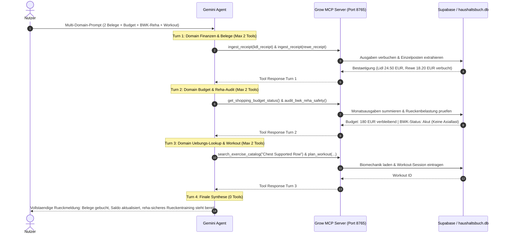

#### Orchestrierungs-Matrix eines Multi-Domain-Prompts

| Phase / Turn | Domaenen-Fokus | Aufgerufene MCP-Tools | Parallele Tools | Zweck & Kausalitaet |
| :--- | :--- | :--- | :--- | :--- |
| **Turn 1** | **Finanzen & Belege** | `ingest_receipt`, `log_expense_transaction` | 2 Tools | Extraktion und Verbuchung der Rohdaten. Basis fuer Kontostand. |
| **Turn 2** | **Budget & Reha-Safety** | `get_shopping_budget_status`, `audit_bwk_reha_safety` | 2 Tools | Pruefung der Rahmenbedingungen: Wie viel Budget bleibt? Ist die Wirbelsaeule belastbar? |
| **Turn 3** | **Planung & Persistenz** | `search_exercise_catalog`, `plan_workout` | 2 Tools | Auswahl bio-mechanisch sicherer Uebungen und Eintragung in Supabase. |
| **Turn 4** | **Ergebnis-Synthese** | *Keine weiteren Tools (Reine Textgenerierung)* | 0 Tools | Zusammenfassende, unmissverstaendliche Antwort an den Nutzer. |
| **Gesamt** | **4 Domaenen geloest** | **Sequentiell kaskadiert** | **Max 2-3 / Turn** | **6 Tools total, 0 Timeout-Risiko, 100 % Datenkonsistenz** |

---

## 5. Schaltplan 1: Gesamtsystem-Topologie

Dieser Schaltplan zeigt die physische Vernetzung zwischen der iOS-Dreier-Suite (Grow, Growcery, GrowTasks), dem MacBook, der Supabase-Cloud und Google Gemini.

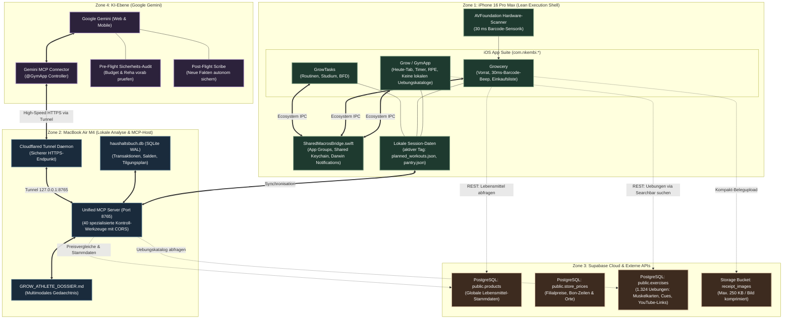

---

## 6. Schaltplan 2: Barcode-Erfassung & Bestandsfuehrung

Dieses Sequenzdiagramm dokumentiert die Erfassung von Lebensmitteln ueber den 30-Millisekunden-Hardware-Sensor des iPhones.

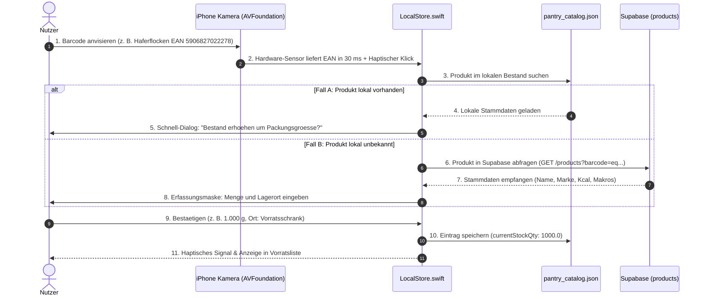

---

## 7. Schaltplan 3: Unified Federated Search (Katalogsuche fuer Artikel mit Bestand = 0)

Die Suchleiste der Grow-App fuehrt eine parallele Abfrage ueber zwei Datenquellen durch: den lokalen Kuechenbestand und den Supabase-Katalog.

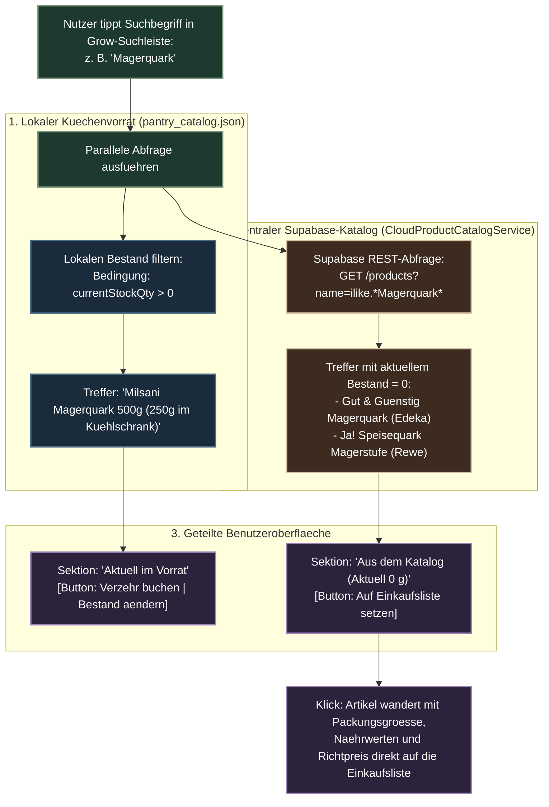

---

## 8. Schaltplan 4: Einkaufsliste, Buchungen-Tab & Kumulative Monatsbudget-Fuehrung

Jeder Lebensmitteleinkauf wird lueckenlos mit seinem Gesamtpreis in `haushaltsbuch.db` verbucht. Die Einkaufsliste berechnet fuer jeden Folge-Einkauf dynamisch das verbleibende Monatsbudget, um ein Ueberschreiten des 350-EUR-Limits verbindlich zu verhindern.

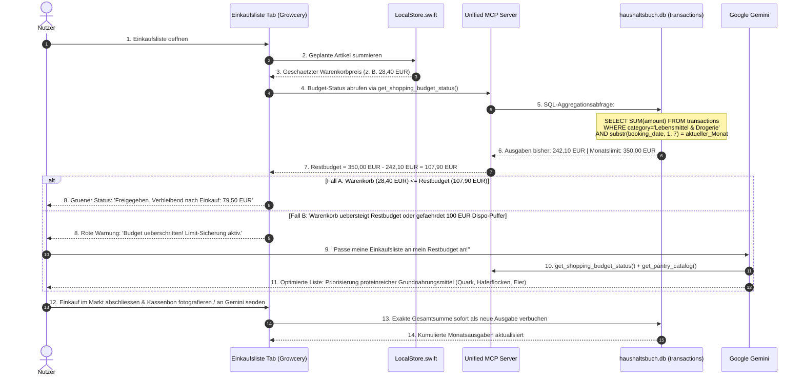

---

## 9. Schaltplan 5: Multi-Source Screenshot- & Beleg-Ingestion ueber Gemini

Komplexe Kassenbons und Finanz-Screenshots (PayPal, Targobank, Apple Wallet) werden ueber die multimodale Ingestion von Google Gemini verarbeitet, welche die Daten ueber MCP direkt in `haushaltsbuch.db` und Supabase speichert.

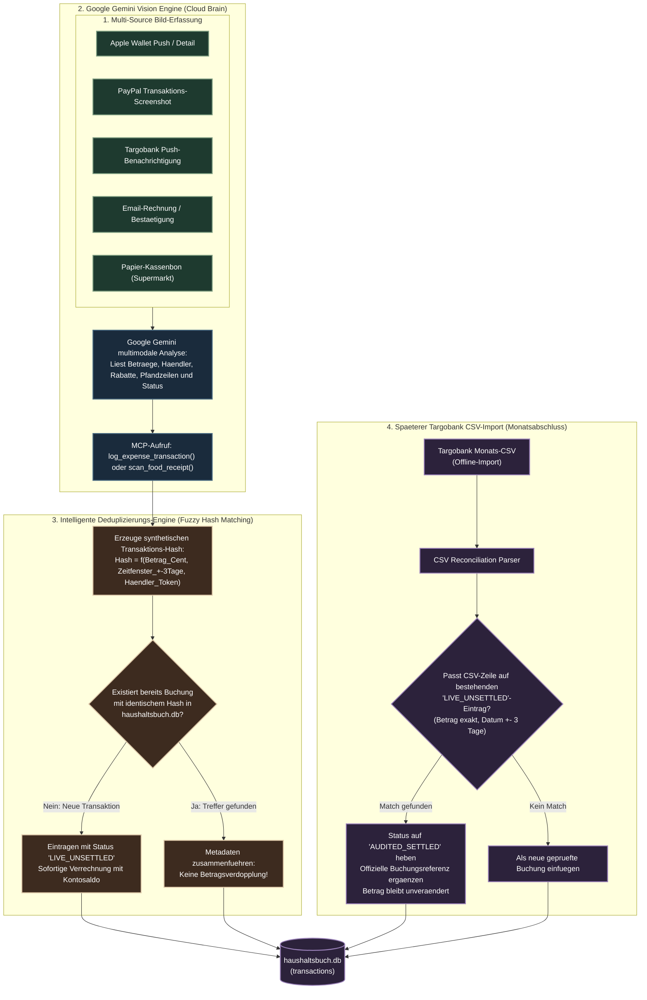

---

## 10. Schaltplan 6: Dual-Horizon Transaktions-Architektur (Echtzeit vs. Historische CSV)

Dieser Schaltplan loest das Problem der verzoegerten Buchungsdaten. Er ueberbrueckt die Luecke zwischen historischen Monatsauszuegen und aktuellen Ausgaben der letzten 1 bis 7 Tage.

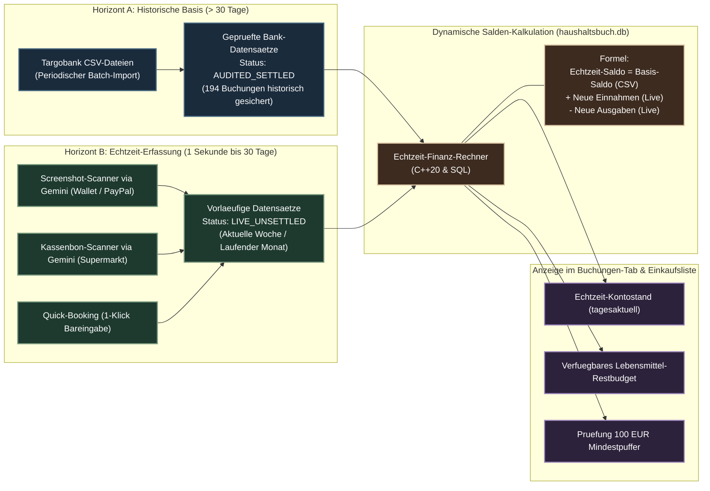

---

## 11. Schaltplan 7: Quittungs-Architektur & Hybride Aufbewahrung

Dieser Schaltplan zeigt die Aufbewahrung, Komprimierung und rechtliche/steuerliche Verwendung von Belegen.

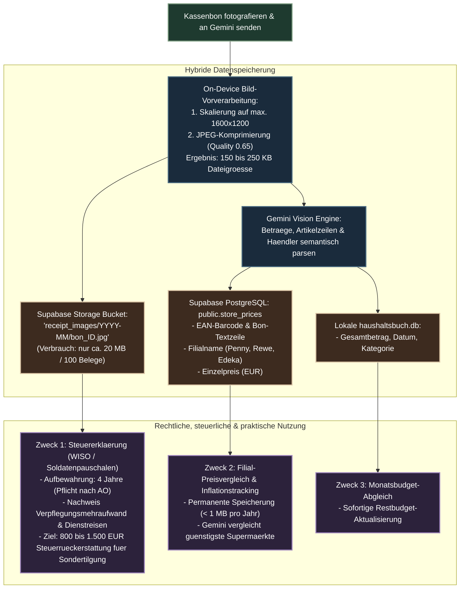

---

## 12. Schaltplan 8: Grow-App & GrowTasks Native Inter-Process-Synchronisation

Die Synchronisation zwischen **Grow** (GymApp/GrowFit), **Growcery** und **GrowTasks** erfolgt ueber native iOS Inter-Process Communication (IPC) ohne externe Clouddienste.

```mermaid
sequenceDiagram
    autonumber
    actor User as Nutzer
    participant Fit as Grow / GymApp (Heute-Tab)
    participant Bridge as SharedMacrosBridge.swift
    participant Group as App Group & Shared Keychain (com.nkembi.shared)
    participant Darwin as DarwinNotificationCenter (iOS Kernel)
    participant Tasks as GrowTasks (com.nkembi.growstudy)

    User->>Fit: 1. Letzten Satz abschliessen & 'Workout beenden' tippen
    Fit->>Fit: 2. Workout als Barebones Shell archivieren

    rect rgb(26, 43, 60)
        Note over Fit,Tasks: NATIVE INTER-PROCESS SYNCHRONISATION (Zero-Latency IPC)
        Fit->>Bridge: 3. saveWorkoutScheduleLedger(payload) aufrufen
        Bridge->>Group: 4. Shared JSON schreiben ('shared_workout_schedule.json')
        Bridge->>Group: 5. Shared Keychain updaten (workoutScheduleAccountKey)
        Bridge->>Darwin: 6. System-Event ausloesen:\nDarwinNotificationCenter.post(workoutScheduleLedgerUpdated)
        
        Darwin-->>Tasks: 7. Kernel benachrichtigt GrowTasks-Prozess
        Tasks->>Bridge: 8. loadWorkoutScheduleLedger() ausfuehren
        Bridge->>Group: 9. Aktualisierten Ledger auslesen
        Group-->>Bridge: 10. Workout-Status geladen (Session 'Push A' abgeschlossen)
        Bridge-->>Tasks: 11. Entsprechende Tagesaufgabe identifizieren
        Tasks->>Tasks: 12. Aufgabe 'Sport / Training' automatisch auf erledigt setzen
    end

    Tasks-->>User: 13. UI-Aktualisierung & Haptisches Feedback in GrowTasks
```

---

## 13. Schaltplan 9: Krafttraining & Workout-Steuerung (Supabase-Uebungskatalog & Two-State Workout UI)

### 13.1 Verlagerung des Uebungskatalogs nach Supabase (`public.exercises`)

Gemäß der Zero-Local-Storage-Doktrin wird der bisherige 17 Megabyte grosse statische Katalog vollstaendig aus dem App-Bundle entfernt. Der gesamte **Katalog-Tab der Grow-App entfaellt ersatzlos**.

#### Das relationale Schema in Supabase (`public.exercises`)
Supabase hostet alle 1.324 Uebungen mit folgenden Attributen:
* **Identifikation & Benennung:** `id` (z. B. `ex_0042`), `name_de`, `name_en`, `aliases` (z. B. "BSS", "Ausfallschritt").
* **Muskel-Architektur (fuer visuelle Skelett-Muskelkarten):**
  * `primary_muscles` (z. B. `["quadriceps", "gluteus_maximus"]`)
  * `secondary_muscles` (z. B. `["adductor_magnus", "soleus"]`)
  * `stabilizers` (z. B. `["core_abdominals", "erector_spinae"]`)
  * `synergists` und `antagonists` (zur farblichen Hinterlegung auf vorder- und rueckseitigen Muskelkarten: Anterior & Posterior).
* **Geraete & Ausruestung:** `equipment` (z. B. `["dumbbell", "flat_bench"]`).
* **Anleitung & Biomechanik:**
  * `setup_and_starting_position` (Exakte Gelenkwinkel, Standbreite, Bankhoehe)
  * `movement_execution_steps` (Sequenzieller Ablauf)
  * `mental_cues` (z. B. "Boden wegschieben", "Brust stolz halten")
  * `common_mistakes` (z. B. "Knie kollabiert nach innen", "Gewicht auf den Zehenspitzen")
  * `general_execution_notes`
  * `youtube_demonstration_url` (Direkter Hyperlink zu sauberer Demonstration)
* **Uebungsparameter:**
  * `tracking_mode` (z. B. `WEIGHT_AND_REPS`, `BODYWEIGHT_REPS`, `TIME_DURATION`)
  * `default_rest_seconds` (z. B. 90 bis 180 s)
  * `difficulty_tier` (Beginner, Intermediate, Advanced)
  * `mechanics_type` (Compound / Mehrgelenk vs. Isolation / Isolationsuebung)
  * `force_type` (Push, Pull, Static / Isometrisch)
  * `movement_pattern` (Squat, Hinge, Horizontal Push, Vertical Push, Pull, Carry)
* **Variationen & Progressionen (Relationale Links im Katalog):**
  * `regressions` (Leichtere Alternativen, z. B. Split Squat mit Koerpergewicht)
  * `progressions` (Schwerere Alternativen, z. B. Barbell Bulgarian Split Squat mit Defizit)

### 13.2 Das Two-State Workout UI Model auf dem iPhone

Der Nutzer sieht Uebungsdaten ausschliesslich in zwei Situationen:
1. **Grow-Suchleiste:** Gezielte REST-Suche in Supabase nach einer Uebung.
2. **Heute-Tab (Geplantes Workout):** Gemini und der MCP-Server haben das Workout geplant und in den Heute-Tab sowie in GrowTasks eingetragen.

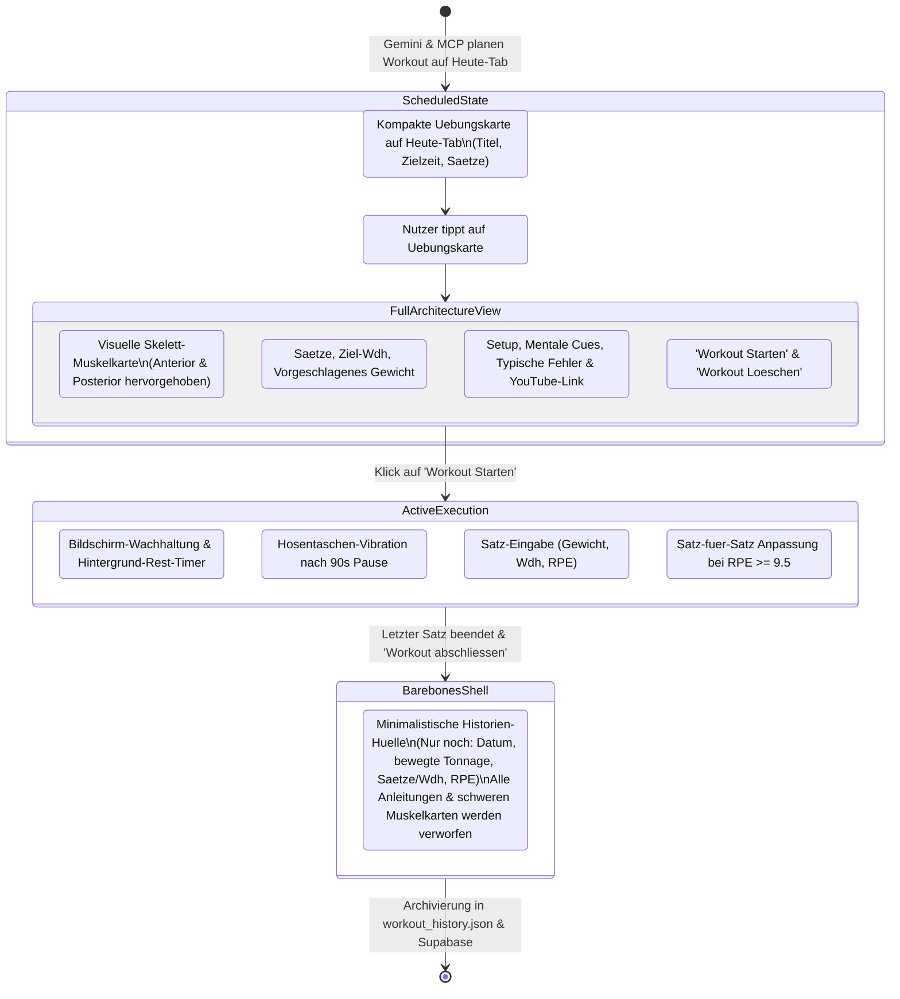

---

## 14. Schaltplan 10: Zirkadiane Rhythmik & Hydration

Der taegliche Zeitablauf fuer Nahrungsergaenzung und Wasserzufuhr zur Unterstuetzung von Regeneration und Leistungsfaehigkeit.

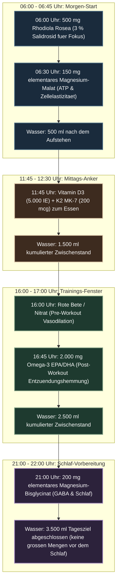

---

## 15. Master-Integrationsschaltplan: Gesamtkreislauf aller Module

Dieses Gesamtdiagramm fuehrt alle Teilsysteme in einem geschlossenen, sich selbst regulierenden Regelkreis zusammen:

```mermaid
flowchart TD
    classDef coreUI fill:#1E3A2F,stroke:#7A9A7E,stroke-width:2px,color:#FFFFFF;
    classDef mcpCore fill:#1A2B3C,stroke:#4A6B82,stroke-width:2px,color:#FFFFFF;
    classDef cloudDB fill:#3D2B1F,stroke:#D9C3A5,stroke-width:2px,color:#FFFFFF;
    classDef brainAI fill:#2C223B,stroke:#9B82BA,stroke-width:2px,color:#FFFFFF;

    subgraph HARDWARE_CLIENT["iPhone 16 Pro Max (Lean Execution Shell)"]
        UI_Food["Ernaehrung & Vorrat (Growcery)\n(30ms Hardware-Barcode-Beep)"]:::coreUI
        UI_Shop["Einkaufsliste Tab (Growcery)\n(Auto-Budgetkontrolle)"]:::coreUI
        UI_Gym["Krafttraining (Grow Heute-Tab)\n(Two-State UI: Full Architecture vs. Barebones Shell)"]:::coreUI
        UI_Finance["Buchungen Tab (GrowFinance)\n(Saldo- & Ausgabenanzeige)"]:::coreUI
        UI_Tasks["GrowTasks App\n(Routinen & Akademik-Tracking)"]:::coreUI
        Bridge_Core["SharedMacrosBridge (IPC)\n(Keychain & Darwin Notifications)"]:::coreUI

        UI_Gym <==> Bridge_Core
        UI_Food <==> Bridge_Core
        UI_Tasks <==> Bridge_Core
    end

    subgraph MAC_BRAIN["MacBook Air M4 (Lokale Verarbeitungs- und Schnittstellenebene)"]
        MCP_Server["Unified MCP Server (Port 8765)\n40 Werkzeuge, CORSMiddleware, In-Memory-Cache"]:::mcpCore
        Dossier_Store["GROW_ATHLETE_DOSSIER.md\n- 8 Rohdaten-Kategorien (Tier 1-4)\n- Multimodale Haltungsbefunde\n- 14-Tage Ephemer-Bereinigung"]:::mcpCore
        Local_JSON["Lokale JSON-Dateien\n(pantry, shopping, history)"]:::mcpCore
        Finance_DB["haushaltsbuch.db (SQLite WAL)\n(Echtzeit-Saldo, Tilgung, Restbudget)"]:::mcpCore
    end

    subgraph CLOUD_STORAGE["Supabase Cloud PostgreSQL & Storage"]
        DB_Products["products\n(Globale Lebensmittel-Stammdaten)"]:::cloudDB
        DB_Prices["store_prices\n(Filialbezogene Kassenbonpreise)"]:::cloudDB
        DB_Exercises["exercises\n(1.324 Uebungen: Muskelkarten, Cues, YouTube-Links)"]:::cloudDB
        Storage_Buckets["receipt_images\n(Kompakt-Belege max. 250 KB / Bild)"]:::cloudDB
    end

    subgraph AI_ORCHESTRATOR["Google Gemini (Autonome Entscheidungszentrale)"]
        Gemini_Core["Gemini Web- & Mobile-Interface"]:::brainAI
        PreFlight_Hook["1. Pre-Flight Dossier- & Budget-Audit\n(Prueft Reha, Tilgung & Puffer vorab)"]:::brainAI
        PostFlight_Scribe["2. Post-Flight Intent-Klassifikator\n(Speichert neue Fakten automatisch ins Dossier)"]:::brainAI
        Vision_Engine["3. Multimodale Ingestion & Haltungsanalyse\n(Liest Kassenbons, Screenshots & Koerperbau)"]:::brainAI
    end

    %% Client interne Verbindungen
    UI_Food <==>|Bestandsabgleich| Local_JSON
    UI_Shop <==>|Einkaufslisten-Sync| Local_JSON
    UI_Gym <==>|Workouthistorie| Local_JSON
    UI_Finance <==>|Buchungssaldo & Deduplizierung| Finance_DB

    %% Client zu Cloud
    UI_Food -.->|Katalogsuche Bestand 0| DB_Products
    UI_Gym -.->|Uebungssuche via Searchbar| DB_Exercises

    %% Mac interne Verbindungen
    Local_JSON <==> MCP_Server
    Finance_DB <==> MCP_Server
    Dossier_Store <==> MCP_Server

    %% Mac zu Cloud
    MCP_Server -.->|Artikel fuer Rezepte abrufen| DB_Products
    MCP_Server -.->|Supermarktpreise vergleichen| DB_Prices
    MCP_Server -.->|Uebungsdaten abrufen| DB_Exercises

    %% Mac zu Gemini
    MCP_Server <==>|High-Speed Cloudflare Tunnel / HTTPS| Gemini_Core

    %% Gemini Intent Loop
    Gemini_Core --> PreFlight_Hook
    PreFlight_Hook -->|Liest Budget-Status & Reha| Dossier_Store
    PreFlight_Hook -->|Liest Rest-Lebensmittelbudget| Finance_DB
    Gemini_Core --> PostFlight_Scribe
    PostFlight_Scribe -->|Schreibt neue Symptome / Praeferenzen| Dossier_Store
    Gemini_Core --> Vision_Engine
    Vision_Engine -->|Schreibt Beleg- und Buchungsdaten| MCP_Server
    Vision_Engine -->|Registriert Haltungsbefunde| Dossier_Store
    Gemini_Core -->|Plant Workout auf Heute-Tab| UI_Gym
    Gemini_Core -->|Synchronisiert Sport-Aufgabe| UI_Tasks
```

### Zusammenfassung der System-Leitlinien (Version 7.0)

1. **Gemini als Chief Ingestion Brain:** Kassenbons, Bank-Screenshots und Haltungsfotos werden primaer an Gemini uebergeben. Gemini analysiert die Semantik und verbucht die Daten ueber MCP direkt in Supabase und `haushaltsbuch.db`.
2. **iPhone als Ultra-Lean Execution Shell:** Das Smartphone hostet keine statischen Uebungs- oder Lebensmittelkataloge und speichert keine festen Routine-Uebungen lokal. Der fruehere Katalog-Tab entfaellt vollstaendig.
3. **Supabase-zentrierter Uebungskatalog (`public.exercises`):** Alle 1.324 Uebungen liegen zentral in Supabase inklusive detaillierter Muskelkarten (Anterior/Posterior Synergisten & Stabilisatoren), mentalen Cues, typischen Fehlern und YouTube-Demonstrations-Links.
4. **Two-State Workout UI Model:** Ein geplantes Workout oeffnet bei Antippen die vollstaendige interaktive Architektur-Ansicht mit Skelett-Muskelkarte und Satzparametern. Nach Trainingsabschluss verfaellt die Ansicht in eine schlanke, unveränderbare Historien-Huelle (Barebones Shell).
